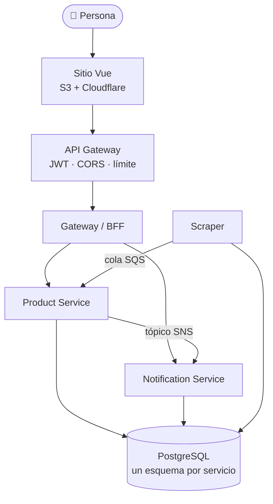
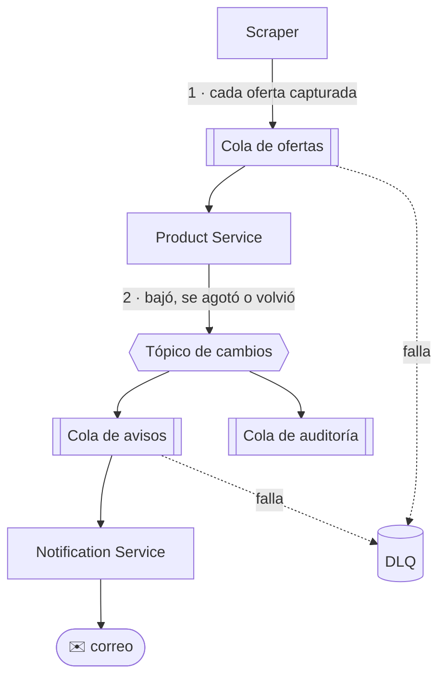
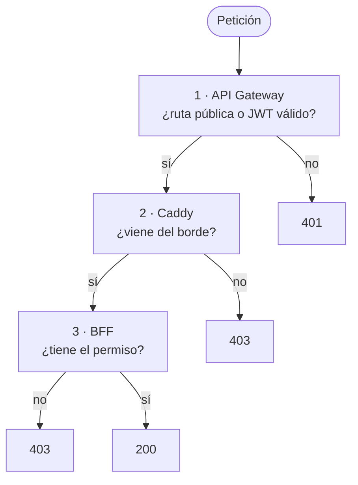
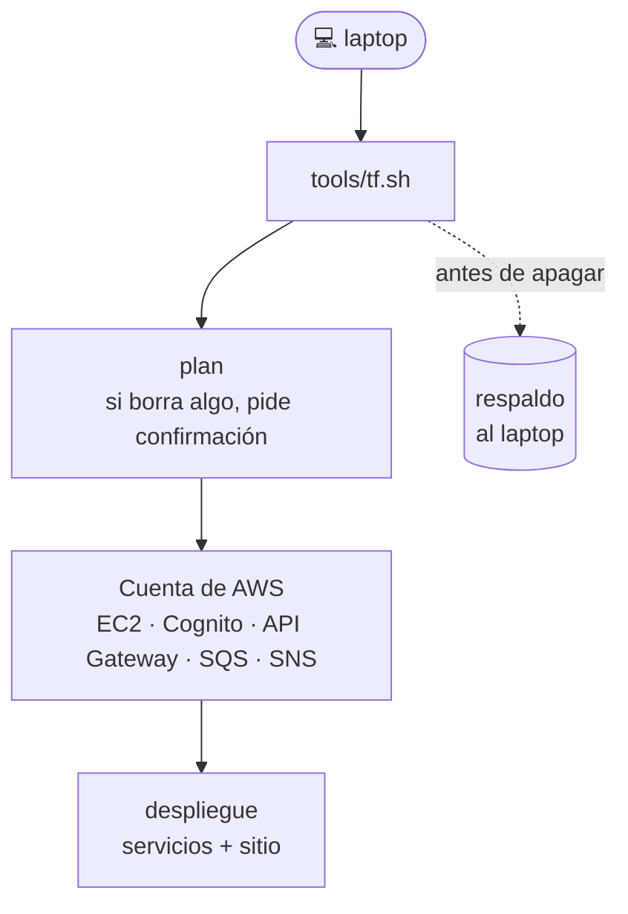

<h1>&nbsp; Cacha el Precio</h1>

**¿Ese 50% de descuento es de verdad? Cáchalo antes de comprar.**

Comparador de precios de ropa y calzado en Chile. Junta las prendas de varias tiendas, guarda cómo
cambia su precio y te avisa cuando lo que sigues baja o vuelve. No vende nada: te muestra el precio
y te manda a la tienda.

[Qué hace](#qué-hace) · [Cómo funciona](#cómo-funciona) · [Estado](#estado) · [Documentación](#documentación) · [Equipo](#equipo)

---

## Qué hace

Antes del Cyber, el SERNAC ya persiguió a grandes tiendas por inflar el «precio normal»: un
producto anunciado con 65% de descuento en realidad tenía 30%. Quien compra no tiene cómo darse
cuenta, porque solo ve el precio de hoy y el que la tienda dice que tenía antes.

**Cacha el Precio** revisa las ofertas de seis tiendas chilenas (Falabella, Paris,
H&M, Hites, La Polar y Sparta) y guarda cómo cambia el precio de cada prenda. Así, cuando ves un
descuento, puedes compararlo con el precio que **nosotros vimos**, no con el que dice la tienda.
Buscas una polera o unas zapatillas, ves en qué tienda está más barata y vas directo a comprarla
allá: aquí no se vende nada.

Si entras con tu cuenta de Google, puedes guardar las prendas que te gustan, armar outfits de la
cabeza a los pies y recibir un correo cuando algo que sigues baja de precio, se agota o vuelve a
estar disponible.

---

## Cómo funciona

### Arquitectura

Todo entra por el **API Gateway**. La máquina responde **403** a quien llegue sin el encabezado
secreto que solo el borde pone, así que no hay forma de saltárselo.

| Pieza | Tecnología | Para qué |
|---|---|---|
| **Sitio** | Vue 3 · Pinia · Vite | catálogo, ficha, armario y panel admin |
| **Borde** | AWS API Gateway | valida el token, aplica CORS y el límite de tráfico |
| **Gateway / BFF** | ASP.NET Core 10 | revalida el token y arma el contrato público |
| **Product Service** | ASP.NET Core 10 · EF Core | catálogo, ofertas por tienda y armario |
| **Notification Service** | ASP.NET Core 10 · MailKit | avisos por correo, sin repetir |
| **Scraper** | Python 3.14 · FastAPI | captura las tiendas y guarda el historial |
| **Identidad** | Amazon Cognito | login con Google y permisos por grupo |

Un solo PostgreSQL aloja a los tres servicios con datos, **cada uno en su esquema**: ninguno lee las
tablas de otro. Por qué está hecho así, en las [decisiones (ADR)](docs/adr/README.md).

<b>Ver todo el stack</b>

| Área | Tecnologías |
|---|---|
| **Backend** | C# · ASP.NET Core 10 · Entity Framework Core 10 · Npgsql · MailKit · Asp.Versioning · Scalar |
| **Scraper** | Python 3.14 · FastAPI · Uvicorn · httpx · Beautiful Soup · Pydantic · psycopg 3 · boto3 |
| **Frontend** | Vue 3 · Vue Router · Pinia · Vite 8 · Axios |
| **Datos** | PostgreSQL 16 · Amazon S3 |
| **Identidad** | Amazon Cognito · OAuth 2.0 / OIDC · PKCE · JWT · Google |
| **Nube** | AWS API Gateway · EC2 · SQS · SNS · S3 · Cognito |
| **Borde** | Cloudflare (DNS y CDN) · Caddy 2 |
| **Contenedores** | Docker · Docker Compose · imágenes sin root |
| **Infraestructura** | Terraform 1.15 · AWS CLI v2 |
| **Pruebas y calidad** | xUnit · pytest · pruebas de humo · `dotnet format` · Ruff · mypy |

### Mensajería

Dos flujos independientes. Si un servicio está caído, los mensajes **esperan en la cola**; si uno
no se puede procesar, termina en una **DLQ** con su diagnóstico.

| Garantía | Cómo se cumple |
|---|---|
| Nada se pierde si un servicio cae | la cola guarda el mensaje y lo reintenta |
| Un mensaje roto no traba al resto | va a su DLQ con el diagnóstico |
| Nadie recibe el mismo correo dos veces | una llave única por evento y destinatario |

Contratos y errores en [MENSAJERÍA](docs/MENSAJERIA.md).

### Seguridad

El token se valida **dos veces**: en el borde y otra vez en el BFF. El catálogo es público a
propósito; lo personal y lo administrativo, no.

| Quién | Cómo entra | Qué puede |
|---|---|---|
| Visitante | sin cuenta | ver el catálogo, las fichas y el historial |
| Usuario | Google, con PKCE | guardar prendas y outfits, recibir avisos |
| Admin | Google, grupo `admin` | ver el panel de mensajería |
| Scraper | token de máquina | solo publicar ofertas |

Ningún secreto vive en el repositorio: un hook de pre-commit frena cualquier intento de subir uno.

### Infraestructura

Toda la cuenta de AWS está escrita en **Terraform**. El mismo código sirve para las tres cuentas
del equipo, y montar, prender y apagar es un comando cada uno.

| Barrera | Qué evita |
|---|---|
| Revisa la cuenta antes de empezar | trabajar con credenciales vencidas o ajenas |
| Pide escribir `BORRAR` antes de destruir | perder usuarios o colas por un error |
| No apaga sin un respaldo que no esté vacío | perder el historial de precios |

Probado desde cero en una cuenta vacía: **81 recursos**, la app desplegada y los datos restaurados
con un comando. Paso a paso en [OPERAR EN AWS](docs/OPERAR-EN-AWS.md).

---

## Estado

Lo que corre hoy, no lo planificado.

| | Pieza | Estado |
|:---:|---|---|
| 🟢 | Sitio | `www.cacha-el-precio.com` |
| 🟡 | API | `api.cacha-el-precio.com`, solo durante las sesiones de trabajo (la EC2 del Learner Lab no queda prendida) |
| 🟢 | Login | Google vía Cognito |
| 🟢 | Catálogo | 6 tiendas en vivo (Ripley y Converse con el parser listo) |
| 🟢 | Mensajería | los dos flujos probados en AWS, con DLQ y panel |
| 🟢 | Infraestructura | toda la cuenta en Terraform, probada en una cuenta vacía |
| 🟢 | Respaldos | cada hora a S3, y al laptop antes de cada apagado |
| ⬜ | CI/CD | todavía no; las pruebas se corren a mano antes de cada PR |
| ⬜ | Red privada | la EC2 usa la red por defecto; la protege el encabezado del borde ([ADR-015](docs/adr/015-red-privada-con-vpc-link.md)) |

---

## Documentación

Todo está en [`docs/`](docs/), y cada documento parte con un resumen de diez segundos. **Empieza
por [CONTEXTO](docs/CONTEXTO.md)**: cómo está todo hoy y qué leer para cada cosa.

| Para… | Documento |
|---|---|
| La idea, el alcance y las reglas del producto | [EL PROYECTO](docs/EL-PROYECTO.md) |
| Cómo está construido y por qué | [ARQUITECTURA](docs/ARQUITECTURA.md) · [ADR](docs/adr/README.md) |
| Las colas, los eventos y el panel | [MENSAJERÍA](docs/MENSAJERIA.md) |
| Montar, prender, apagar y cambiar de cuenta | [OPERAR EN AWS](docs/OPERAR-EN-AWS.md) |
| Programar en local y antes de un PR | [DESARROLLO](docs/DESARROLLO.md) |
| Lo que falta y las tareas | [PLAN EFT](docs/PLAN-EFT.md) · [TAREAS](docs/TAREAS.md) |
| Cada servicio por dentro | [Gateway](gateway/README.md) · [Product](product-service/README.md) · [Notification](notification-service/README.md) · [Scraper](scraper-service/README.md) · [Frontend](frontend/README.md) |

<b>Más documentos</b>

| Para… | Documento |
|---|---|
| Qué evalúa cada entrega del ramo | [EVALUACIONES](docs/EVALUACIONES.md) |
| Qué se hizo cada día | [BITÁCORA](docs/BITACORA.md) |
| Cómo cambió el proyecto desde agosto | [HISTORIA](docs/HISTORIA.md) |
| Cómo está escrita la infraestructura | [Terraform](infra/terraform/README.md) |

---

## Equipo

<table align="center">
  <tr>
    <td align="center"><a href="https://github.com/MartinMDevv"> <b>Martin Mora</b></a></td>
    <td align="center"><a href="https://github.com/OrionTheProgrammer"> <b>Leandro Pedraza</b> «Orion»</a></td>
    <td align="center"><a href="https://github.com/Panditax727"> <b>Juan Pizarro</b> «Panditax»</a></td>
  </tr>
</table>

Cada cambio nace en su rama, pasa por un PR hacia `development` y recién después llega a `main`.
**Nadie mergea su propio PR**, y cada decisión técnica queda en un ADR, con sus consecuencias,
incluidas las malas.

---

Hecho en Chile 🇨🇱 por tres estudiantes de **Duoc UC** · 2026

