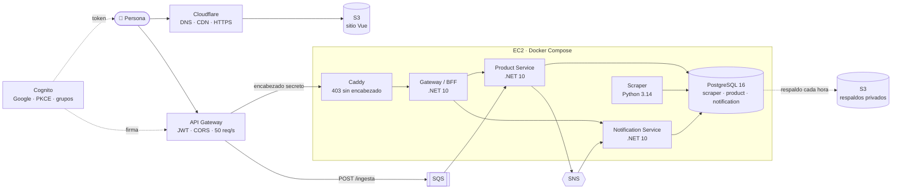
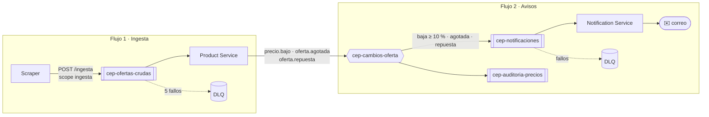
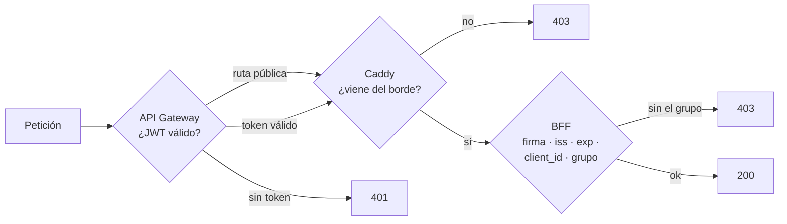
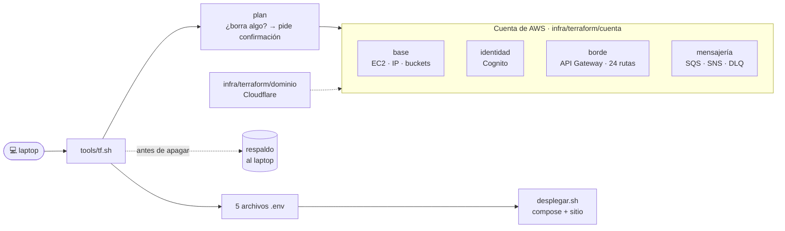
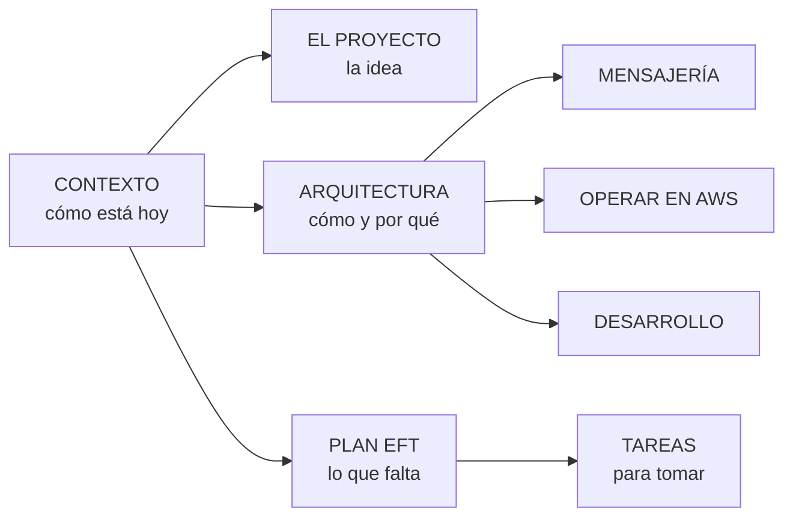
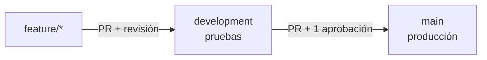

<h1>&nbsp; Cacha el Precio</h1>

**¿Ese 50% de descuento es de verdad? Cáchalo antes de comprar.** Comparador de precios de ropa y
calzado en Chile: junta las prendas de varias tiendas, guarda cómo cambia su precio y te avisa cuando
lo que sigues baja o vuelve. No vende nada: te muestra el precio y te manda a la tienda.

[Qué hace](#qué-hace) · [Arquitectura](#arquitectura) · [Mensajería](#mensajería) · [Seguridad](#seguridad) · [Infraestructura](#infraestructura-como-código) · [Tecnologías](#tecnologías-y-herramientas) · [Estado](#estado) · [Documentación](#documentación) · [Equipo](#equipo-y-forma-de-trabajo)

| 🏬 6 tiendas en vivo | 🧩 4 servicios | 📨 2 flujos de mensajería | ☁️ 1 comando para montar AWS |
|:---:|:---:|:---:|:---:|
| Falabella, Paris, H&M, Hites, La Polar y Sparta (Ripley y Converse con el parser listo) | gateway, productos, avisos y scraper | ingesta por SQS y avisos por SNS | toda la cuenta en Terraform |

> 💡 **Por qué existe.** El SERNAC ya persiguió a grandes tiendas por inflar el «precio normal»
> antes del Cyber: un 65% de descuento que en realidad era 30%. Cacha el Precio compara contra el
> precio que **nosotros vimos**, no contra el que dice la tienda.

---

## Qué hace

| | Para quien compra | Por dentro |
|---|---|---|
| 🔎 | Busca y filtra prendas de varias tiendas en un solo catálogo, por talla, presupuesto y tipo de prenda | Un scraper por tienda captura las ofertas públicas y las normaliza a un contrato común |
| 📈 | Ve si un descuento es real, con el historial de precio de cada oferta | Cada captura queda en el historial; el mismo modelo se agrupa entre tiendas |
| 👕 | Arma outfits de la cabeza a los pies y guarda sus prendas en «Mi armario» | Deseados y outfits se guardan por persona, ligados a su identidad |
| 🔔 | Sigue una prenda y recibe un correo cuando baja de precio, se agota o vuelve | Los cambios de oferta viajan por un tópico hacia el servicio de avisos |
| 🛠️ | (admin) Mira las colas, revisa los mensajes con error y simula avisos | Panel dentro del gateway, solo para el grupo `admin` |

---

## Arquitectura

Todo el tráfico entra por el **API Gateway**. La máquina responde **403** a cualquier petición que
no traiga el encabezado secreto que solo el borde inyecta, así que saltárselo no es una opción.

| Pieza | Tecnología | Responsabilidad | Persistencia |
|---|---|---|---|
| **Frontend** | Vue 3 · Pinia · Vite | catálogo, ficha, armador de outfits, cuenta y panel admin | S3 detrás de Cloudflare |
| **Borde** | API Gateway (HTTP API) | autoriza el JWT, aplica CORS y límite de tráfico, enruta | — |
| **Gateway / BFF** | ASP.NET Core 10 | revalida el token, arma el contrato público, administra la mensajería | — |
| **Product Service** | ASP.NET Core 10 · EF Core | catálogo multi-oferta, historial, armario personal; consume la ingesta | PostgreSQL, esquema `product` |
| **Notification Service** | ASP.NET Core 10 · EF Core · MailKit | seguidores y avisos por correo | PostgreSQL, esquema `notification` |
| **Scraper** | Python 3.14 · FastAPI | captura 6 tiendas en vivo (8 con parser) y publica cada oferta | PostgreSQL, esquema `scraper`; imágenes en S3 |
| **Identidad** | Amazon Cognito | login con Google, PKCE, grupos y scope de máquina | administrada por AWS |
| **Mensajería** | Amazon SQS · Amazon SNS | ingesta asíncrona, avisos y auditoría | administrada por AWS |

Un solo PostgreSQL aloja a los tres servicios, **cada uno en su esquema**: ninguno lee las tablas
de otro. Las decisiones de diseño, con sus costos, están en los [ADR](docs/adr/).

---

## Mensajería

Dos flujos independientes. Si Product Service está caído, las ofertas esperan en la cola sin
perderse; si un mensaje no se puede procesar, termina en una **DLQ** con su diagnóstico.

| Garantía | Cómo se cumple |
|---|---|
| Nada se pierde si un servicio cae | la cola retiene el mensaje y lo reintenta |
| Un mensaje roto no traba al resto | va a su DLQ con seis atributos de diagnóstico |
| Un aviso repetido no manda dos correos | llave única por evento y destinatario |
| Una oferta repetida no duplica datos | upsert por tienda e identificador externo |
| Colas, tópicos y reglas no se contradicen | se declaran en un solo archivo, `infra/mensajeria/topologia.json` |

Contrato, errores y panel de administración en [MENSAJERÍA](docs/MENSAJERIA.md).

---

## Seguridad

El token se valida **dos veces**: en el borde y otra vez en el BFF. El catálogo es público a
propósito; lo personal y lo administrativo, no.

| Quién | Cómo entra | Qué obtiene |
|---|---|---|
| Visitante | sin token | catálogo, fichas, historial |
| Persona registrada | Google → Cognito, Authorization Code + PKCE | armario, outfits, seguimiento de prendas |
| Admin | mismo login, grupo `admin` | panel de mensajería y diagnóstico |
| Scraper | `client_credentials`, scope `ingesta` | solo publicar ofertas |

Ningún secreto vive en el repositorio: la configuración sale de archivos locales que no se
versionan y un hook de pre-commit frena cualquier intento de subir uno. Detalle en
[ARQUITECTURA](docs/ARQUITECTURA.md#6--seguridad-e-identidad) y el [ADR-026](docs/adr/026-encabezado-secreto-del-borde.md).

---

## Infraestructura como código

Toda la cuenta de AWS se declara en **Terraform**. Un mismo código sirve para las tres cuentas del
equipo; lo único que cambia es un archivo de variables por persona. Montar, prender y apagar son un
comando cada uno, y apagar **respalda la base antes** de bajar la máquina.

| Barrera | Qué evita |
|---|---|
| Comprueba la cuenta antes de empezar | trabajar con credenciales vencidas o de otra persona |
| Pide escribir `BORRAR` si el plan destruye algo fuera de la máquina | perder un user pool o una cola por un error en el código |
| No apaga sin un respaldo bajado y no vacío | perder el historial de precios, que no se recupera hacia atrás |
| El estado y los secretos nunca van a git | filtrar llaves; lo frena el hook de pre-commit |

Probado desde cero en una cuenta vacía: **81 recursos** creados, aplicación desplegada y datos
restaurados con un solo comando. Paso a paso en [OPERAR EN AWS](docs/OPERAR-EN-AWS.md)
y detalle técnico en [`infra/terraform`](infra/terraform/README.md).

---

## Tecnologías y herramientas

  

| Área | Tecnologías |
|---|---|
| **Backend** | C# · ASP.NET Core 10 · Entity Framework Core 10 · Npgsql · MailKit · Asp.Versioning · Scalar (OpenAPI) |
| **Scraper** | Python 3.14 · FastAPI · Uvicorn · httpx · Beautiful Soup · Pydantic · psycopg 3 · boto3 |
| **Frontend** | Vue 3 · Vue Router · Pinia · Vite 8 · Axios |
| **Datos** | PostgreSQL 16 · Amazon S3 |
| **Identidad** | Amazon Cognito · OAuth 2.0 / OIDC · PKCE · JWT · Google como proveedor federado |
| **Nube** | AWS: API Gateway · EC2 · SQS · SNS · S3 · Cognito · IAM (LabRole) |
| **Borde y red** | Cloudflare (DNS y CDN) · Caddy 2 con certificados automáticos |
| **Contenedores** | Docker · Docker Compose · imágenes multi-etapa sin root |
| **Infraestructura** | Terraform 1.15 · proveedores `hashicorp/aws` 6 y `cloudflare` 5 · AWS CLI v2 |
| **Pruebas** | xUnit · ASP.NET Core Testing · pytest · pruebas de humo del frontend · pruebas de punta a punta contra AWS |
| **Calidad** | `dotnet format` · Ruff · mypy · hook de pre-commit contra secretos |
| **Trabajo en equipo** | Git · GitHub · git subtree (frontend) · ADR · Trello |

---

## Estado

Lo que corre hoy, no lo planificado.

| | Pieza | Estado |
|---|---|---|
| 🟢 | Sitio público | `www.cacha-el-precio.com`, en S3 detrás de Cloudflare |
| 🟡 | API pública | `api.cacha-el-precio.com`, en una EC2 del Learner Lab que **no está prendida 24/7** por créditos limitados: fuera de las sesiones de trabajo no responder es lo normal |
| 🟢 | Login | Google vía Cognito, con PKCE |
| 🟢 | Catálogo | 8 tiendas con scraper propio; historial de precio por oferta |
| 🟢 | Mensajería | los dos flujos probados de punta a punta en AWS, con DLQ y panel de administración (solo lectura y reenvío) |
| 🟢 | Infraestructura | toda la cuenta en Terraform, probada desde cero en una segunda cuenta |
| 🟢 | Respaldos | cada hora a un bucket privado con versionado, y antes de cada apagado al laptop |
| ⬜ | CI/CD | sin workflows todavía; las comprobaciones se corren a mano antes de cada PR |
| ⬜ | Red privada | la EC2 usa la VPC por defecto con IP pública; el puerto de entrada lo cierra el encabezado del borde ([ADR-015](docs/adr/015-red-privada-con-vpc-link.md)) |

---

## Documentación

Los documentos del equipo están en [`docs/`](docs/), y cada uno parte con un resumen de diez
segundos. Por dónde empezar:

| Para… | Documento |
|---|---|
| Saber cómo está todo hoy y qué leer | [CONTEXTO](docs/CONTEXTO.md) |
| La idea, el alcance, las tiendas y las reglas del producto | [EL PROYECTO](docs/EL-PROYECTO.md) |
| Cómo está construido, la seguridad y por qué así | [ARQUITECTURA](docs/ARQUITECTURA.md) · [decisiones (ADR)](docs/adr/README.md) |
| Colas, tópicos, contratos y panel | [MENSAJERÍA](docs/MENSAJERIA.md) |
| Montar, prender, apagar y cambiar de cuenta | [OPERAR EN AWS](docs/OPERAR-EN-AWS.md) · [Terraform](infra/terraform/README.md) |
| Programar en local y lo que se corre antes de un PR | [DESARROLLO](docs/DESARROLLO.md) |
| Lo que falta para la entrega final y las tareas | [PLAN EFT](docs/PLAN-EFT.md) · [TAREAS](docs/TAREAS.md) |
| Qué evalúa cada entrega | [EVALUACIONES](docs/EVALUACIONES.md) |
| Qué se hizo cada día, y cómo cambió el proyecto desde agosto | [BITÁCORA](docs/BITACORA.md) · [HISTORIA](docs/HISTORIA.md) |
| Cada servicio por dentro | [Gateway](gateway/README.md) · [Product Service](product-service/README.md) · [Notification Service](notification-service/README.md) · [Scraper](scraper-service/README.md) · [Frontend](frontend/README.md) |

---

## Equipo y forma de trabajo

<table align="center">
  <tr>
    <td align="center"><a href="https://github.com/Martinnnn-ops"> <b>Martin Mora</b></a></td>
    <td align="center"><a href="https://github.com/OrionTheProgrammer"> <b>Leandro Pedraza</b> «Orion»</a></td>
    <td align="center"><a href="https://github.com/Panditax727"> <b>Juan Pizarro</b> «Panditax»</a></td>
  </tr>
</table>

Cada cambio nace en su rama, pasa por un PR hacia `development` y recién después llega a `main`.
**Nadie mergea su propio PR.** Cada decisión técnica queda en un ADR, con sus consecuencias, incluidas
las malas.

---

Hecho en Chile 🇨🇱 por tres estudiantes de **Duoc UC** · 2026

