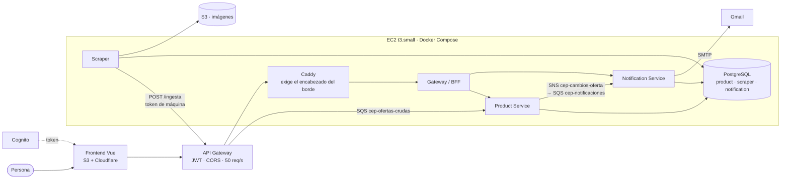
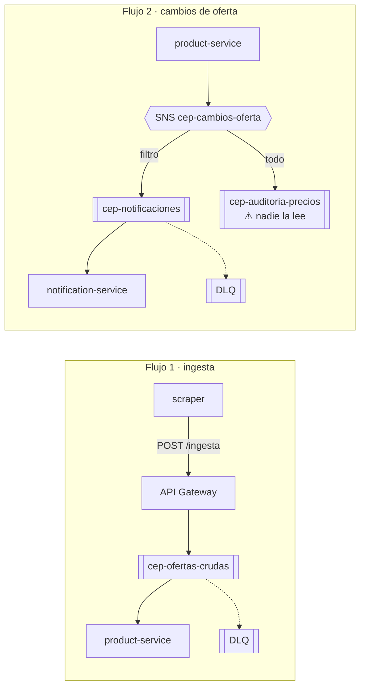
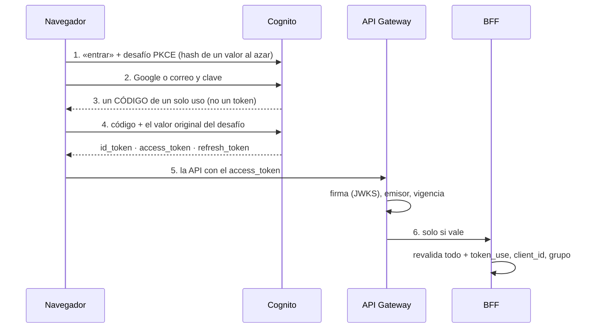
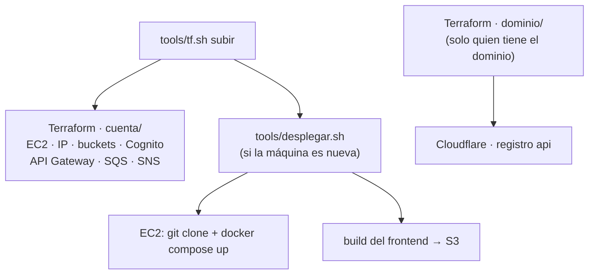

# Arquitectura: cómo está construido y por qué

> **Qué es.** Las piezas del sistema, quién es dueño de cada dato, cómo viajan los mensajes, cómo
> funciona el login y por qué lo desplegado difiere del diseño original.
> **Para quién.** El equipo y la defensa. El detalle de cada servicio está en su README.
> **Última revisión:** 18-11-2026. Absorbe `IDENTIDAD.md` (§6) y la parte vigente de
> `DESPLIEGUE.md` (§7), que se resumen en [HISTORIA](HISTORIA.md).

> 📍 **En 10 segundos:** un frontend Vue en S3 detrás de Cloudflare llama al **API Gateway**, que
> valida el JWT de **Cognito** y es el **único camino** hacia una EC2 con Docker Compose. Ahí
> **Caddy** exige un encabezado secreto y le pasa al **gateway (BFF)**, que vuelve a validar y
> reparte a **product-service** y **notification-service**. El **scraper** publica ofertas por una
> cola **SQS**, y los cambios de precio salen por **SNS** hacia los correos. Todo en **un
> PostgreSQL con un esquema por dueño**, y toda la infraestructura en **Terraform**.

**Leyenda:** ✅ funciona · 🟡 a medias · ⬜ falta · 🔎 por confirmar · ⏸️ después de la EFT · 🚫 no se hace

---

## Índice

1. [Vista general](#1--vista-general)
2. [Principios](#2--principios)
3. [Los servicios y sus límites](#3--los-servicios-y-sus-límites)
4. [Persistencia](#4--persistencia)
5. [Comunicación síncrona y mensajería](#5--comunicación-síncrona-y-mensajería)
6. [Seguridad e identidad](#6--seguridad-e-identidad)
7. [Despliegue: lo que hay y por qué difiere del diseño](#7--despliegue-lo-que-hay-y-por-qué-difiere-del-diseño)
8. [Escalado y fallas](#8--escalado-y-fallas)
9. [Registro de decisiones](#9--registro-de-decisiones)

---

## 1 · Vista general

| Componente | Responsabilidad | Tecnología |
|---|---|---|
| API Gateway | JWT en el borde, CORS, stages `dev` y `prod`, 50 req/s. **Único camino de entrada** | HTTP API de AWS |
| Caddy | TLS y proxy hacia el BFF; **403 sin el encabezado del borde** | Caddy 2 |
| Gateway | autorización de negocio y contrato público en español; panel de mensajería | ASP.NET Core 10 |
| Product Service | catálogo, ofertas y armario; consume la ingesta y publica los cambios | ASP.NET Core 10 + EF Core |
| Notification Service | seguidores y avisos por correo | ASP.NET Core 10 + EF Core + MailKit |
| Scraper | captura, normalización, imágenes e historial | Python 3.14 + FastAPI |
| SQS + SNS | ingesta asíncrona, avisos y auditoría, con DLQ | 3 colas, 2 DLQ, 1 tópico |
| Cognito | usuarios, login, grupos y tokens | un pool por cuenta, 3 app clients |
| CDN del sitio | TLS y caché de los estáticos | **Cloudflare**, no CloudFront ([ADR-023](adr/023-cloudflare-como-cdn.md)) |

> 🟢 **Desde el 10-09 el diagrama y el tráfico real coinciden.** El frontend se compila apuntando
> al API Gateway (verificado **dentro de `dist/assets/`**, no en la configuración) y Caddy responde
> 403 a quien llegue sin el encabezado ([ADR-026](adr/026-encabezado-secreto-del-borde.md)). El
> camino por el borde no es una costumbre: es el único posible.

---

## 2 · Principios

1. **Cada dato tiene un dueño.** El scraper guarda observaciones e historial; product-service, el
   catálogo y el armario; notification-service, los avisos; Cognito, las identidades.
2. **Las bases no se comparten.** Un PostgreSQL, pero un esquema por servicio, y ninguno lee el de
   otro: la frontera se cruza por HTTP o por una cola.
3. **El gateway es la única entrada.** Los servicios solo se publican en `127.0.0.1` (para
   diagnóstico) y en la red interna del compose.
4. **Un proceso nuevo solo si tiene reglas, datos o escalado propios.** Un contenedor vacío no
   desacopla nada ([ADR-020](adr/020-csharp-y-simplificacion-de-servicios.md)).
5. **Nada se crea a mano en la consola.** Lo que no se sabe recrear se pierde con la cuenta
   ([ADR-033](adr/033-terraform-para-la-infraestructura.md)).
6. **Las decisiones responden al equipo real**, no a una preferencia universal por un lenguaje.

---

## 3 · Los servicios y sus límites

| Servicio | Es dueño de | No hace | README |
|---|---|---|---|
| **Gateway** | el contrato público, la autorización y el panel | no guarda datos | [gateway](../gateway/README.md) |
| **Product Service** | el catálogo vigente, las ofertas, el armario | no guarda el historial | [product-service](../product-service/README.md) |
| **Notification Service** | los avisos enviados y la bandeja de correos | no decide qué cambio importa (eso es el filtro del tópico) | [notification-service](../notification-service/README.md) |
| **Scraper** | lo capturado y el **historial de precios** | no sirve el catálogo a la web | [scraper-service](../scraper-service/README.md) |

**Por qué el gateway es un BFF y no solo un proxy.** Adapta la API a lo que necesita el frontend y
centraliza la autorización. API Gateway y BFF no se duplican: el primero corta los tokens inválidos
en el borde; el segundo aplica reglas que conocen la aplicación (scopes, grupos, el `sub` del
armario).

**Por qué C# y Python.** Los servicios de aplicación son C# porque quien más los mantiene tiene más
experiencia ahí, y comparten configuración, health checks e inyección de dependencias. El scraper
sigue en Python porque sus librerías resuelven bien HTML, JSON-LD e imágenes
([ADR-018](adr/018-scraper-en-python.md)). No se busca un solo lenguaje a cualquier costo: se
reduce la variedad que no aporta.

**Por qué no existe `price-service`.** Existió vacío: no ejecutaba lógica ni tenía datos. El
historial vive en el scraper hasta que tenga un caso de uso que justifique sacarlo.

---

## 4 · Persistencia

| Almacén | Dueño | Contenido | Por qué ahí |
|---|---|---|---|
| PostgreSQL `product` | Product Service | catálogo, ofertas, armario | índices, upsert y respaldo común |
| PostgreSQL `scraper` | Scraper | capturas e **historial** (una fila por cambio) | consultas en el tiempo |
| PostgreSQL `notification` | Notification Service | avisos enviados y bandeja | idempotencia: `(event_id, owner)` |
| S3 | Scraper | imágenes WebP | los binarios no van en la base |

- **Un servidor, tres dueños.** Compartir el servidor ahorra operación; no comparte la propiedad del
  dato ([ADR-025](adr/025-catalogo-multi-oferta-postgresql.md)).
- **Migraciones:** product-service y notification-service usan EF Core y migran solos al arrancar.
  El esquema del scraper vive en `infra/postgres/init/01-scraper-schema.sql`.
- **Respaldo:** cada hora a un bucket privado con versionado, y siempre antes de apagar, al laptop
  ([OPERAR-EN-AWS §6](OPERAR-EN-AWS.md#6--apagar-sin-perder-datos-tfsh-apagar)).

---

## 5 · Comunicación síncrona y mensajería

| Flujo | Por qué asíncrono |
|---|---|
| 1 · Ingesta | si product-service cae, las ofertas **esperan en la cola**; las rotas van a una DLQ con su diagnóstico |
| 2 · Avisos | es el segundo consumidor del mismo hecho; el **filtro del tópico** (baja ≥ 10%, agotada, repuesta) decide qué merece correo |

**Lo que sigue siendo síncrono:** el frontend contra el gateway, y el gateway contra los servicios.
Una consulta necesita su respuesta en el momento.

**Dónde se declara:** `infra/mensajeria/topologia.json`, que lee Terraform. El panel del gateway
solo la mira desde el 17-11 ([ADR-032](adr/032-administracion-de-mensajeria.md)). Contratos,
sobres y errores en [MENSAJERIA](MENSAJERIA.md).

**Por qué SQS y SNS y no RabbitMQ.** Son servicios de AWS: no son un contenedor más que operar en
una EC2 de 2 GB ([ADR-029](adr/029-mensajeria-sqs-sns.md)). Para la EFT el *stream* va por
**Kinesis**; **Kafka se descartó el 17-11** ([PLAN-EFT](PLAN-EFT.md)).

---

## 6 · Seguridad e identidad

### Las piezas de Cognito

Un **user pool por cuenta**, creado por Terraform (`infra/terraform/cuenta/identidad.tf`). Los
identificadores cambian por cuenta y quedan en `cognito.env`, fuera del repo.

| Pieza | Para qué |
|---|---|
| **User pool** + dominio del **Hosted UI** | el directorio de usuarios y la pantalla de login de AWS |
| **Google** como proveedor federado | solo en la cuenta con `tiene_dominio = true` |
| **Resource server** con el scope `ingesta` | un permiso propio de nuestra API |
| App client **`frontend`** | sin secreto, Authorization Code + PKCE |
| App client **`scraper`** | con secreto, `client_credentials`, solo el scope `ingesta` |
| App client **`pruebas`** | sin OAuth: solo usuario y clave, para que un test saque un token real sin navegador |
| Grupos **`admin`** y **`usuario`** + 2 usuarios de prueba | viajan en el token; son los que muestran el 200 y el 403 |

> **Por qué un tercer client.** El `frontend` solo acepta SRP, que no se puede hacer desde la línea
> de comandos. Agregarle autenticación por contraseña habría debilitado el argumento de que el
> frontend es **PKCE puro y sin secreto**. Por eso las pruebas tienen su propio client.

### El camino de la persona: Authorization Code + PKCE

- **Por qué un código y no el token en la URL:** el token quedaría en el historial, en los logs y
  en el `Referer`. El código, sin el valor que solo tiene ese navegador, no le sirve a nadie.
- **Por qué el frontend no tiene secreto:** el bundle es público; un secreto ahí no es secreto.
  PKCE lo reemplaza.

### El camino de la máquina

El scraper no es una persona: pide su token con **`client_credentials`** y recibe uno que vale una
hora y **solo trae el scope `ingesta`**. Sirve para `POST /ingesta` y nada más; aunque se filtrara,
no lee datos de nadie.

### Los tres tokens

| Token | Dice | Se usa para |
|---|---|---|
| `id_token` | **quién es**: correo, nombre | que el frontend salude. **Nunca va a la API** |
| `access_token` | **qué puede**: scopes y grupos | el encabezado `Authorization` |
| `refresh_token` | — | pedir tokens nuevos sin volver a entrar |

### Cómo valida el BFF

| # | Qué | Con qué |
|---|---|---|
| 1 | **La firma** | las llaves del JWKS, descargadas una vez y en caché |
| 2 | **`iss`** es nuestro pool | `COGNITO_ISSUER` |
| 3 | **`exp`** no pasó | la hora |
| 4 | **`token_use = access`** | que nadie mande un `id_token` |
| 5 | **`client_id`** está en la lista | `COGNITO_CLIENT_IDS_VALIDOS` |
| 6 | **scope o grupo** de la ruta | si falta: **403**, no 401 |

> **El detalle del `aud`, medido el 30-08.** El access token de Cognito **no trae `aud`**: trae
> `client_id`. Una validación de audiencia estándar rechaza **todos** los tokens buenos con un
> error que manda a buscar al lugar equivocado. Por eso se valida `client_id`, contra una **lista**
> (los tokens de personas vienen del client `frontend`; los de las pruebas, del client `pruebas`).

> **401 y 403 no son lo mismo.** 401 = no sé quién eres. 403 = sé quién eres, pero esto no te toca.

### El borde, los secretos y el CORS

- **Encabezado del borde.** El puerto 8080 está abierto a internet porque AWS no publica un rango
  fijo para el API Gateway. Caddy exige un encabezado secreto que solo el borde inyecta
  ([ADR-026](adr/026-encabezado-secreto-del-borde.md)).
- **CORS solo en el API Gateway**, con orígenes explícitos y sin credenciales
  ([ADR-024](adr/024-cors-en-el-api-manager.md)).
- **Secretos.** Nunca en el repo: un hook de pre-commit frena `.env`, `.tfstate`, `.tfvars`, `.pem`
  y textos con forma de secreto. En la EC2, `desplegar.sh` arma un `.env` con permisos 600 desde lo
  que escribe `tf.sh`. 🟡 **No hay gestor de secretos** (Secrets Manager o Parameter Store): es
  deuda conocida.

### Cómo se defiende

| Pregunta | Respuesta corta |
|---|---|
| ¿Por qué un IDaaS y no un login propio? | la identidad es un problema resuelto y hacerla mal es caro: hashing, recuperación, bloqueo, MFA |
| ¿Por qué Cognito? | está dentro de AWS: el JWT Authorizer se conecta al pool sin configurar emisor y llaves a mano ([ADR-006](adr/006-cognito-como-idaas.md)) |
| Si el API Gateway ya validó, ¿por qué el BFF otra vez? | defensa en profundidad: si algo llega por otro camino, el servicio sigue seguro |
| ¿Qué pasa si se cae Cognito? | nadie inicia sesión, pero **el catálogo sigue funcionando**: es público ([ADR-007](adr/007-catalogo-publico-sin-token.md)) |
| ¿Cómo demuestran que funciona? | 200 con token del grupo correcto, 401 sin token, 403 con el grupo equivocado, y 403 al saltarse el borde |

---

## 7 · Despliegue: lo que hay y por qué difiere del diseño

| Pieza | Diseño original (agosto) | Lo que hay | Por qué |
|---|---|---|---|
| Red | VPC propia, subredes privadas, NAT, ALB, VPC Link | **EC2 con IP pública en la VPC por defecto** | NAT y ALB cobran por hora aunque el lab esté cerrado (~USD 48/mes). Es la opción B del [ADR-015](adr/015-red-privada-con-vpc-link.md) |
| Base | RDS Postgres en subred privada | **PostgreSQL en el compose**, atado a `127.0.0.1` | costo; el respaldo lo cubre `tf.sh` |
| CDN | S3 + CloudFront | **S3 + Cloudflare** | CloudFront está **bloqueado** en el Learner Lab ([ADR-023](adr/023-cloudflare-como-cdn.md)) |
| Cómputo | ECS Fargate | **EC2 `t3.small` con Docker Compose** | el EP1 no daba puntos por el cómputo ([ADR-008](adr/008-ec2-docker-compose.md)) |
| Infraestructura | scripts `crear-*` | **Terraform** desde el 14-11 | reproducible en cualquier cuenta ([ADR-033](adr/033-terraform-para-la-infraestructura.md)) |

> ⚠️ **El informe no puede decir que el backend está en una subred privada**, porque no lo está. Lo
> que lo protege es el encabezado del borde, el puerto de la base atado a `127.0.0.1` y la doble
> validación del token.

### Las reglas del Learner Lab

| Restricción | Qué significa |
|---|---|
| La sesión caduca | las credenciales vencen en ~4 h y la EC2 se detiene sola |
| La IP cambia al reiniciar | `tf.sh apagar` suelta la Elastic IP para no pagarla; al prender, Terraform re-apunta las 14 integraciones. `conservar_ip = true` la deja fija |
| Región fija | todo en `us-east-1` |
| No se crean roles de IAM | se usa **`LabRole`** |
| Hay servicios bloqueados | CloudFront sí; `tools/verificar-aws-academy.sh` e `infra/terraform/sondeo/` dicen qué se puede |

Cómo se monta, prende, apaga y migra: [OPERAR-EN-AWS](OPERAR-EN-AWS.md).

---

## 8 · Escalado y fallas

| Señal | Acción |
|---|---|
| CPU o latencia alta en el gateway | réplicas: es sin estado (el armario ya vive en product-service) |
| El emparejamiento une o separa mal | identidad de producto por número de modelo ([ADR-022](adr/022-identidad-de-producto-entre-tiendas.md)) |
| Ráfagas del scraper | ya pasan por la cola: product-service consume a su ritmo |
| El historial crece | índices, particionado o retención |
| La EC2 se queda sin RAM | medir con `docker stats`; plan B `t3.medium` ([PLAN-EFT](PLAN-EFT.md)) |
| Se cae product-service | el catálogo se atrasa, las ofertas esperan en la cola, nada se pierde |
| Se cae notification-service | los avisos esperan; al volver no se repiten |

---

## 9 · Registro de decisiones

Las 22 decisiones tomadas, con su estado, están en el [índice de ADR](adr/README.md). Una decisión
técnica nueva es un ADR nuevo, con el formato contexto → alternativas → decisión → **consecuencias,
incluidas las malas**.

## Ver también

- [EL-PROYECTO](EL-PROYECTO.md): qué hace y para quién
- [MENSAJERIA](MENSAJERIA.md): el contrato de las colas
- [OPERAR-EN-AWS](OPERAR-EN-AWS.md): montar, prender, apagar y migrar
- [`infra/terraform/README.md`](../infra/terraform/README.md): cómo está escrita la infraestructura
