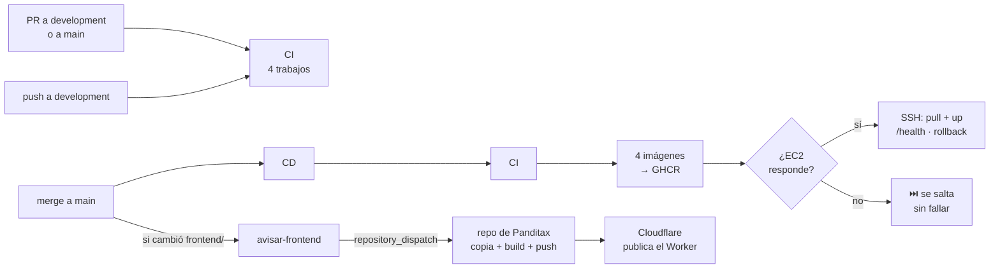

# CI/CD: cómo se prueba y cómo se publica

> **Qué es.** Los tres workflows de GitHub Actions del monorepo y el del repo del frontend: cuándo
> corre cada uno, qué hace, qué secretos usa y qué hacer cuando algo queda en rojo.
> **Para quién.** Quien abre un PR o mergea a `main`, y la defensa («¿cómo llega un cambio a
> producción?»). La decisión y sus alternativas están en el [ADR-034](adr/034-cicd-con-github-actions.md).
> **Última revisión:** 19-11-2026.

> 📍 **En 10 segundos:** cada PR pasa por el **CI** (.NET, scraper, front y dependencias
> vulnerables). **Solo `main` es producción:** un merge a `main` arma las imágenes, las sube a
> **GHCR** y las despliega por SSH en la EC2, con *rollback* si `/health` no responde. El frontend
> no lo publica este repo: `main` le **avisa** al repo de Panditax, que copia `frontend/`, compila y
> hace push a su `main`, y **Cloudflare** publica el Worker solo. Con AWS apagado, el backend se
> salta sin fallar y el sitio sigue arriba.

**Leyenda:** ✅ funciona · 🟡 a medias · ⬜ falta · ⛔ bloqueado · 🔎 por confirmar

---

## El camino de un cambio

| Workflow | Repo | Se dispara con | Qué hace | Estado |
|---|---|---|---|---|
| `ci.yml` | monorepo | PR a `development` o `main`, push a `development`, a mano, y lo llama `cd.yml` | 4 trabajos en paralelo (abajo) | ✅ |
| `cd.yml` | monorepo | **push a `main`** y a mano | CI → imágenes → despliegue en la EC2 | ✅ probado el 19-11 |
| `avisar-frontend.yml` | monorepo | **push a `main` que toca `frontend/`**, y a mano | le avisa al repo del frontend | ✅ |
| `sync-y-desplegar.yml` | [Panditax727/Cacha-el-Precio-Frontend](https://github.com/Panditax727/Cacha-el-Precio-Frontend) | el aviso, cada 15 min y a mano | copia `frontend/`, compila y hace push a su `main` | 🟡 todavía copia desde `development` (abajo) |

---

## CI: «¿está bien?»

Hace lo mismo que la lista de [comprobaciones antes de un PR](DESARROLLO.md#comprobaciones-antes-de-un-pr):
si pasa en tu PC tiene que pasar aquí, y al revés.

| Trabajo | Qué revisa |
|---|---|
| Backend .NET | `dotnet format`, compilación y pruebas de gateway, product-service y notification-service |
| Scraper Python | `pytest -m "not red"` (sin internet) y `ruff` |
| Frontend Vue | `npm run build` y `npm run humo` |
| Dependencias vulnerables | NuGet, `npm audit` y `pip-audit` |

**No usa secrets ni toca AWS o Cloudflare.** Por eso corre seguro en un PR que venga de un fork.
Un push nuevo al mismo PR cancela la corrida anterior.

## CD del backend: «llévalo a producción»

| Paso | Qué hace |
|---|---|
| 1 · CI | el mismo `ci.yml`. Sin CI verde no se despliega nada |
| 2 · Imágenes | arma gateway, product-service, notification-service y scraper **en GitHub** (la EC2 tiene 2 GB y no compila) y las sube a GHCR con el **hash del commit** como etiqueta |
| 3 · ¿AWS prendido? | prueba SSH a la EC2. Si no responde, avisa y termina **en verde**: el lab apagado es lo normal |
| 4 · Desplegar | por SSH corre [`tools/cd-remoto.sh`](../tools/cd-remoto.sh): deja el repo en ese commit, baja las imágenes, levanta el compose **sin compilar** y espera `/health`. Si no responde, **vuelve a la versión anterior** |
| 5 · Limpiar | `docker logout` en la EC2 y borra la llave del runner, aunque algo haya fallado |

Dos despliegues no corren a la vez: el segundo espera (`concurrency`). **Terraform no corre en el
CD**: el estado vive en el laptop y las credenciales del lab vencen cada ~4 h. Una máquina nueva la
monta `tools/tf.sh subir`; el CD solo actualiza una que ya existe.

## CD del frontend: el repo de Panditax y Cloudflare

El sitio `www` es un **Worker de Cloudflare** (`cacha-el-precio-frontend`, solo archivos
estáticos) en la cuenta de Cloudflare de Panditax. Cloudflare está conectado a su repo con la
integración de Git y **publica cada push a su `main`**, sin tokens en GitHub.

| Pieza | Dónde | Qué hace |
|---|---|---|
| Aviso | `avisar-frontend.yml` (este repo) | `repository_dispatch` al repo del frontend con el commit |
| Copia | `sync-y-desplegar.yml` (su repo) | clona el monorepo, copia `frontend/` con `rsync --delete` (conserva su `wrangler.jsonc` y su `.github`), compila y, solo si compiló, hace commit a su `main`. Corre también cada 15 min, por si un aviso se pierde |
| Publicación | Cloudflare | compila con las **variables de build** del Worker y publica `dist/` |
| Encabezados | [`frontend/public/_headers`](../frontend/public/_headers) | HSTS, `nosniff`, `X-Frame-Options`, `Referrer-Policy`, `Permissions-Policy` y la CSP en modo *Report-Only*. El Worker lo aplica solo |

**La configuración del build no está en el repo.** `frontend/.env.production` va vacío a
propósito (cada cuenta tiene su Cognito). Las variables `VITE_API_BASE_URL`, `VITE_API_VERSION`,
`VITE_COGNITO_CLIENT_ID` y `VITE_COGNITO_DOMAIN` están en Cloudflare, en el Worker → **Settings →
Build → Variables**. Si el sistema cambia de cuenta de AWS, hay que cambiarlas ahí y volver a
desplegar.

## Secretos y permisos

| Dónde | Nombre | Para qué |
|---|---|---|
| Environment `produccion` | `EC2_HOST` | la IP elástica de la EC2 (`conservar_ip = true`: no cambia al apagar) |
| Environment `produccion` | `EC2_SSH_KEY` | la llave del lab. Muere con él |
| Repo | `FRONTEND_REPO_TOKEN` | token fino de Panditax, solo para disparar su repo |
| Cada job | `GITHUB_TOKEN` | subir a GHCR y, en la EC2, bajar de GHCR. Vence al terminar el job |

Cada workflow pide solo los permisos que usa (`contents: read`, y `packages: write` solo para
subir imágenes). Las imágenes de GHCR son **públicas**: no llevan secretos, la configuración entra
por el `.env` de la EC2.

## Cuando algo queda en rojo

| Síntoma | Qué es | Qué hacer |
|---|---|---|
| CI rojo en «Formato» | `dotnet format` encontró diferencias | `dotnet format CachaElPrecio.slnx` y commit |
| CI rojo en «Dependencias vulnerables» | un aviso nuevo *high* | `npm audit fix` o `uv lock --upgrade-package <paquete>` |
| CD verde pero «AWS apagado, despliegue omitido» | la EC2 no responde por SSH | prender con `tf.sh subir` y **Re-run** del job «Desplegar en la EC2» |
| CD rojo en «Desplegar» con *rollback* | la versión nueva no levantó | quedó la anterior; mirar los logs del job y `docker compose logs` en la EC2 |
| `www` no cambia después de un merge | el repo de Panditax no copió o Cloudflare no compiló | su pestaña Actions, y en Cloudflare el Worker → **Deployments** |
| El sitio carga pero no hay catálogo ni login | las variables de build apuntan a otra cuenta, o el lab está apagado | revisar las variables en Cloudflare y que `/health` responda |

## Pendiente

| | Qué | Quién |
|---|---|---|
| 🟡 | `sync-y-desplegar.yml` copia desde **`development`** (`MONO_BRANCH`). Hasta que pase a `main`, lo que entra a `development` sale a `www` en ≤ 15 min | Panditax |
| 🟡 | El build de su repo **no revisa el bundle**: si faltan las variables de Cognito, publica igual un sitio sin login | Panditax |
| 🟡 | La CSP está en *Report-Only*: navegar el sitio, revisar la consola y pasarla a `Content-Security-Policy` | equipo |
| 🟡 | **Login con Google**: Cognito ya tiene Google (`tiene_dominio = true`, 23-11). Falta que la variable de build `VITE_COGNITO_DOMAIN` de Cloudflare apunte a `https://cacha-el-precio-731705830984.auth.us-east-1.amazoncognito.com` (hoy al Cognito de `276428661451`) | Panditax |

## Ver también

- [ADR-034](adr/034-cicd-con-github-actions.md): por qué así, y lo que cuesta
- [OPERAR-EN-AWS](OPERAR-EN-AWS.md): prender, apagar y cambiar de cuenta
- [DESARROLLO](DESARROLLO.md): lo que se corre antes de un PR
- [PLAN-EFT §2](PLAN-EFT.md#2--cicd-con-github-actions): el plan original
