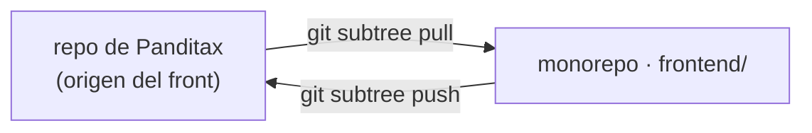

# Desarrollo: trabajar en local y antes de un PR

> **Qué es.** Cómo levantar el proyecto en tu notebook, qué correr antes de pedir revisión y cómo
> se sincroniza el frontend con el repo de Panditax.
> **Para quién.** Quien vaya a programar. Para AWS, el documento es [OPERAR-EN-AWS](OPERAR-EN-AWS.md).
> **Última revisión:** 18-11-2026.

> 📍 **En 10 segundos:** `docker compose up --build -d` levanta todo sin AWS (la mensajería se
> simula). Antes de un PR: `dotnet test`, `pytest` y `ruff` del scraper, y `npm run build` +
> `npm run humo` del front. El frontend entra con **`git subtree`** desde el repo de Panditax, y
> se trae con `git subtree pull`.

---

## Requisitos

| Herramienta | Versión | Para qué |
|---|---|---|
| .NET SDK | 10 | gateway, product-service y notification-service |
| Python | 3.14 | scraper |
| `uv` (o `pip`) | — | dependencias del scraper |
| Node.js + npm | — | frontend (Vite 8) |
| Docker + Docker Compose | — | levantar el entorno completo |
| Terraform | 1.15 o más nuevo | solo para AWS ([`infra/terraform/`](../infra/terraform/README.md)) |

## Clonar y compilar

```bash
git clone https://github.com/Martinnnn-ops/cacha-el-precio.git
cd cacha-el-precio
git config core.hooksPath tools/hooks     # frena commits con secretos, .tfstate o .tfvars
dotnet restore CachaElPrecio.slnx
dotnet build CachaElPrecio.slnx
```

## Servicio por servicio

Product Service y el gateway, en terminales separadas:

```bash
dotnet run --project product-service/Product-Service.csproj --launch-profile http
PRODUCT_URL=http://localhost:8081 dotnet run --project gateway/Gateway.csproj
```

El scraper:

```bash
cd scraper-service
uv sync --all-extras
uv run pytest -m "not red"
```

El frontend:

```bash
cd frontend
npm install
npm run dev            # http://localhost:5173
```

Sin AWS, la mensajería se simula: `MENSAJERIA_MODO=memoria` en el gateway, y si las URL de las
colas quedan vacías, los consumidores no arrancan y el resto funciona igual
([MENSAJERIA](MENSAJERIA.md#variables-de-entorno)).

## Todo junto, con contenedores

```bash
cp .env.example .env
# Completa DB_PASSWORD y la configuración de Cognito.
docker compose up --build -d
docker compose ps
```

| Servicio | Puerto local | Salud |
|---|---:|---|
| Gateway | 8080, a través de Caddy | `http://localhost:8080/health` |
| Product Service | 8081, solo loopback | `http://localhost:8081/health` |
| Notification Service | 8082, solo loopback | `http://localhost:8082/health` |
| Scraper API | 8000, solo loopback | `http://localhost:8000/health` |
| PostgreSQL | 5432, solo loopback | healthcheck de Compose |

Para reconstruir un solo servicio sin arrastrar sus dependencias:

```bash
docker compose build gateway && docker compose up -d --no-deps gateway
```

## Migraciones de base de datos

Product Service y Notification Service aplican sus migraciones de EF Core al iniciar. Para
administrarlas:

```bash
dotnet tool install --global dotnet-ef --version 10.0.11
dotnet ef migrations list --project product-service/Product-Service.csproj
dotnet ef database update --project product-service/Product-Service.csproj
dotnet ef migrations has-pending-model-changes --project product-service/Product-Service.csproj
```

Un cambio de esquema va siempre por una migración, nunca por un `ALTER` a mano. El esquema del
scraper vive en `infra/postgres/init/`.

## Comprobaciones antes de un PR

```bash
dotnet format CachaElPrecio.slnx --verify-no-changes --no-restore
dotnet build CachaElPrecio.slnx --no-restore
# Las pruebas contra AWS real se omiten; se activan con CEP_AWS_REAL=1 y credenciales del lab.
dotnet test CachaElPrecio.slnx --no-build

cd scraper-service
uv run pytest -m "not red"
uv run ruff check .

# Frontend. Con el backend levantado, `humo` comprueba además la conexión real
# contra el gateway: si se omite BACKEND_URL, esa sección se salta y el resto
# sigue pasando, así que conviene pasarla.
cd ../frontend
npm run build
BACKEND_URL=http://127.0.0.1:8080 npm run humo
```

Si el PR toca `infra/terraform/`:

```bash
terraform fmt -check -recursive infra/terraform
./tools/tf.sh plan <tu-nombre>      # con la cuenta prendida: el plan tiene que decir lo esperado
```

Y antes de dar el PR por listo, la lista de [`AGENTS.md`](../AGENTS.md#cómo-mantener-el-orden):
documentos al día con el cambio, `README.md` con su tabla de **Estado**, entrada en la
[bitácora](BITACORA.md) y la tarea marcada en [TAREAS](TAREAS.md).

## El frontend y el repo de Panditax

El frontend nació en el [repositorio de Panditax](https://github.com/Panditax727/Cacha-el-Precio-Frontend)
y entró al monorepo el 09-09 con `git subtree`, **sin `--squash`**, para conservar los commits y su
autoría (en un trabajo con nota individual, `git log` es la evidencia de quién hizo qué). Ese repo
sigue existiendo y de ahí sale el sitio publicado en `www`.



```bash
# una vez por clon: el remoto es configuración local, no viaja en el repo
git remote add frontend-origin https://github.com/Panditax727/Cacha-el-Precio-Frontend.git

git subtree pull --prefix=frontend frontend-origin main      # traer lo nuevo de allá
git subtree push --prefix=frontend frontend-origin <rama>    # devolver algo, en una rama
```

Avisa a Panditax antes de empujar algo a su repo. El historial completo de cómo entró, en
[HISTORIA](HISTORIA.md).

## Flujo Git

`feature/*` → PR a `development` → PR a `main`. Quien abre el PR no lo mezcla por su cuenta.
Detalle en [TAREAS](TAREAS.md#modo-de-trabajo).
