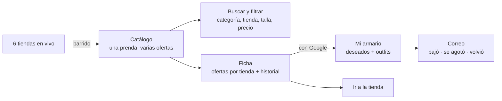
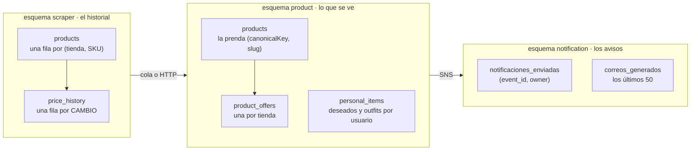

# El proyecto: la idea, el alcance y las reglas del producto

> **Qué es.** Qué hace Cacha el Precio y para quién, qué entra y qué no, de dónde salen los datos,
> cómo se mide el descuento real, quién puede hacer qué y los límites legales.
> **Para quién.** El equipo, y cualquiera que tenga que defender el proyecto.
> **Última revisión:** 18-11-2026. Reúne lo que estaba en `PLAN.md`, `REQUISITOS.md` y
> `CATALOGO-PERSONAL.md`, que se resumen en [HISTORIA](HISTORIA.md).

> 📍 **En 10 segundos:** una web que **compara el precio de la misma prenda entre tiendas
> chilenas**, guarda el **historial** y muestra el **descuento real**: contra el mínimo que
> *nosotros* vimos, no contra el precio de referencia que inventa la tienda. Hoy cubre **ropa y
> calzado de adulto** de **6 tiendas en vivo** (8 con parser). Quien entra con Google puede **guardar prendas, armar
> outfits y recibir un correo** cuando algo baja de precio, se agota o vuelve. No vendemos nada:
> informamos y mandamos a la tienda.

**Leyenda:** ✅ hecho · 🟡 a medias · ⬜ falta · 🔎 por confirmar · ⏸️ después de la EFT · 🚫 no se hace

---

## Índice

1. [El problema](#1--el-problema)
2. [Qué hace hoy](#2--qué-hace-hoy)
3. [Quién puede hacer qué](#3--quién-puede-hacer-qué)
4. [Alcance: qué entra y qué no](#4--alcance-qué-entra-y-qué-no)
5. [Las tiendas](#5--las-tiendas)
6. [El modelo de datos](#6--el-modelo-de-datos)
7. [Emparejar la misma prenda entre tiendas](#7--emparejar-la-misma-prenda-entre-tiendas)
8. [El descuento real](#8--el-descuento-real)
9. [El catálogo y el armario personal](#9--el-catálogo-y-el-armario-personal)
10. [Requisitos no funcionales](#10--requisitos-no-funcionales)
11. [Lo legal y lo ético](#11--lo-legal-y-lo-ético)
12. [Riesgos](#12--riesgos)
13. [Glosario](#13--glosario)

---

## 1 · El problema

El SERNAC ya persiguió a Falabella y a Paris por **inflar el precio de referencia** antes del
Cyber: un producto se anunciaba con 65% de descuento sobre $198.900, cuando días antes esa
referencia rondaba los $100.000. El descuento real era 30%.

Quien compra no tiene cómo saberlo. Cacha el Precio sí, porque **captura el precio todos los
días** y guarda el historial.

**Para quién:** alguien que está por gastar en ropa o zapatillas y quiere saber dónde está más
barato, si el descuento es de verdad y si queda su talla.

### Qué no es

- **No es una tienda:** no hay carrito, ni pago, ni despacho.
- **No es un cotizador:** no se arman pedidos ni se le pide precio a un vendedor.
- **No es un catálogo propio:** son los productos que las tiendas publican.

---

## 2 · Qué hace hoy



| Funcionalidad | Estado |
|---|---|
| Catálogo público de ropa y calzado, sin iniciar sesión | ✅ |
| Una prenda con las ofertas de cada tienda | ✅ |
| Filtros por categoría, zona del cuerpo, género, tienda, talla y precio | ✅ |
| Ficha con gráfico de historial y «mínimo que hemos visto» | 🟡 básica; el precio tachado no aparece (§8) |
| Login con Google (y registro por correo en el Hosted UI) | ✅ |
| Deseados (corazón) y outfits por capas en «Mi armario» | ✅ |
| Correo cuando una prenda seguida baja 10% o más, se agota o se repone | ✅ |
| Panel de mensajería para el grupo `admin` | ✅ solo mira |
| «Lo más visto» y «Lo más reciente» | ✅ |
| Precio habitual calculado con Kinesis | ⬜ EFT ([PLAN-EFT](PLAN-EFT.md)) |

---

## 3 · Quién puede hacer qué

> **Los precios son públicos. Tu armario es tuyo. La operación es del equipo.**

| Rol | Puede | Cómo se reconoce |
|---|---|---|
| **Visitante** | buscar, filtrar, ver fichas e historial, ir a la tienda | sin token |
| **Usuario** | lo anterior + guardar deseados, armar outfits, recibir avisos | token válido de Cognito |
| **Administrador** | lo anterior + el panel de mensajería y el diagnóstico | token con el grupo `admin` |
| **El scraper** (máquina) | publicar ofertas en `/ingesta`, y nada más | token `client_credentials` con el scope `ingesta` |

El **403** de la demo no es inventado: es un usuario común que intenta abrir el panel.

### Las historias de usuario

Las originales del 26-08, con lo que pasó con cada una:

| HU | Historia | Estado |
|---|---|---|
| 00 | Explorar sin registrarse | ✅ |
| 01 · 02 | Registrarse, entrar con Google, cerrar sesión | ✅ |
| 03 | Ver y editar mi perfil | 🟡 se ve; no hay datos que editar |
| 04 · 05 | Buscar y filtrar | ✅ |
| 06 | Ficha con la comparación entre tiendas | ✅ |
| 07 | Historial de precios en un gráfico | 🟡 con pocos puntos (falta el barrido automático) |
| 08 · 09 · 11 | Seguir, ver mi lista, dejar de seguir | ✅ como «deseados» del armario |
| 10 | Recibir un aviso por correo | ✅ desde el EP3 |
| 12 | Presupuesto | ⏸️ |
| 13 | Resolver emparejamientos dudosos (admin) | 🚫 el emparejamiento es automático; el panel admin es el de mensajería |
| 14 | Vigilar las capturas (admin) | 🟡 el panel muestra colas y DLQ, no los barridos |
| 15 | Activar o desactivar una tienda (admin) | 🚫 |

---

## 4 · Alcance: qué entra y qué no

### Entra

- **Ropa y calzado de adulto**, nuevos, vendidos online, con precio y stock visibles.
- Precios en pesos chilenos.
- Las tiendas que permiten la captura automática (§5).

### No entra

| Fuera | Por qué |
|---|---|
| Ropa infantil | decisión del 23-09 ([ADR-028](adr/028-armario-personal-y-politica-catalogo.md)): se rechaza al capturar y se oculta lo viejo |
| Lo que no es ropa (hogar, electrónica, toallas, billeteras) | se descarta antes de guardar |
| Segunda mano, réplicas, ventas por Instagram | no tienen catálogo estructurado |
| Carrito, pagos, checkout | informamos y derivamos |
| App móvil | la web es responsive |
| Tiendas que bloquean al bot | no se suplanta un navegador |

### Cómo llegamos aquí

El plan del 08-09 partía con **zapatillas de 4 marcas en 2 tiendas** (Sparta y Hites), porque ahí
se suponía que el *style code* de fábrica permitía comparar exacto. Dos cosas lo cambiaron:

1. **Medido el 27-08 sobre 2.088 productos, el style code no sirve para comparar entre tiendas.**
   Solo Nike lo trae extraíble (96%); New Balance, Adidas, Asics y Puma dan 0%, y Hites no publica
   ninguno. Quedó como identidad interna, no como mecanismo de comparación.
2. **El scraper de Python** llegó el 07-09 con parsers de varias tiendas y categorías de ropa, y el
   catálogo creció en los hechos. El alcance se amplió a ropa y calzado.

---

## 5 · Las tiendas

| Tienda | Estado | Nota |
|---|---|---|
| Falabella · Paris · Hites · H&M · La Polar · Sparta | ✅ se barren | sitemaps o listados públicos |
| Ripley | 🟡 | el parser funciona; el sitemap responde 403 al bot |
| Converse | 🚫 | su `robots.txt` bloquea a todos los bots |
| Zara · Nike | 🚫 | bloquean al bot identificado |

Cómo se extrae cada una y las trampas que tenía, en el
[README del scraper](../scraper-service/README.md#4--las-tiendas).

---

## 6 · El modelo de datos

Cada dato tiene un solo dueño, y ningún servicio lee el esquema de otro.



| Decisión | Por qué |
|---|---|
| **La oferta es estado, el historial es serie** | la oferta se actualiza (upsert); el historial solo crece. Mezclarlos habría roto el gráfico |
| El historial guarda **solo los cambios** | un barrido varias veces al día sin cambios no llena la tabla de duplicados |
| `(tienda, SKU)` es único | capturar dos veces lo mismo no duplica nada |
| El armario se guarda por `sub` del token | nadie puede leer el armario de otro cambiando un número |

El detalle técnico está en [ARQUITECTURA](ARQUITECTURA.md#4--persistencia) y en el
[ADR-025](adr/025-catalogo-multi-oferta-postgresql.md).

---

## 7 · Emparejar la misma prenda entre tiendas

Es el problema difícil del proyecto: cada tienda usa su propio SKU y su propio nombre.

**Hoy:** product-service arma un `canonicalKey` con la marca y el nombre, quitando género, color y
talla. Si dos ofertas dan la misma llave, son la misma prenda. Es una **heurística**: a veces une
dos modelos distintos o separa el mismo.

**Lo que se midió (27-08), y por qué no basta con comparar texto:**

| Comparación | Similitud (`pg_trgm`) | Debería | Pasa |
|---|---|---|---|
| `574 Negra` vs `574 Negro`, **el mismo zapato** | 0,696 | unir | queda en duda |
| `574 Negra` vs `515 Negra`, **otro zapato** | 0,660 | separar | queda en duda |

Entre acertar y equivocarse hay **0,04**. El número del modelo es lo único que los distingue, y el
trigrama casi no lo pesa. Por eso un emparejamiento mejor tiene que **extraer el número de modelo y
exigir que coincida**, y dejar el parecido de texto para el resto. La propuesta está en el
[ADR-022](adr/022-identidad-de-producto-entre-tiendas.md), sin implementar.

**Para el informe:** revisar 30 prendas a mano y reportar el número (*«24 de 30 bien = 80%»*). Es un
resultado medido, no una opinión. ⬜ No se ha hecho.

---

## 8 · El descuento real

Nuestro «mínimo histórico» es en realidad **el mínimo que hemos visto desde que capturamos**.
Presentarlo como verdad absoluta sería indefendible, así que la ficha muestra los números y deja
que la persona saque la conclusión:

```
Precio hoy                        $89.990
Referencia de la tienda          $149.990   (–40% según ellos)
Mínimo que hemos visto            $84.990   (desde el 27-08-2026)
→ Descuento real contra el mínimo visto: 5,9%
```

Esa transparencia **es** el argumento del proyecto, y además nos protege: no afirmamos más de lo
que podemos probar.

| Pieza | Estado |
|---|---|
| Precio de hoy y mínimo visto | ✅ |
| **Precio de referencia (tachado)** | ⬜ el scraper no guarda todavía los 3 precios (normal, internet, tarjeta) |
| **Precio habitual** (el rango normal de la prenda) | ⬜ lo calcula el lector de Kinesis, en la EFT |

> ⚠️ **El historial no se recupera hacia atrás.** Los días que nadie capturó no existen. Por eso el
> barrido automático cada 3 h está en el camino a la EFT.

---

## 9 · El catálogo y el armario personal

Decidido el 23-09 por Orion ([ADR-028](adr/028-armario-personal-y-politica-catalogo.md)).

### La política del catálogo

- **No entra ropa infantil.** El scraper la rechaza antes de procesar imágenes y guardar;
  product-service la valida al recibir y oculta la que había antes.
- **«Genéricas»** agrupa las prendas sin marca, sin cambiarles la categoría.
- Lo que entró antes del filtro se limpia con `tools/limpiar-catalogo.py`: primero audita, y con
  `--apply` respalda **antes** y borra en una transacción. Si el respaldo falla, no borra.
  ⬜ No se ha corrido sobre la base desplegada (está en [TAREAS](TAREAS.md)).

### El armario

| Qué | Cómo |
|---|---|
| **Deseados** | el corazón de cada prenda; son los que reciben aviso por correo |
| **Outfits** | combinaciones con nombre, armadas por capas |
| **Las capas** | cabeza, torso base, torso intermedio, abrigo, interior, piernas, calcetines y calzado. Solo base, piernas y calzado son obligatorias |
| **Al abrir un outfit** | precio y stock se vuelven a consultar; una prenda retirada no se pone en una ranura equivocada |

Las rutas son `/mi-cuenta` en el gateway ([README del gateway](../gateway/README.md#4--las-rutas)).

---

## 10 · Requisitos no funcionales

Los que siguen vigentes, agrupados. Los IDs son los del documento original del 26-08.

| Tema | Requisito | Estado |
|---|---|---|
| **Identidad** | OIDC con Authorization Code + PKCE, nunca flujo implícito (RNF-01) | ✅ |
| | El borde **y** el servicio validan el token (RNF-03, 04) | ✅ |
| | Autorización por grupo, no por lista de correos en el código (RNF-05) | ✅ |
| | 401 sin token, 403 sin permiso, sin detalles internos (RNF-10) | ✅ |
| | CORS con orígenes explícitos, nunca `*` (RNF-07) | ✅ |
| **Secretos** | Nada en el repo (RNF-08) | ✅ hook de pre-commit. 🟡 En la EC2 van en archivos `.env`, no en un gestor de secretos |
| | La base no es accesible desde internet (RNF-09) | ✅ atada a `127.0.0.1` |
| **Datos personales** | Solo correo, nombre y el armario; los avisos solo a quien sigue la prenda (RNF-11, 13) | ✅ Ley 21.719, minimización |
| **Fuentes** | Datos públicos, 1 pedido cada 1–2 s, `robots.txt` (RNF-14 a 17) | ✅ |
| **Resiliencia** | Si un consumidor cae, los mensajes esperan en la cola (RNF-18) | ✅ |
| | Lo que falla se reintenta y luego se aparta en una DLQ (RNF-19) | ✅ 5 intentos |
| | Procesar dos veces no duplica nada (RNF-20) | ✅ upsert y `(event_id, owner)` |
| | Si una tienda falla, las demás siguen (RNF-21) | ✅ |
| **Rendimiento** | Un token inválido muere en el borde, sin gastar el backend (RNF-25) | ✅ |
| **Usabilidad** | Funciona en el teléfono, tema claro y oscuro (RNF-26, 27) | ✅ |
| **Operación** | Costo dentro del crédito (RNF-31) | ✅ `tf.sh apagar` baja la EC2 y su IP |

---

## 11 · Lo legal y lo ético

Consultamos sitios comerciales de forma automática. Esto cierra la pregunta antes de que la hagan:

- **Qué recolectamos:** solo datos públicos de precio, stock y nombre, los mismos que ve cualquiera.
  Ningún dato personal de las tiendas, ninguna cuenta.
- **Cómo:** un pedido cada 1–2 segundos, User-Agent que dice quiénes somos, y respeto a
  `robots.txt`. **No suplantamos un navegador** para saltar un bloqueo.
- **Qué no hacemos:** no revendemos el dato ni clonamos catálogos. La web **manda el tráfico a la
  tienda**, no se lo queda.
- **Interés público:** el precedente del SERNAC respalda la transparencia de precios.

Si una tienda pide que dejemos de consultarla, se retira.

---

## 12 · Riesgos

| Riesgo | Qué hacemos | Estado |
|---|---|---|
| **El historial queda vacío** | barrido automático; respaldo antes de apagar | 🟡 el barrido sigue manual |
| **Se acaba el crédito o la cuenta** | Terraform monta todo en otra cuenta con un comando; respaldo en el laptop ([OPERAR-EN-AWS](OPERAR-EN-AWS.md)) | ✅ probado el 17-11 |
| **Una tienda cambia su HTML** | extracción por JSON-LD; pruebas con HTML real guardado | ✅ |
| **Nos bloquean por scrapear** | pausa entre pedidos, bot identificado, `robots.txt` | ✅ |
| **El emparejamiento falla mucho** | medirlo con 30 prendas y reportar el número honesto | ⬜ |
| **La demo en vivo se cae** | el video de la EFT va grabado | ⬜ |

---

## 13 · Glosario

| Término | En simple |
|---|---|
| **OAuth2** | el protocolo para dar permisos sin entregar la contraseña: «¿qué puede hacer?» |
| **OIDC** | la capa de OAuth2 que agrega identidad: «¿quién es?» |
| **IDaaS** | identidad como servicio: Cognito se encarga de usuarios y tokens |
| **JWT** | el token: un texto firmado que dice quién eres y qué puedes |
| **JWKS** | las llaves públicas de Cognito, para verificar la firma sin preguntarle |
| **PKCE** | lo que protege el login de una app sin secreto, como un frontend |
| **Client credentials** | el login de una máquina: el scraper pide su token sin persona detrás |
| **BFF** | *Backend for Frontend*: el gateway, que adapta la API a lo que necesita el frontend |
| **SQS · SNS** | cola de mensajes · tópico que reparte un mensaje a varias colas |
| **DLQ** | la cola donde caen los mensajes que fallaron demasiado, para revisarlos |
| **Idempotencia** | que procesar lo mismo dos veces dé lo mismo que procesarlo una |
| **Kinesis** | un *stream* de AWS: una fila ordenada de eventos que varios pueden leer |
| **Terraform** | la infraestructura escrita como código, que se crea y destruye con un comando |
| **canonicalKey** | la llave que dice «esta oferta y esa son la misma prenda» |

## Ver también

- [ARQUITECTURA](ARQUITECTURA.md): cómo está construido
- [EVALUACIONES](EVALUACIONES.md): qué pide el ramo
- [PLAN-EFT](PLAN-EFT.md): lo que falta construir
