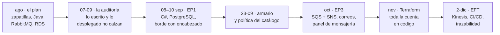

# Historia: cómo llegó el proyecto hasta aquí

> **Qué es.** Lo que vale la pena recordar de los documentos viejos: qué se planeó, qué cambió en
> el camino y qué se aprendió. Reemplaza la carpeta `docs/archivo/`, que tenía ocho documentos
> (unas 3.000 líneas) que ya no describían el sistema.
> **Para quién.** La defensa («¿por qué cambiaron de opinión?») y el informe. **No se mantiene**:
> lo vigente empieza en [CONTEXTO](CONTEXTO.md).
> **Última revisión:** 18-11-2026.

> 📍 **En 10 segundos:** el proyecto partió en agosto como un comparador de **zapatillas en 2
> tiendas**, con Java, RabbitMQ, Kafka, RDS y una red privada. Al construirlo cambió casi todo:
> **C# y Python**, **ropa y calzado en 8 tiendas**, **PostgreSQL en Docker**, **SQS y SNS**, una
> **EC2 pública protegida por el borde** y, desde noviembre, **Terraform**. Cada cambio tiene su
> ADR. Lo que más enseñó: tres personas trabajando sin cruzar lo que hacía cada una.

---

## 1 · La línea de tiempo



| Fecha | Qué pasó | Dónde está hoy |
|---|---|---|
| 19–30 ago | Plan inicial: zapatillas de 4 marcas en Sparta y Hites; scraper capturando desde el 27-08 | [EL-PROYECTO §4](EL-PROYECTO.md#4--alcance-qué-entra-y-qué-no) |
| 27-08 | **Se mide que el *style code* no sirve para comparar entre tiendas** (solo Nike lo trae) | [EL-PROYECTO §4](EL-PROYECTO.md#cómo-llegamos-aquí) |
| 30-08 | Cognito probado en el Learner Lab; se descarta el plan B de Keycloak | [ADR-006](adr/006-cognito-como-idaas.md) |
| 07-09 | **Auditoría:** el sistema desplegado y los documentos no coinciden (§2) | — |
| 08-09 | PR #18: los servicios pasan de Java a **C#**; se retiran los procesos vacíos | [ADR-020](adr/020-csharp-y-simplificacion-de-servicios.md) |
| 09-09 | El frontend de Panditax entra al monorepo con `git subtree`; product-service pasa a PostgreSQL | [DESARROLLO](DESARROLLO.md#el-frontend-y-el-repo-de-panditax) · [ADR-025](adr/025-catalogo-multi-oferta-postgresql.md) |
| 10-09 | El API Gateway pasa a ser el **único camino** (encabezado del borde); Elastic IP; respaldo cada hora. **Se pierden 221 productos con su historial** al recrear la máquina | [ADR-026](adr/026-encabezado-secreto-del-borde.md) · [OPERAR-EN-AWS §6](OPERAR-EN-AWS.md#6--apagar-sin-perder-datos-tfsh-apagar) |
| 13-09 | Entrega del EP1 | — |
| 23-09 | Armario personal y fuera la ropa infantil (Orion) | [ADR-028](adr/028-armario-personal-y-politica-catalogo.md) |
| 14–21 oct | EP3: SQS + SNS, notification-service, panel de mensajería | [ADR-029](adr/029-mensajeria-sqs-sns.md) a [032](adr/032-administracion-de-mensajeria.md) |
| 10–17 nov | Terraform, fases 0 a 7; el panel deja de crear y borrar; Kafka descartado | [ADR-033](adr/033-terraform-para-la-infraestructura.md) · [PLAN-EFT](PLAN-EFT.md) |

El detalle día por día está en la [bitácora](BITACORA.md).

---

## 2 · La auditoría del 07-09: lo que no calzaba

El 07-09 se comparó lo desplegado con lo escrito y aparecieron **nueve decisiones tomadas
construyendo**, de las que solo una tenía ADR. No eran malas decisiones; el problema era que
varias **contradecían lo que íbamos a defender en voz alta**.

| # | Lo que pasó en el código | Lo que decían los documentos | Cómo se resolvió |
|---|---|---|---|
| 1 | `catalog-service` pasa a `product-service` | — | [ADR-016](adr/016-product-service-y-modelos-sin-dto.md) |
| 2 | Sin DTO: los controllers devuelven entidades | — | ADR-016, con el costo anotado |
| 3 | product-service con **SQLite** | PostgreSQL | migrado a PostgreSQL el 09-09 ([ADR-025](adr/025-catalogo-multi-oferta-postgresql.md)) |
| 4 | Versionado de rutas por encabezado | el ADR-014 versionaba artefactos, no rutas | se quedó: `Version: 1.0` / `2.0` |
| 5 | Scraper en **Python** | ADR-013: todo en Java | [ADR-018](adr/018-scraper-en-python.md) y [ADR-020](adr/020-csharp-y-simplificacion-de-servicios.md) |
| 6 | **Caddy** haciendo TLS y CORS delante de todo | el API Manager era API Gateway | Caddy detrás del borde y 403 sin el encabezado ([ADR-026](adr/026-encabezado-secreto-del-borde.md)) |
| 7 | Ingesta **HTTP directa** scraper → catálogo | ingesta por RabbitMQ | aceptado para el EP1; en el EP3 pasó a SQS ([ADR-029](adr/029-mensajeria-sqs-sns.md)) |
| 8 | El mismo producto **duplicado** en dos bases | una sola base | un PostgreSQL, un esquema por dueño (ADR-025) |
| 9 | **Ropa y calzado** | solo calzado hasta después del EP1 | el alcance se amplió ([EL-PROYECTO §4](EL-PROYECTO.md#4--alcance-qué-entra-y-qué-no)) |

Y tres problemas más que se encontraron ese día:

- **La escritura del catálogo estaba abierta a internet:** cualquiera podía hacer `POST /productos`.
  Se cerró exigiendo el scope `ingesta`.
- **Había dos user pools en dos cuentas:** el frontend hablaba con el de una cuenta y el BFF confiaba
  en el de otra; por eso todo daba 401. Hoy hay **un pool por cuenta**, creado por Terraform.
- **Nadie había ejecutado el backend C#** cuando se mergeó, y el sitio publicado era anterior a todo
  el cambio. Se levantó y probó por fases antes de desplegar.

---

## 3 · El diseño original contra lo construido

| Pieza | Agosto | Hoy | Por qué cambió |
|---|---|---|---|
| Servicios | Java 25 + Micronaut, 4 servicios | C# (3) + Python (1) | experiencia del equipo; los procesos vacíos no desacoplan |
| `price-service` | guardaba el historial | no existe | no tenía lógica ni datos propios |
| Mensajería | RabbitMQ + Kafka | SQS + SNS, y Kinesis para la EFT | servicios de AWS en vez de contenedores en una EC2 de 2 GB; Kafka descartado el 17-11 |
| Scraper | Lambda 3 veces al día | contenedor en la EC2 | la migración a Lambda quedó pendiente y nunca se hizo; el barrido automático entra en la EFT |
| Base | RDS en subred privada | PostgreSQL en Docker | costo; el respaldo lo cubre `tf.sh` |
| Red | VPC propia, NAT, ALB, VPC Link | VPC por defecto con encabezado del borde | NAT y ALB cobran por hora |
| CDN | CloudFront | Cloudflare | CloudFront está bloqueado en el Learner Lab |
| Correo | SES | Gmail por SMTP | 🔎 el porqué no quedó escrito en ningún ADR |
| Infraestructura | scripts `crear-*` | Terraform | reproducible en cualquier cuenta |
| Alcance | zapatillas, 2 tiendas | ropa y calzado, 8 tiendas | el scraper de Python trajo más tiendas; el *style code* no servía igual |

---

## 4 · Lo que aprendimos

- **Un documento que miente es peor que uno que falta.** La auditoría del 07-09 encontró un
  diagrama, un runbook y un plan describiendo un sistema que no existía. De ahí salen las reglas de
  `AGENTS.md`: cada tema en un solo documento, y cuando el código contradice un documento, se anota.
- **El que destruye tiene que llamar al que protege.** Los 221 productos del 10-09 se perdieron
  porque el respaldo corría en la EC2 y el que la borraba corría en el laptop. `tf.sh apagar`
  respalda antes de destruir y, si el respaldo falla, no apaga.
- **Medir antes de decidir.** El *style code* parecía la solución al emparejamiento hasta que se
  midió sobre 2.088 productos. Los umbrales de similitud parecían razonables hasta que se probaron
  con nombres reales.
- **Tres personas que no cruzan lo que hacen pisan el trabajo del otro.** El 08-09 pasaron tres
  cambios encadenados en dos repos sin que nadie hablara. Por eso las tareas se toman en una tabla
  compartida y nadie mergea su propio PR.
- **Lo que no se puede recrear, se pierde.** Por eso nada se crea a mano en la consola, y por eso
  existe Terraform.

---

## Los documentos originales

No se borraron de la historia: están en git. Este commit es el merge del PR #47 en `development`
(26-10), así que no se pierde aunque se borre una rama. Así estaban antes de Terraform:

```bash
git show 736be1e:docs/INTEGRACION.md        # la auditoría del 07-09 y la deuda hasta noviembre
git show 736be1e:docs/INTEGRACION-FRONTEND.md   # cómo entró el frontend, fase por fase
git show 736be1e:docs/PLAN.md               # el plan de agosto: tiendas, modelo, matching, costos
git show 736be1e:docs/REQUISITOS.md         # historias de usuario y requisitos del EP1
git show 736be1e:docs/DESPLIEGUE.md         # el runbook del EP1 (nunca se siguió tal cual)
git show 736be1e:docs/IDENTIDAD.md          # la identidad antes de juntarse en ARQUITECTURA
git show 736be1e:docs/CATALOGO-PERSONAL.md  # el armario y la limpieza del catálogo (Orion)
git show 736be1e:docs/TAREAS.md             # las tareas con la historia del EP1
git show 736be1e:docs/MONTAR-EN-TU-CUENTA.md
git show 736be1e:docs/MIGRACION.md
```

## Ver también

- [CONTEXTO](CONTEXTO.md): cómo está todo hoy
- [BITACORA](BITACORA.md): qué pasó cada día
- [índice de ADR](adr/README.md): cada decisión con sus consecuencias
