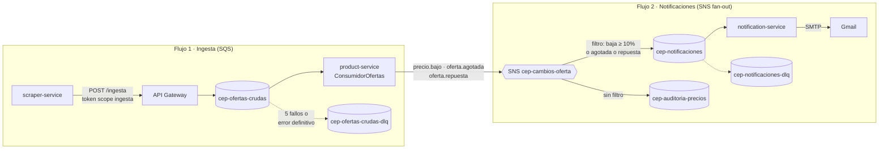

# Mensajería asíncrona (EP3)

Cómo se comunican los servicios por colas y tópicos. La decisión y sus porqués están en
[ADR-029](adr/029-mensajeria-sqs-sns.md). Este documento es el **contrato**: si algo de aquí
cambia, se avisa al equipo antes de tocar el código.

- **Topología** (colas, tópicos, reglas): [`infra/mensajeria/topologia.json`](../infra/mensajeria/topologia.json). Es el único lugar donde se declaran.
- **Crear todo en tu cuenta:** `python3 tools/crear-mensajeria.py` (`--estado`, `--borrar`), o desde la
  aplicación con `POST /api/admin/mensajeria/topologia/aplicar` (ver [Administración](#administración-t11)).
- **Sondeo de Academy:** `python3 tools/probar-mensajeria-academy.py` (¿API Gateway → SQS con LabRole?).
  ✅ Respondió que sí el 14-10-2026: **opción A**.
- **La puerta `POST /ingesta`** la crea `tools/crear-api-gateway.sh` (integración `SQS-SendMessage`
  con `LabRole`, scope `ingesta`). Si las colas no existen, ese script corre antes
  `crear-mensajeria.py`. El cuerpo del POST llega tal cual a la cola: es el sobre de abajo.

## Los dos flujos

Son independientes. El flujo 1 no necesita que exista notification-service; el flujo 2 empieza
donde termina el 1.



| Recurso | Tipo | Produce | Consume | Notas |
|---|---|---|---|---|
| `cep-ofertas-crudas` | cola | scraper (vía API Gateway) | product-service | visibilidad 60 s, DLQ tras 5 |
| `cep-ofertas-crudas-dlq` | DLQ | SQS | — | retención 14 días, redrive manual |
| `cep-cambios-oferta` | tópico SNS | product-service | 2 suscripciones | fan-out; el tipo de cambio va en el atributo `type` |
| `cep-notificaciones` | cola | SNS (filtro: baja ≥ 10%, agotada o repuesta) | notification-service | DLQ tras 5 |
| `cep-notificaciones-dlq` | DLQ | SQS | — | retención 14 días |
| `cep-auditoria-precios` | cola | SNS (sin filtro) | el equipo, desde el panel (`GET /api/admin/mensajeria/colas/cep-auditoria-precios/mensajes`) | recibe todo: sirve para pillar precios sospechosos del scraper y para demostrar la regla de distribución |

## Sobre común

Todo mensaje va dentro del mismo sobre. Los campos van en inglés, igual que `ProductRequest`.

| Campo | Tipo | Qué es |
|---|---|---|
| `eventId` | string (UUID) | Identificador único del evento. Lo genera el productor. Va en todos los logs |
| `type` | string | `oferta.capturada`, `precio.bajo`, `oferta.agotada` u `oferta.repuesta` |
| `version` | int | Versión del contrato de ese `type`. Hoy `1` |
| `source` | string | Servicio que lo produjo |
| `occurredAt` | string (ISO 8601, UTC) | Cuándo ocurrió |
| `data` | objeto | El contenido, según el `type` |

Un consumidor que recibe un `type` o una `version` que no conoce lo trata como **error
definitivo** (ver abajo).

## `oferta.capturada` · v1

Produce: scraper-service. Consume: product-service.

`data` es **exactamente el `ProductRequest`** que ya recibe `POST /api/products`
(`product-service/Models/DTOs/ProductRequest.cs`). El consumidor llama a `UpsertProductAsync`
sin cambios.

```json
{
  "eventId": "3b0f8d4e-6a51-4f7e-9b2a-1c9e0a7d2f11",
  "type": "oferta.capturada",
  "version": 1,
  "source": "scraper-service",
  "occurredAt": "2026-10-14T18:00:00Z",
  "data": {
    "canonicalKey": null,
    "externalId": "SKU-12345",
    "store": "tienda-ejemplo",
    "name": "Polera básica negra",
    "brand": "Marca",
    "category": "poleras",
    "bodyArea": "torso",
    "gender": "unisex",
    "layer": "base",
    "price": 14990,
    "sizes": ["S", "M", "L"],
    "description": null,
    "url": "https://tienda-ejemplo.cl/polera-basica-negra",
    "image": "https://tienda-ejemplo.cl/img/polera.jpg",
    "active": true
  }
}
```

## Cambios de oferta (tópico `cep-cambios-oferta`)

Los tres los produce product-service en `UpsertProductAsync`, **solo cuando la oferta ya existía**,
comparando lo guardado con lo que llega, antes de `ApplyOffer`. Si en un mismo upsert baja el precio
y cambia la disponibilidad, se publican los dos eventos. Los consume notification-service (según el
filtro) y la cola de auditoría (todos). La publicación va **después** de guardar y es best-effort
(cómo y por qué, en [ADR-031](adr/031-publicacion-cambios-oferta.md)).

| Evento | Cuándo | `data` |
|---|---|---|
| `precio.bajo` | precio nuevo **menor** que el guardado | ver abajo |
| `oferta.agotada` | `active` pasa de `true` a `false` | los campos comunes + `lastPrice` |
| `oferta.repuesta` | `active` pasa de `false` a `true` | los campos comunes + `price` |

Campos comunes de `data`: `productId`, `slug`, `name`, `image`, `store`, `url`.

> El scraper ya manda `active = producto.available` (`product_service_sync.py`). Hoy el agotado se
> detecta cuando **la tienda** marca la prenda como no disponible. Que una prenda *desaparezca* del
> listado (la «ausencia» de la bitácora) no llega a product-service y queda fuera de este alcance.

### `precio.bajo` · v1

```json
{
  "eventId": "9a7e2c1b-0d4f-4b8a-a3e6-5f2d1c0b9e88",
  "type": "precio.bajo",
  "version": 1,
  "source": "product-service",
  "occurredAt": "2026-10-14T18:00:03Z",
  "data": {
    "productId": 123,
    "slug": "polera-basica-negra",
    "name": "Polera básica negra",
    "image": "https://tienda-ejemplo.cl/img/polera.jpg",
    "store": "tienda-ejemplo",
    "url": "https://tienda-ejemplo.cl/polera-basica-negra",
    "previousPrice": 19990,
    "newPrice": 14990,
    "discountPct": 25
  }
}
```

### `oferta.agotada` · v1

```json
{
  "eventId": "…", "type": "oferta.agotada", "version": 1,
  "source": "product-service", "occurredAt": "…",
  "data": {
    "productId": 123, "slug": "polera-basica-negra", "name": "Polera básica negra",
    "image": "…", "store": "tienda-ejemplo", "url": "…",
    "lastPrice": 14990
  }
}
```

`oferta.repuesta` es igual, con `price` en vez de `lastPrice`.

### Atributos del mensaje SNS

Obligatorios: **el filtro solo lee atributos, no el cuerpo**.

| Atributo | Tipo SNS | Cuándo | Valor |
|---|---|---|---|
| `type` | String | siempre | el mismo `type` del sobre |
| `discountPct` | Number | solo en `precio.bajo` | el mismo de `data.discountPct`, entero |

Filtro de `cep-notificaciones` (en `topologia.json`): `precio.bajo` **con** `discountPct ≥ 10`,
**o** cualquier `oferta.agotada` u `oferta.repuesta`. Agregar un tipo nuevo es sumarlo a esa lista.

`discountPct = round((previousPrice - newPrice) * 100 / previousPrice)`.

## Confirmación, reintentos y errores

Regla general: **el mensaje se borra (`DeleteMessage`, el ACK) solo después de terminar el
trabajo**. Nunca antes.

| Situación | Tipo | Qué hace el consumidor | Qué pasa con el mensaje |
|---|---|---|---|
| Se procesó bien | éxito | `DeleteMessage` | sale de la cola |
| Base de datos caída, timeout, Gmail no responde | **recuperable** | no lo borra, registra el error | reaparece a los 60 s; en el último intento lo aparta el consumidor con diagnóstico (en product-service; en notification-service lo mueve SQS, sin atributos) |
| JSON roto, `type`/`version` desconocido, falla de validación, correo de destino inválido | **definitivo** | lo envía a la DLQ **con atributos de diagnóstico** y lo borra de la cola original | queda en la DLQ sin gastar 5 reintentos |

Atributos de diagnóstico que se agregan al mandar a la DLQ (además del cuerpo original intacto):

| Atributo | Ejemplo |
|---|---|
| `error-type` | `definitivo` |
| `error-reason` | `validacion: price debe ser > 0` |
| `error-exception` | `ArgumentException` |
| `failed-by` | `product-service` |
| `failed-at` | `2026-10-14T18:00:05Z` |
| `original-message-id` | el `MessageId` de SQS |

Todos los logs de los consumidores incluyen `eventId`, `MessageId` y `ApproximateReceiveCount`.

### Duplicados

SQS Standard entrega **al menos una vez**: el mismo mensaje puede llegar dos veces.

- **product-service** ya es idempotente: `UpsertProductAsync` + índices `UNIQUE` en
  `(Store, ExternalId)` y `CanonicalKey`. Repetir no cambia nada.
- **notification-service** no lo es por naturaleza (un correo mandado no se «des-manda»).
  Antes de enviar revisa la tabla `notificaciones_enviadas` con la clave
  `(seguimiento, eventId)`: un duplicado de SQS trae el mismo `eventId`. Si ya está, borra el
  mensaje sin reenviar.

## Productor de ofertas (scraper, flujo 1)

Con `MODO_PUBLICACION=cola`, el scraper deja cada prenda en `POST /ingesta` en vez de mandarla a
`POST /api/products` (`http`, por defecto en local). El barrido no cambia: `ProductServiceSync`
recibe un cliente con `sincronizar_producto()` y no sabe cuál le tocó; `main.construir_sync` elige
`IngestaColaClient` o `ProductServiceClient`.

- **Token:** `client_credentials` del client del scraper con el scope `ingesta`; se reutiliza hasta
  60 s antes de vencer. Ante un 401 pide uno nuevo **una vez** y reintenta.
- **Sobre:** `oferta.capturada` v1 con un `eventId` nuevo por prenda; `data` es el mismo payload
  del modo `http`.
- **Errores:** 200 = encolada. Otro 4xx falla solo esa prenda y el barrido sigue. 5xx o timeout se
  reintenta hasta 3 veces con espera creciente.
- **Si falta configuración** en modo cola (`API_GATEWAY_URL_INGESTA`, `COGNITO_DOMINIO`,
  `COGNITO_SCRAPER_CLIENT_ID/SECRET/SCOPE`), el scraper no arranca y dice cuál falta.

`tools/desplegar.sh` deja el servidor en modo cola cuando tiene `api-gateway.env`. Pruebas en
`scraper-service/tests/unit/infrastructure/test_ingesta_cola_client.py`.

## Consumidor de ofertas (product-service, flujo 1)

`ConsumidorOfertas` (un `BackgroundService`) lee `cep-ofertas-crudas` con long polling de 20 s, de a
10 mensajes. Por cada uno abre un scope nuevo y le pasa el cuerpo a `ProcesadorOfertaCapturada`,
que valida el sobre (`type=oferta.capturada`, `version=1`) y guarda `data` con
`UpsertProductAsync`, **sin modificar ese método**: es el mismo camino que `POST /api/products`.

| Salida | Cuándo | Qué hace |
|---|---|---|
| ok | se guardó | `DeleteMessage` |
| dlq | JSON roto, `type`/`version` desconocido, `data` que no es una oferta, precio ≤ 0, campo obligatorio vacío, prenda infantil | a `cep-ofertas-crudas-dlq` con los 6 atributos de diagnóstico, y se borra |
| reintento | base caída, timeout (incluido `TaskCanceledException`) | no se borra, se registra un warning y SQS lo reintenta |
| dlq-agotado | el mismo error recuperable en el **último** intento (`maxReceiveCount` de la cola, leído de su `RedrivePolicy`) | lo aparta el consumidor en la DLQ con `error-type=recuperable-agotado` y la razón del último error |

Cada log lleva `eventId`, `MessageId`, el intento y el resultado. Sin `SQS_OFERTAS_CRUDAS_URL` el
consumidor no arranca (registra «desactivado») y la API HTTP sigue igual. El negocio habla con
`IColaMensajes`, igual que notification-service. Probado en
`product-service.Tests/ConsumidorOfertasTests.cs`.

## Administración (T11)

Panel para consultar y gestionar la mensajería, en el gateway bajo `/api/admin/mensajeria`. Exige el
grupo `admin` de Cognito (403 sin él). Decisión en [ADR-032](adr/032-administracion-de-mensajeria.md);
demo con casos válidos e inválidos en [`gateway/Mensajeria.http`](../gateway/Mensajeria.http).

| Método y ruta | Qué hace |
|---|---|
| `GET /colas` · `GET /colas/{nombre}` | Mensajes visibles, en proceso y demorados, DLQ y `maxIntentos`, de qué colas es DLQ |
| `POST /colas` · `DELETE /colas/{nombre}` | Crear (con DLQ opcional) y borrar |
| `GET /colas/{nombre}/mensajes` | Lo que hay en una DLQ (con su diagnóstico) o en `cep-auditoria-precios`, **sin borrarlo**. Solo colas sin DLQ propia: para SQS mirar es una recepción y suma intentos (409) |
| `POST /colas/{dlq}/redrive` | Devolver los mensajes de la DLQ a su cola (`?destino=` si la usan varias) |
| `GET /topicos` · `POST` · `DELETE /topicos/{nombre}` | Tópicos con sus suscripciones y filtros |
| `GET /suscripciones` · `POST` · `PUT` · `DELETE /suscripciones/{topico}/{cola}` | Reglas de distribución; al suscribir se ajusta la política de la cola |
| `GET /topologia` | `topologia.json` contra lo que existe (falta, distinta, extra) |
| `POST /topologia/aplicar` | Crea lo que falta y corrige lo distinto. Idempotente; no borra lo extra |

Errores: `400 { estado, error, mensaje, errores: [{ campo, error }] }` cuando la forma está mal
(nombre sin `cep-` o con mayúsculas, rangos de AWS, `maxIntentos` fuera de 1..10, filtro sobre un
atributo que nadie publica o con un `type` que no existe, DLQ o tópico inexistente) y `409` cuando
choca con lo que hay (ya existe, es DLQ de otra, tiene suscripciones, está declarado en
`topologia.json` y no se pidió `?forzar=true`). Un permiso que el LabRole niega sale como `502`.

`MENSAJERIA_MODO=memoria` simula todo sin AWS (por defecto si no se configura); en la EC2 va `aws`.

## Correo (notification-service)

Interfaz `IEnviadorCorreo` con dos implementaciones, elegidas por configuración:

| Implementación | Cuándo | Qué hace |
|---|---|---|
| `EnviadorCorreoSmtp` | servidor | Gmail por SMTP con MailKit: `smtp.gmail.com:587`, STARTTLS, contraseña de aplicación |
| `EnviadorCorreoLog` | local y pruebas | escribe el correo en el log, no envía nada |

⚠️ La contraseña de aplicación va **solo** en el `.env` del servidor. En el repo queda
`.env.example` con el valor vacío.

Para comprobar desde la EC2 que el puerto 587 sale (AWS bloquea el 25, no el 587):

```bash
timeout 5 bash -c '</dev/tcp/smtp.gmail.com/587' && echo "587 abierto" || echo "587 bloqueado"
```

## Variables de entorno

`tools/crear-mensajeria.py` escribe `mensajeria.env` (no va al repo) con:

```
MENSAJERIA_REGION=us-east-1
SQS_OFERTAS_CRUDAS_URL=...
SQS_NOTIFICACIONES_URL=...
SQS_AUDITORIA_PRECIOS_URL=...
SQS_OFERTAS_CRUDAS_DLQ_URL=...
SQS_NOTIFICACIONES_DLQ_URL=...
SNS_CAMBIOS_OFERTA_ARN=...
```

Si la URL de una cola viene vacía, su consumidor **no arranca** y el servicio sigue funcionando
como antes. Así se puede programar en local sin cuenta de AWS.
