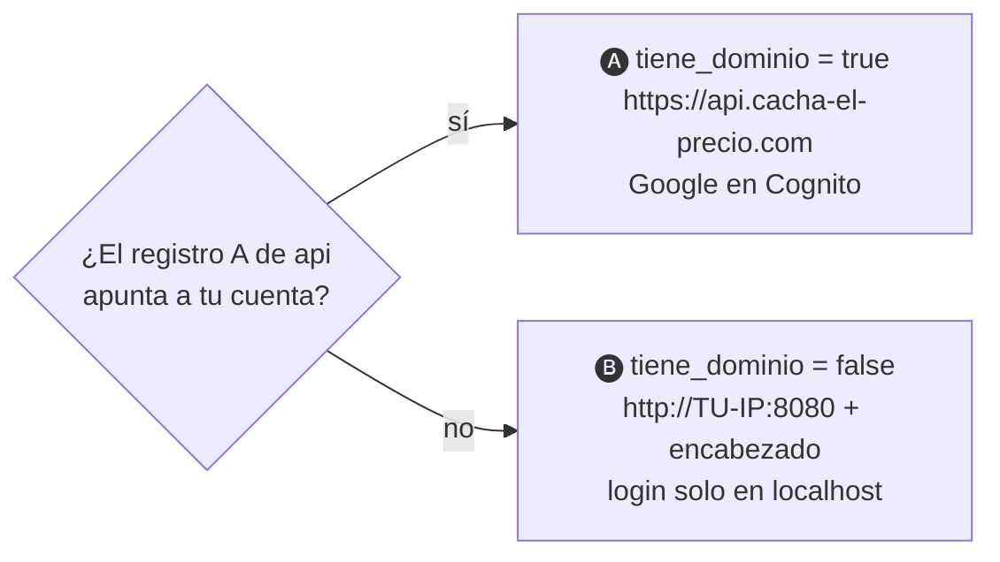
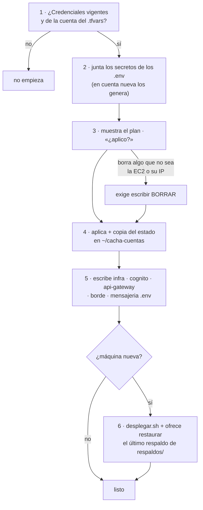
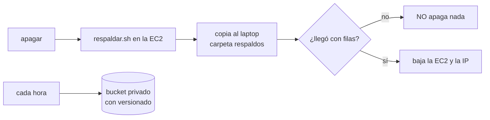
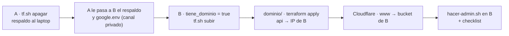

# Operar en AWS: montar, prender, apagar y cambiar de cuenta

> **Qué es.** La guía para levantar el sistema entero en una cuenta de AWS, prenderlo y apagarlo
> cada día sin perder datos, y saltar a otra cuenta (con el dominio) cuando una se agota.
> **Para quién.** Quien vaya a prender el sistema. Sirve para las tres cuentas del equipo.
> **Última revisión:** 28-11-2026 (el monitoreo). Junta lo que estaba en `MONTAR-EN-TU-CUENTA.md` y
> `MIGRACION.md`. Probado desde cero el 17-11 en una cuenta vacía (`081199126041`, 81 recursos) y
> en el día a día en `731705830984` desde el 14-11.

> 📍 **En 10 segundos:** credenciales del lab en `~/.aws/credentials`, la llave en
> `~/labsuser.pem`, y **`tools/tf.sh subir <tu-nombre>`**: Terraform crea o prende todo, escribe
> los 5 `.env`, despliega la app y restaura el último respaldo. Al terminar,
> **`tools/tf.sh apagar <tu-nombre>`**: respalda la base **al laptop** y baja solo la EC2 y su IP.
> La única diferencia entre cuentas es **`tiene_dominio`** en tu `.tfvars` (🅐 con dominio, 🅑 sin).

**Leyenda:** ✅ automático · 🟡 a medias · 🔴 a mano · 🅐 cuenta con dominio · 🅑 cuenta sin dominio

---

## Índice

- [**Las recetas, para copiar y pegar**](#las-recetas-para-copiar-y-pegar)
- [0 · Lo primero: el dominio](#0--lo-primero-el-dominio)
- [1 · Antes de empezar](#1--antes-de-empezar)
- [2 · Montar o prender: `tf.sh subir`](#2--montar-o-prender-tfsh-subir)
- [3 · Comprobar que quedó bien](#3--comprobar-que-quedó-bien)
- [4 · Ver el sitio y entrar al panel](#4--ver-el-sitio-y-entrar-al-panel)
- [5 · Lista del dueño del dominio](#5--lista-del-dueño-del-dominio)
- [6 · Apagar sin perder datos: `tf.sh apagar`](#6--apagar-sin-perder-datos-tfsh-apagar)
- [7 · Cambiar de cuenta](#7--cambiar-de-cuenta)
- [8 · Si algo falla](#8--si-algo-falla)
- [9 · Qué es automático y qué no](#9--qué-es-automático-y-qué-no)

---

## Las recetas, para copiar y pegar

> Si ya sabes en qué caso estás, esto es todo. El resto del documento explica el porqué de cada
> línea. El detalle de Terraform está en [`infra/terraform/README.md`](../infra/terraform/README.md).

### La primera vez en tu clon (los dos casos)

```bash
cd cacha-el-precio
git switch development && git pull

# Terraform 1.15 o más nuevo, aws-cli v2 y jq
terraform version && aws --version && jq --version

# tu archivo de cuenta, fuera de git
cp infra/terraform/cuenta/cuentas/ejemplo.tfvars.example infra/terraform/cuenta/cuentas/<tu-nombre>.tfvars
#    editar: cuenta_esperada (tu número de cuenta) y tiene_dominio (ver el paso 0)

git config core.hooksPath tools/hooks     # frena commits con secretos, .tfstate o .tfvars
```

### Cada sesión de trabajo

```bash
# 1 · credenciales del lab en ~/.aws/credentials, y la llave
cp ~/Descargas/labsuser.pem ~/labsuser.pem && chmod 400 ~/labsuser.pem
aws sts get-caller-identity       # tiene que responder con TU número de cuenta

# 2 · montar o prender: crea lo que falte, escribe los .env y, si la máquina es nueva,
#     despliega la aplicación y restaura el último respaldo del laptop
LLAVE=~/labsuser.pem ./tools/tf.sh subir <tu-nombre>

# 3 · al terminar: respalda la base AL LAPTOP y baja solo la EC2 y la IP
LLAVE=~/labsuser.pem ./tools/tf.sh apagar <tu-nombre>
```

### 🅐 Lo que se suma en la cuenta del dominio

```bash
# en tu .tfvars:   tiene_dominio = true      (y google.env en la raíz del repo)

# después de 'subir', apunta 'api' a la IP nueva (token de Cloudflare fuera del repo)
cd infra/terraform/dominio
set -a; . ~/cacha-cuentas/cloudflare.env; set +a
terraform apply -var api_ip=<INFRA_IP de infra.env>
cd -

# el panel de mensajería: entra UNA vez con Google en www.cacha-el-precio.com y luego
./tools/hacer-admin.sh tu@gmail.com
#    cierra sesión en el sitio y vuelve a entrar: el menú ya muestra «Mensajería»
```

### 🅑 Sin dominio

Nada más. Con `tiene_dominio = false` el borde entra por `http://<TU-IP>:8080` con el
encabezado secreto, y Cognito no crea Google. El **login solo funciona en `localhost:5173`**
(`cd frontend && npx vite preview --port 5173`), no en la URL de S3: el motivo está en el
[paso 4](#4--ver-el-sitio-y-entrar-al-panel).

---

## 0 · Lo primero: el dominio

Un dominio es una guía telefónica: traduce un nombre a una IP. Ese renglón se llama **registro A**,
vive en Cloudflare y **admite una sola dirección**. `api.cacha-el-precio.com` no es «de» cada uno:
apunta a una máquina a la vez.

De ahí sale el certificado. Caddy pide uno gratis a Let's Encrypt, y Let's Encrypt comprueba que
el dominio sea tuyo **conectándose a lo que diga el DNS**. Si el DNS apunta a otra máquina:
**certificado denegado**. No es un error de configuración, es el DNS.



| | 🅐 **Con dominio** | 🅑 **Sin dominio** |
|---|---|---|
| En tu `.tfvars` | `tiene_dominio = true` | `tiene_dominio = false` (por defecto) |
| El borde llama a | `https://api.cacha-el-precio.com` | `http://<TU-IP>:8080` |
| Salto borde → EC2 | cifrado, con certificado real | sin cifrar, **con encabezado secreto** |
| Google en Cognito | sí, con `google.env` | no |
| El user pool | con `deletion_protection` | sin protección |
| Ver el sitio | `www.cacha-el-precio.com` | la URL de S3, o `localhost` |
| Iniciar sesión | en todas partes | **solo en `localhost:5173`** |
| Además | `infra/terraform/dominio/` tras cada `subir` | nada |

> ⚠️ **Cambió el 17-11.** Los scripts viejos miraban el DNS y decidían solos. Ahora lo decide la
> línea `tiene_dominio`: es explícito y no depende del orden. Si hace falta forzar otro destino,
> existe la variable `backend_url`.

**Por qué 🅑 es seguro igual.** El 8080 está abierto a internet (AWS no publica un rango fijo para
el API Gateway), así que **Caddy exige un encabezado secreto** que solo el API Gateway inyecta, y
responde 403 a quien no lo traiga ([ADR-026](adr/026-encabezado-secreto-del-borde.md)). Y el
usuario sigue con HTTPS: el certificado lo pone el API Gateway. Solo va sin cifrar el salto
interno de AWS a tu máquina.

---

## 1 · Antes de empezar

| Qué | Cuándo | Caso | Por qué a mano |
|---|---|---|---|
| **Herramientas:** Terraform ≥ 1.15, **aws-cli v2** y `jq` | una vez | 🅐🅑 | la v1 interpreta mal los parámetros que empiezan con `https://` |
| **Credenciales del lab** en `~/.aws/credentials` | cada vez que lo enciendes | 🅐🅑 | son temporales (~4 h). `tf.sh` no empieza si vencieron o son de otra cuenta |
| **La llave** `~/labsuser.pem` con `chmod 400` | cada vez que lo enciendes | 🅐🅑 | cada lab genera su `vockey` y solo se baja de la consola. SSH rechaza una llave que otros puedan leer |
| **Tu `.tfvars`** | una vez por cuenta | 🅐🅑 | dice cuál es tu cuenta y si tiene el dominio |
| **`google.env`** en la raíz | una vez, compartido | 🅐 | hay **una sola app** en Google; su secreto no se deriva |
| **Token de Cloudflare** en `~/cacha-cuentas/cloudflare.env` | una vez | 🅐 | permiso *DNS: Edit* solo sobre la zona; un registro, un dueño |

**Las credenciales:** Learner Lab → *Start Lab* → *AWS Details* → *AWS CLI: Show* → copiar el
bloque entero en `~/.aws/credentials`. Se comprueba con `aws sts get-caller-identity`.

**Tu `.tfvars`:**

```hcl
cuenta_esperada = "123456789012" # aws sts get-caller-identity --query Account --output text
tiene_dominio   = false          # true solo en la cuenta a la que apunta cacha-el-precio.com
llave_ssh       = "vockey"
```

No va a git (lo frenan el `.gitignore` y el hook). Otras variables con valor por defecto, en
[`variables.tf`](../infra/terraform/cuenta/variables.tf): `tipo_instancia` (`t3.small`),
`disco_gb` (20), `conservar_ip`, `backend_url`.

**`google.env`** (🅐), en la raíz del repo y fuera de git:

```bash
GOOGLE_CLIENT_ID=...
GOOGLE_CLIENT_SECRET=...
```

`tf.sh` lo pasa a Terraform por variable de entorno: el secreto **nunca** se escribe en un
`.tfvars`. Se pasa entre nosotros por un canal privado, nunca por el repo.

> ⚠️ **La línea `ADMINS=` de `google.env` ya no hace nada.** La leía un script retirado el 17-11.
> Los admins se dan con `hacer-admin.sh` ([4](#el-panel-de-mensajería)).

**El token de Cloudflare** (🅐):

```bash
mkdir -p ~/cacha-cuentas
echo 'CLOUDFLARE_API_TOKEN=...' > ~/cacha-cuentas/cloudflare.env && chmod 600 ~/cacha-cuentas/cloudflare.env
```

---

## 2 · Montar o prender: `tf.sh subir`

```bash
LLAVE=~/labsuser.pem ./tools/tf.sh subir <tu-nombre>
```

Es **el mismo comando** para montar una cuenta vacía y para prender una que apagaste ayer.
Terraform compara el código con lo que hay en AWS y hace solo la diferencia.



- **El `BORRAR`:** un pool o un cliente de Cognito nuevos cambian de id, y una cola nueva pierde sus
  mensajes. Por eso no se salta nunca.
- **La restauración:** si falla tres veces, termina con error y dice cómo hacerla a mano. Un
  «listo» con la base vacía no es un listo.
- **Opciones:** `SI=1` no pregunta «¿aplico?»; `RAMA=feature/x` despliega otra rama en una máquina
  nueva.
- **Mirar sin tocar:** `./tools/tf.sh estado <tu-nombre>` (¿AWS coincide con el código?) y
  `./tools/tf.sh plan <tu-nombre>` (el plan completo, sin aplicar).

### Qué hace cada pieza

| Pieza | Qué hace |
|---|---|
| `infra/terraform/cuenta/` | toda la cuenta: EC2, IP, buckets, Cognito, API Gateway (24 rutas), colas y tópico. Detalle en su [README](../infra/terraform/README.md) |
| `tools/desplegar.sh` | arma el `.env` del servidor, clona el repo en la rama pedida, levanta el compose, comprueba el 8080 **con** el encabezado, instala el respaldo de cada hora y el barrido cada 3 h (`cep-barrido`, tiendas en `/etc/default/cep-barrido`) y sube el frontend compilado **para esta cuenta** (mira dentro del bundle antes de subirlo). A mano sirve para redesplegar: `--solo-backend` o `--solo-front` |
| `tools/respaldar.sh` | vuelca y restaura la base (`--listar`, `--restaurar <carpeta>`) |
| `tools/hacer-admin.sh` | mete una cuenta de Google al grupo `admin` |
| `tools/probar-mensajeria.py` | prueba los dos flujos y el panel contra la cuenta prendida |
| `tools/verificar-aws-academy.sh` | comprueba qué deja hacer una cuenta nueva; crea, prueba y borra |

> ⚠️ **La EC2 clona desde GitHub.** Un cambio local al `Caddyfile` o al `docker-compose.yml` **no
> llega** hasta que esté en la rama que despliegas. Solo el `.env` se copia aparte.

### Solo 🅐 · el DNS

Al prender, la EC2 recibe **otra IP** (salvo `conservar_ip = true`, ~USD 3,6 al mes). El registro
`api` se mueve desde su propia carpeta:

```bash
cd infra/terraform/dominio
set -a; . ~/cacha-cuentas/cloudflare.env; set +a
terraform init                                   # solo la primera vez
terraform apply -var api_ip=<INFRA_IP de infra.env>
```

**Por qué en otra carpeta:** el DNS es lo único que no se repite en las tres cuentas. Si viviera en
`cuenta/`, cualquiera que hiciera `subir` podría mover el dominio sin querer. `www`, la raíz, el
correo (MX, SPF, DKIM, DMARC) y la verificación de Google siguen a mano en Cloudflare.

---

## 3 · Comprobar que quedó bien

```bash
source api-gateway.env && API=$API_GATEWAY_URL_PROD
curl -s -o /dev/null -w '%{http_code}\n' $API/health        # 200
curl -s -o /dev/null -w '%{http_code}\n' $API/productos     # 200  (público, ADR-007)
curl -s -o /dev/null -w '%{http_code}\n' $API/seguimiento   # 401  (el borde corta)

source infra.env
curl -s -o /dev/null -w '%{http_code}\n' http://$INFRA_IP:8080/health   # 403 (la puerta de atrás)

python3 tools/probar-mensajeria.py      # «TODO OK», y deja un .log
./tools/tf.sh estado <tu-nombre>        # «no hay cambios pendientes»
```

### El catálogo parte vacío

Pasa en una cuenta nueva sin respaldo en `respaldos/`. Se llena con el scraper:

```bash
ssh -i ~/labsuser.pem ec2-user@$INFRA_IP \
  'for T in paris hites; do curl -s -X POST "http://127.0.0.1:8000/scrape/$T?limite=250"; done'
```

Con `desplegar.sh` esto ya corre solo cada 3 h (`sudo systemctl start cep-barrido` lo lanza al tiro; `journalctl -u cep-barrido` muestra qué pidió). El **catálogo se repone solo**; lo que no vuelve es el **historial** de los días sin capturar.

---

## 4 · Ver el sitio y entrar al panel

**🅐** `https://www.cacha-el-precio.com`, con login.

**🅑** dos opciones:

- **Para probar, con login:** `cd frontend && npx vite preview --port 5173` → `http://localhost:5173`.
  Funciona porque `localhost` es la única excepción de Cognito a su regla de retornos `https`.
- **Para enseñarlo:** la URL del bucket (`INFRA_SITIO_URL` en `infra.env`). Se ve todo el catálogo,
  pero **el login no funciona**.

> **Por qué.** Cognito solo acepta retornos `https://`, y S3 no puede dar HTTPS a un bucket solo:
> hace falta un CDN delante, y para el CDN hace falta el dominio. Los **datos** sí van cifrados en
> los dos casos: el API Gateway es `https://`.

### El panel de mensajería

El panel (`/admin/mensajeria`) solo aparece si el token trae el grupo `admin`. En el sitio se
entra con Google, así que hay que meter al grupo la cuenta de Google de quien lo va a usar:

```bash
# 1 · entrar UNA vez con Google en el sitio (ahí Cognito crea el usuario)
./tools/hacer-admin.sh tu@gmail.com      # 2 · desde el repo
# 3 · cerrar sesión en el sitio y volver a entrar
./tools/hacer-admin.sh --listar          # quién es admin
./tools/hacer-admin.sh --quitar alguien@gmail.com
```

- **Por qué no lo hace Terraform:** el usuario de Google no existe hasta su primer login, y Cognito
  lo nombra `Google_<número>`, que nadie puede adivinar. El script lo busca por el correo.
- **Por qué volver a entrar:** el grupo viaja **dentro** del token, y el que tienes es de antes.
- **Si `tf.sh` avisa que el user pool cambió:** los usuarios del pool viejo no existen en el nuevo.
  `hacer-admin.sh` otra vez y `desplegar.sh --solo-front`.
- **En 🅑** no hay Google: la mensajería se prueba con `tools/probar-mensajeria.py` o en
  `localhost:5173` con el admin de prueba.

> Desde el 17-11 el panel **solo mira**: colas, tópicos y reglas se cambian en `topologia.json` +
> `tf.sh subir` ([MENSAJERIA](MENSAJERIA.md#administración-t11)).

### El monitoreo

Prometheus, Grafana y Loki **no se prenden solos** (perfil `monitoreo`, [ADR-036](adr/036-monitoreo-prometheus-grafana-loki.md)):
se prenden para trabajar y para la demo. Grafana solo escucha en `127.0.0.1`, así que se entra por
un **túnel SSH**; el security group no abre nada nuevo.

```bash
. infra.env   # INFRA_IP
# 1 · prenderlo (la primera vez baja ~3,6 GB de imágenes)
ssh -i ~/labsuser.pem ec2-user@$INFRA_IP \
  'cd /opt/cacha-el-precio && docker compose --profile monitoreo up -d'
# 2 · la clave de Grafana (la genera desplegar.sh y la conserva)
ssh -i ~/labsuser.pem ec2-user@$INFRA_IP 'grep GRAFANA_CLAVE /opt/cacha-el-precio/.env'
# 3 · el túnel: deja esta terminal abierta y abre http://localhost:3000 (usuario admin)
ssh -i ~/labsuser.pem -N -L 3000:127.0.0.1:3000 ec2-user@$INFRA_IP
# 4 · apagarlo al terminar (los datos se quedan 3 días en sus volúmenes)
ssh -i ~/labsuser.pem ec2-user@$INFRA_IP \
  'cd /opt/cacha-el-precio && docker compose --profile monitoreo stop prometheus node-exporter loki alloy grafana'
```

- **Si el puerto 3000 de tu PC está ocupado:** `-L 3001:127.0.0.1:3000` y abre `localhost:3001`.
- **La fila de AWS vacía:** Grafana lee CloudWatch con el `LabRole` de la EC2. Si el lab lo niega,
  el resto del tablero funciona igual 🔎.
- **Qué mirar y qué mostrar:** [infra/monitoreo](../infra/monitoreo/README.md#2--el-tablero-cacha-el-precio--salud).

---

## 5 · Lista del dueño del dominio

Para 🅐, antes de una demo. Cada línea es algo que ya falló alguna vez.

| | Qué revisar | Cómo |
|---|---|---|
| ☐ | Tu clon al día en `development` | la EC2 clona de GitHub, no de tu disco |
| ☐ | `tiene_dominio = true` en tu `.tfvars` | si no, el borde entra por `:8080` y no hay Google |
| ☐ | AWS coincide con el código | `./tools/tf.sh estado <tu-nombre>` |
| ☐ | **`www` apunta al bucket de ESTA cuenta** | en Cloudflare, `www` → `cacha-el-precio-web-<TU-CUENTA>` |
| ☐ | `api` apunta a tu IP | `getent hosts api.cacha-el-precio.com` = la IP de `infra.env` |
| ☐ | Google conoce tu dirección de retorno | [§7](#google-y-las-direcciones-de-retorno) |
| ☐ | Hay **un solo** pool `cacha-el-precio` | `aws cognito-idp list-user-pools --max-results 20` |
| ☐ | El catálogo no está vacío | `curl $API_GATEWAY_URL_PROD/productos` |
| ☐ | Entras con Google en `www` y quedas con sesión | — |
| ☐ | Eres admin y el panel carga, también recargando `/admin/mensajeria` | [§4](#el-panel-de-mensajería) |

---

## 6 · Apagar sin perder datos: `tf.sh apagar`

```bash
LLAVE=~/labsuser.pem ./tools/tf.sh apagar <tu-nombre>
```

| Qué cobra | |
|---|---|
| 🔴 EC2 encendida | **por hora**, la uses o no |
| 🔴 Elastic IP | justo cuando **no** está pegada a una máquina viva |
| 🟢 Buckets, user pool, API Gateway, colas | casi nada con nuestro volumen |

`apagar` baja **solo la EC2 y su IP**. Cognito con sus usuarios, la API, las colas y los buckets
siguen vivos, así que prender es un `subir` sin cambios de id. Mientras tanto la API responde 500:
apunta a una máquina que no está.

### Las capas que protegen los datos



1. **`apagar` respalda antes de destruir**, y si algo falla **no apaga**. Saltárselo exige
   `SIN_RESPALDO=1`.
2. **`subir` restaura** el último respaldo en una máquina nueva, y avisa con error si no pudo.
3. **Volcado cada hora al bucket privado**, que sobrevive a la instancia (no a la cuenta).
4. **Versionado en el bucket**, para que un respaldo malo no pise al bueno.
5. **El respaldo se verifica solo:** comprueba que traiga filas de productos, no solo la estructura.
   La falla clásica de un respaldo es que corre sin error y guarda cero bytes.

> Esto existe porque el 10-09 se perdieron **221 productos con su historial**: el que destruía
> corría en el laptop y el que respaldaba en la EC2, así que **nunca se llamaban**. `tf.sh` los junta.

⚠️ `respaldar.sh` **no vuelca el esquema `notification`** (seguidores y bandeja). Anotado en
[CONTEXTO](CONTEXTO.md#deuda-abierta).

**Restaurar a mano:** `./tools/respaldar.sh --listar` y
`./tools/respaldar.sh --restaurar respaldos/<carpeta>`. Pide escribir `RESTAURAR` antes de
sobrescribir.

---

## 7 · Cambiar de cuenta

Cuando la cuenta se queda sin crédito, la resetean o el dominio tiene que saltar.

> **Por qué tener las tres cuentas listas, si con una basta.** Para programar no hace falta AWS:
> `docker compose up` en el notebook es el 95% del tiempo. Y para estar en línea basta una cuenta.
> Pero **las cuentas de Academy se acaban**: tener Terraform probado en otra es **un seguro, no una
> obligación** de tenerlas prendidas.

### Qué sobrevive a perder la cuenta

| Qué | ¿Sobrevive? |
|---|---|
| Código, docs, Terraform, scripts, `topologia.json`, migraciones | ✅ en GitHub |
| Los respaldos que bajó `tf.sh apagar` a `respaldos/` | ✅ en el laptop de quien apagó |
| El historial de `tools/scraper-rapido` | ✅ en el notebook |
| Los 5 `.env` | ⚠️ en disco; `subir` los reescribe en la cuenta nueva |
| El estado de Terraform | ⚠️ en el laptop; **no sirve en otra cuenta**, cada una tiene el suyo |
| **PostgreSQL** (`product`, `scraper`, `notification`) | 🔴 vive en la EC2 |
| Imágenes y respaldos en S3 | 🔴 los buckets se van con la cuenta |
| Usuarios de Cognito | 🔴 los de prueba vuelven con Terraform; los de Google, al entrar. **Los admins hay que rehacerlos** |

> 🔴 **Sin un respaldo en el laptop, una migración pierde los datos**, y el historial no se
> recupera hacia atrás. Antes de soltar la cuenta: `tf.sh apagar`, o a mano
> `ssh … 'cd /opt/cacha-el-precio && sudo ./tools/respaldar.sh'` y `scp` de la carpeta.

### Los pasos

```bash
./tools/verificar-aws-academy.sh       # 1 · ¿la cuenta nueva deja hacer todo? crea, prueba y borra
cp infra/terraform/cuenta/cuentas/ejemplo.tfvars.example infra/terraform/cuenta/cuentas/<nombre>.tfvars
cp -r <respaldo-de-la-cuenta-vieja> respaldos/   # 2 · para que subir lo encuentre
LLAVE=~/labsuser.pem ./tools/tf.sh subir <nombre> # 3 · 81 piezas, despliegue y restauración
```

Lo que Terraform usa además (S3, SQS, SNS, la integración con SQS) se sondea con
`infra/terraform/sondeo/`. **Si algo falla, para ahí.** No hay nada que editar en el código: los
buckets, el dominio del Hosted UI y las URL se derivan del número de cuenta.

> ⚠️ **Una carpeta del repo = una cuenta.** `tf.sh` usa un estado y un juego de `.env` por carpeta.
> Para manejar dos cuentas a la vez, una segunda copia:
> `git worktree add ../cacha-otra-cuenta development`. Así se hizo la prueba del 17-11.

### Google y las direcciones de retorno

| Lista | Dónde vive | Para qué | Quién la mantiene |
|---|---|---|---|
| Retornos del app client | Cognito | a dónde vuelve el usuario **a tu sitio** | Terraform, con `localhost` y producción |
| Retornos autorizados | Google Cloud Console | a dónde vuelve Google **a Cognito** | a mano, **una sola vez** |

El truco: Google siempre vuelve a `https://<dominio-de-cognito>/oauth2/idpresponse`, y ese dominio
es `cacha-el-precio-<CUENTA>`, **predecible antes de crear nada**. Un cliente de Google acepta
varias direcciones, así que se declaran las tres cuentas de una vez:

```
https://cacha-el-precio-<CUENTA-1>.auth.us-east-1.amazoncognito.com/oauth2/idpresponse
https://cacha-el-precio-<CUENTA-2>.auth.us-east-1.amazoncognito.com/oauth2/idpresponse
https://cacha-el-precio-<CUENTA-3>.auth.us-east-1.amazoncognito.com/oauth2/idpresponse
```

Hecho eso, el día de la migración no se entra a Google.

### Mudar el dominio de la cuenta A a la B



1. **A** respalda y apaga, y pasa a **B** el respaldo y `google.env` por un canal privado.
2. Si **A** sigue viva, `tiene_dominio = false` en su `.tfvars`.
3. **B** pone `tiene_dominio = true` y corre `subir`: crea Google y apunta el borde al dominio.
4. Quien tiene el token de Cloudflare mueve `api` con `dominio/`.
5. En Cloudflare, a mano, `www` y la raíz pasan al bucket `cacha-el-precio-web-<cuenta-B>`.
6. Los admins entran una vez con Google y se corre `hacer-admin.sh` en **B**.

**El dominio y el cliente de Google no se tocan**: solo cambia a dónde apuntan.

### Checklist de la cuenta nueva

- [ ] `verificar-aws-academy.sh` pasa entero y `tf.sh estado` dice «no hay cambios pendientes»
- [ ] `/health` 200 · `/productos` sin token 200 · `/seguimiento` sin token 401 · `:8080` directo 403
- [ ] `python3 tools/probar-mensajeria.py` → **TODO OK**
- [ ] El preflight de CORS devuelve el origen del sitio, no `*`
- [ ] El login completa el ciclo y el panel carga con los admins rehechos
- [ ] Los productos aparecen y el historial tiene las fechas viejas

---

## 8 · Si algo falla

| Síntoma | Qué pasa de verdad |
|---|---|
| «Credenciales vencidas» o `ExpiredToken` | vencieron. Pégalas de nuevo y corre otra vez: Terraform retoma lo que faltó |
| «Las credenciales son de X y tu .tfvars dice Y» | credenciales de otra cuenta, o `cuenta_esperada` mal |
| `tf.sh` pide `BORRAR` | el plan borra algo fuera de la EC2 y la IP. **Lee la lista antes** |
| `terraform init` con `unexpected EOF` | se cortó la descarga del proveedor: [receta](../infra/terraform/README.md#si-terraform-init-se-corta) |
| «la base quedó VACÍA» | la restauración falló tres veces; corre los dos comandos que imprime |
| `desplegar.sh`: «falta mensajeria.env» | corre `tf.sh subir`: `desplegar.sh` ya no crea colas |
| SSH: `UNPROTECTED PRIVATE KEY FILE` | falta el `chmod 400` |
| `http://<IP>/health` da **308** | correcto: Caddy solo atiende el dominio; usa el 8080 con el encabezado |
| `http://<IP>:8080` da **403** | correcto: es la puerta cerrada |
| **Todo** da 403, también por el borde | falta `BORDE_SECRETO` en la máquina o no coincide: `tf.sh subir` y `desplegar.sh --solo-backend` |
| Todo da **500** después de `apagar` | correcto: la máquina no está |
| `/productos` devuelve `[]` | base nueva: restaura un respaldo o corre el scraper ([3](#el-catálogo-parte-vacío)) |
| El login lleva a un Cognito ajeno | se compiló con `frontend/.env.production`; `desplegar.sh` lo detecta y no lo sube |
| Un contenedor muere al compilar | sin memoria: `swapon --show` |
| `No space left on device` | `docker builder prune -af` en la EC2 |
| No aparece «Mensajería» o el panel da 403 | no eres admin, o tu token es de antes: `hacer-admin.sh` y **volver a entrar** |
| `hacer-admin.sh`: el correo «todavía no existe» | esa cuenta nunca entró con Google en **este** pool |
| El panel da 404/405 al crear o borrar | correcto: desde el 17-11 solo mira |
| Un archivo nuevo de `infra/postgres/init/` no se aplica | solo corre con el volumen **vacío**. Aplícalo con `docker compose exec -T postgres psql … < archivo.sql`; `down -v` también, pero **borra los datos** |

---

## 9 · Qué es automático y qué no

| Pieza | Estado | Si es a mano, por qué |
|---|---|---|
| EC2, IP, buckets, Cognito, Google, API Gateway, colas | ✅ Terraform | — |
| Registro `api` en Cloudflare | ✅ `dominio/` | lo corre solo quien tiene el token |
| Desplegar la app y el sitio | ✅ `desplegar.sh`, llamado por `subir` | — |
| Respaldo antes de apagar, restauración al prender, respaldo cada hora | ✅ `tf.sh` y un timer | — |
| Barrido de precios cada 3 h (paris, hites; Sparta bloquea a AWS) | ✅ timer `cep-barrido` | — |
| Credenciales del lab y la llave | 🔴 | temporales; solo se bajan de la consola |
| Tu `.tfvars` y `google.env` | 🔴 | dicen qué cuenta eres; el secreto de Google no se deriva |
| Admins del panel | 🟡 `hacer-admin.sh` | el usuario de Google no existe hasta su primer login |
| `www` y la raíz en Cloudflare | 🔴 | apuntan a un bucket y solo cambian si el dominio salta |
| El estado de Terraform | 🔴 | uno por cuenta, en el laptop; nunca a git |
| Red privada (VPC, NAT) | 🚫 | el NAT cobra por hora ([ARQUITECTURA §7](ARQUITECTURA.md#7--despliegue-lo-que-hay-y-por-qué-difiere-del-diseño)) |

Lo que se deriva solo del número de cuenta: el bucket del sitio (`cacha-el-precio-web-<CUENTA>`),
el de respaldos (`cacha-el-precio-respaldos-<CUENTA>`), el dominio del Hosted UI
(`cacha-el-precio-<CUENTA>`) y la AMI, que se pide por su parámetro público y no por un id que
cambia con cada versión.

## Ver también

- [`infra/terraform/README.md`](../infra/terraform/README.md): fases, barreras, `import` y reglas del estado
- [ARQUITECTURA](ARQUITECTURA.md): qué hay desplegado y por qué así
- [ADR-033](adr/033-terraform-para-la-infraestructura.md): por qué Terraform
