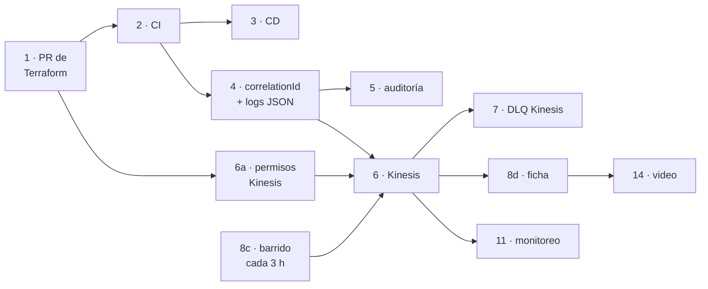
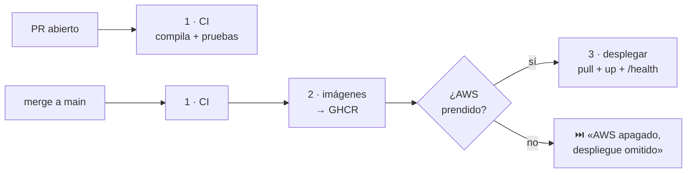
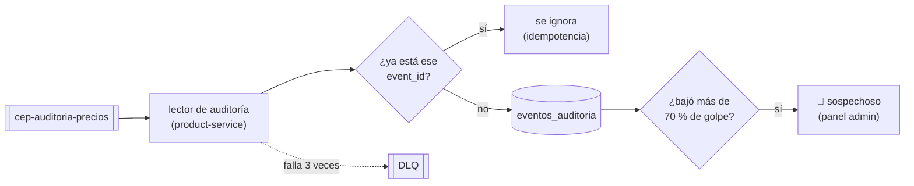
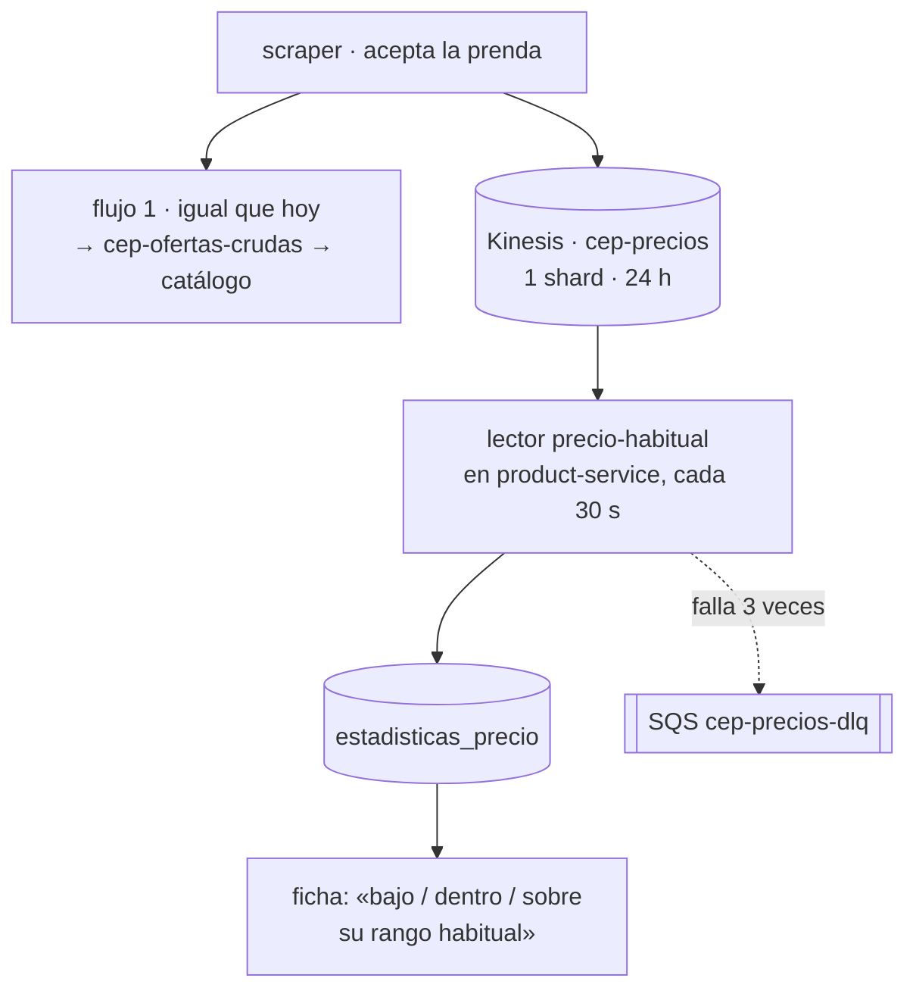
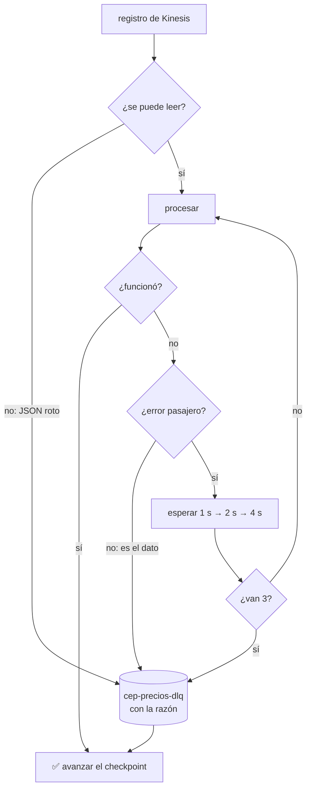
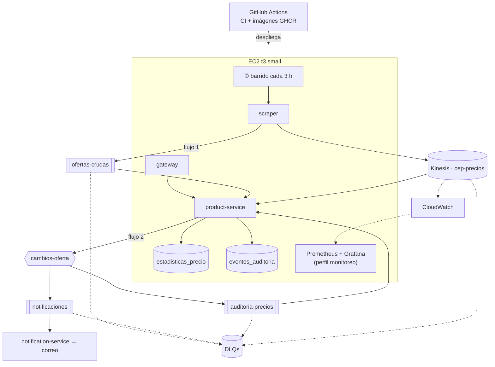

# Plan de la EFT: lo que falta construir y en qué orden

> **Qué es.** Qué hay que construir para la Evaluación Final Transversal, por qué cada pieza, cómo
> funciona y qué puede salir mal. Es la versión para el equipo del plan acordado el 16 y 17-11 (plan
> del 15-11 + issue [#49](https://github.com/Martinnnn-ops/cacha-el-precio/issues/49)).
> **Para quién.** Los tres. Las tareas sueltas, para tomarlas, están en [TAREAS](TAREAS.md).
> **Última revisión:** 19-11-2026.

> 📍 **En 10 segundos:** entrega el **miércoles 2-dic-2026 a las 17:00**. Primero se mergea
> **Terraform** y se arma el **CI/CD**. Después, cada pedido lleva un **correlationId** en logs
> JSON, la cola de auditoría que nadie leía pasa a guardar **todos los cambios de precio**, y
> **Kinesis** recibe cada precio capturado para calcular el **precio habitual**. **Kafka no va**
> (17-11). La EC2 sigue en `t3.small`, con **Prometheus + Grafana**. En paralelo: historial con
> **3 precios**, barrido automático y la ficha pulida. Todo se suma **al lado** de lo que ya
> existe, sin reescribir lo que funciona.

**Leyenda:** ✅ listo · 🟡 a medias · ⬜ falta · ⛔ bloquea lo que viene después · 🔎 por confirmar · ⏸️ después de la EFT · 🚫 no se hace

| Lo que pide la EFT | Qué hacemos | Sección |
|---|---|---|
| **Kinesis** (anuncio del profe, 10-11) | stream de precios capturados → precio habitual | [§5](#5--kinesis-los-precios-capturados) |
| ~~Kafka~~ | 🚫 descartado el 17-11: va solo Kinesis | [§10](#10--por-qué-cambió-el-plan) |
| «DLC» = **DLQ** 🔎 | las DLQ de SQS (ya existen) + la del lector de Kinesis | [§6](#6--los-mensajes-que-fallan-dlq) |
| Logs avanzados | `correlationId` + logs JSON | [§3](#3--correlationid-y-logs-en-json) |
| Trazabilidad e idempotencia (clase del 12-11) | lector de la cola de auditoría | [§4](#4--la-cola-de-auditoría-que-nadie-leía) |
| Módulos extra | CI/CD, 3 precios, ficha, Grafana, Terraform | [§2](#2--cicd-con-github-actions) · [§7](#7--historial-ficha-y-catálogo) · [§8](#8--la-ram-y-el-monitoreo) |

**Los entregables:** informe ejecutivo, informe técnico, repos de GitHub, diagramas y un **video de
10 a 15 minutos** que explique la aplicación completa (sin explicar código). **La defensa es
individual**: cada uno tiene que poder responder sobre cualquier pieza.

---

## Índice

1. [El orden](#1--el-orden)
2. [CI/CD con GitHub Actions](#2--cicd-con-github-actions)
3. [correlationId y logs en JSON](#3--correlationid-y-logs-en-json)
4. [La cola de auditoría que nadie leía](#4--la-cola-de-auditoría-que-nadie-leía)
5. [Kinesis, los precios capturados](#5--kinesis-los-precios-capturados)
6. [Los mensajes que fallan: DLQ](#6--los-mensajes-que-fallan-dlq)
7. [Historial, ficha y catálogo](#7--historial-ficha-y-catálogo)
8. [La RAM y el monitoreo](#8--la-ram-y-el-monitoreo)
9. [Cómo queda todo junto](#9--cómo-queda-todo-junto)
10. [Por qué cambió el plan](#10--por-qué-cambió-el-plan)
11. [Calendario](#11--calendario)

---

## 1 · El orden



**El camino crítico:** 1 → 6a → 6 → 8d, con el 8c corriendo en paralelo para tener datos. Si el 1
se atrasa, se atrasa todo.

| # | Qué | Qué trae | Estado |
|---|---|---|---|
| 1 | **PR de Terraform** (`feature/terraform` → `development`) | toda la infra se prende y apaga con un comando, en cualquier cuenta | 🟡 fases 0 a 7 hechas y probadas (17-11); falta revisar y mergear · ⛔ **bloquea casi todo**: Kinesis y los grupos de logs se escriben en Terraform |
| 2 | **CI** | pruebas automáticas en cada PR | ✅ 19-11 (`feature/cicd`) |
| 3 | **CD** solo desde `main` | desplegar sin hacerlo a mano; la EC2 deja de compilar | ✅ 19-11, probado en `731705830984` |
| 4 | **correlationId + logs JSON** | seguir un pedido de punta a punta | ✅ 28-11, `feature/trazabilidad`: logs JSON en los 4 servicios, `X-Correlation-Id` en el gateway, `correlationId` en el sobre de SQS, SNS y Kinesis; probado en la EC2 |
| 5 | **Lector de `cep-auditoria-precios`** | trazabilidad + idempotencia | ✅ 28-11: `ConsumidorAuditoria` + tabla `EventosAuditoria` (una vez por `eventId`, 🚩 si baja ≥70%) + DLQ; idempotencia probada mandando el mismo cambio dos veces. Panel: **«Seguir un barrido»** |
| 6a | Probar permisos de Kinesis en el Academy | saber si se puede antes de programar | 🔎 ⛔ bloquea el 6 |
| 6 | **Kinesis con los precios capturados** | el stream que pidió el profe | ⬜ |
| 7 | DLQ del lector de Kinesis | un precio roto no traba al resto | ⬜ |
| 8a–f | Limpiar catálogo, 3 precios, barrido, ficha, lo visual roto | lo que se ve en el video | 🟡 (§7) |
| 11 | **Prometheus + Grafana** | un tablero con servicios, EC2, Kinesis y SQS | ⬜ |
| 13–15 | Informes, video, ensayo | la entrega | ⬜ |

### Fuera de la EFT

| Qué | Por qué |
|---|---|
| 🚫 **Kafka** | descartado el 17-11; además ahorra ~1 GB de RAM y evita subir la EC2 |
| ⏸️ **Feed personalizado** | funcionalidad nueva entera que la rúbrica no pide |
| 🚫 **Rediseño visual completo** | a dos semanas, sin diseño definido; se arregla solo lo roto (8e) |
| ⏸️ **Kinesis para las visitas** | obligaría a cambiar un endpoint que funciona |
| ⏸️ **Más tiendas** | extra, solo si sobra tiempo |

---

## 2 · CI/CD con GitHub Actions

> ✅ **Hecho el 19-11.** Cómo quedó y cómo se usa: [CICD](CICD.md) y [ADR-034](adr/034-cicd-con-github-actions.md).
> Lo que cambió respecto de este plan: el frontend no lo publica `cd.yml`, sino Cloudflare desde el
> repo de Panditax; y el compose mantiene `build:` y suma `image:`, así `desplegar.sh` sigue igual.

**Para qué.** Van a entrar muchos PRs de tres personas. El **CI** compila y prueba cada PR solo: si
algo se rompe, queda en rojo **antes** de mergear. El **CD** lleva lo mergeado a la EC2 sin hacerlo
a mano. Reemplaza a Jenkins, que pedía ~1 GB de RAM.



| Paso | Cuándo | Qué hace | ¿AWS? |
|---|---|---|---|
| **CI** | cada PR y cada push a `development` y `main` | `dotnet test`, `pytest` y `ruff`, `npm run build` + `npm run humo` | no |
| **Imágenes** | al mergear a **`main`** | arma las imágenes y las sube a **GHCR** con el hash del commit | no |
| **Desplegar** | después de las imágenes | SSH a la EC2, baja las imágenes, las levanta y revisa `/health` | sí; si está apagado, **se salta sin fallar** |

📂 `.github/workflows/ci.yml` y `cd.yml`. Cambian `docker-compose.yml` (de `build:` a `image:`) y
`tools/desplegar.sh` (de compilar a `pull`).

| ⚠️ Riesgo | Cómo se evita |
|---|---|
| Los *secrets* del repo solo los cambia su dueño | `tf.sh` los sube si lo corre quien tiene acceso; si no, se despliega a mano como hoy |
| La EC2 no puede bajar imágenes privadas | un token de solo lectura en su `.env`, o paquetes públicos (no llevan secretos) |
| Minutos de Actions | 🔎 revisar la cuota de la cuenta |
| La llave SSH | un *secret* aparte; es del lab y muere con él |

---

## 3 · correlationId y logs en JSON

**El problema.** Un clic pasa por el gateway, product-service y quizás una cola, y cada uno escribe
logs **por separado y en texto suelto**. Con 50 pedidos a la misma hora no hay forma de saber qué
línea es de cuál.

**El `correlationId` es el número de seguimiento de un paquete.** El gateway se lo pega al pedido
apenas entra, viaja a cada servicio y a cada mensaje de cola, y **todo log del camino lo lleva**.
**El JSON** es el formato: campos con nombre, para poder filtrar.

```json
{"hora":"14:02:11","servicio":"product-service","nivel":"error","correlationId":"a7f3","mensaje":"timeout conectando a postgres"}
```

> **correlationId = poder seguir un pedido; JSON = poder buscarlo.** Juntos son los «logs
> avanzados» de la EFT.

| Dónde | Qué cambia |
|---|---|
| gateway | crea el id (o respeta el que llega en `X-Correlation-Id`) y lo devuelve en la respuesta |
| cada servicio .NET | logs en JSON con el id en el *scope* de cada pedido |
| los sobres de las colas | el id viaja como atributo del mensaje |
| scraper | logs en JSON y el id en cada `oferta.capturada` |

### Cómo quedó y cómo se muestra (28-11)

| Pieza | Qué hace |
|---|---|
| Logs JSON | `AddJsonConsole` en los 3 .NET y un formateador propio en el scraper: una línea por evento, con `correlationId` en el scope |
| Pedidos web | el gateway crea o respeta `X-Correlation-Id` (solo `[A-Za-z0-9._:-]`, hasta 128), lo devuelve y lo pasa a product-service |
| Barridos | el scraper crea `barrido-<tienda>-<fecha>` y lo pone en cada oferta (SQS) y cada precio (Kinesis); product-service lo copia a los cambios (SNS) |
| Trazas | tabla `Trazas` en product y notification: cuántas cosas hizo cada etapa con ese número |
| Panel | Mensajería › **Seguir un barrido**: línea de tiempo por etapa, cambios auditados con 🚩 y el comando para los logs |

**Lo que encontró (para contarlo en la defensa):** el 28-11, la línea de tiempo de un barrido de
Paris mostró 217 ofertas enviadas y 206 guardadas. Filtrando los logs por su `correlationId` apareció
la causa: descripciones de más de 2.000 caracteres (`22001`), mal clasificadas como error pasajero,
que llevaban **76 ofertas apartadas en la DLQ** sin que nadie lo notara. Arreglado: la descripción
se recorta a 2.000 caracteres y el `22001` va directo a la DLQ. Con el redrive, las ofertas
apartadas vuelven a entrar. Detalle en la [bitácora del 28-11](BITACORA.md).

**Demo en 3 pasos:**
1. `curl -H "X-Correlation-Id: demo-profe-001" -H "Version: 2.0" $API/productos/<slug> -D -` → la respuesta trae el mismo número.
2. En la EC2: `docker compose logs --no-log-prefix | grep demo-profe-001` → aparece en el gateway y en product-service.
3. Panel › Seguir un barrido → el último barrido, etapa por etapa (SQS → Kinesis → SNS → auditoría → avisos).

| ⚠️ Ojo | Cómo |
|---|---|
| Datos personales en los logs | nunca correos, tokens ni cuerpos de correo |
| Toca todos los `Program.cs` | hacerlo **antes** del 5 y el 6 |

---

## 4 · La cola de auditoría que nadie leía

**Qué pasaba.** En el EP3, SNS copia **todos** los cambios de oferta a `cep-auditoria-precios`,
para demostrar el reparto con reglas distintas. `topologia.json` dice que era para «revisar precios
sospechosos del scraper», pero **nunca se le hizo el lector**: los avisos se acumulan y SQS los
borra solos a los **4 días**.



Se copia el molde que ya existe: `ConsumidorOfertas` → `ConsumidorAuditoria`,
`ProcesadorOfertaCapturada` → `ProcesadorAuditoria`, y `ColaMensajesSqs` se reutiliza tal cual. Más
una migración con la tabla, una DLQ en `topologia.json` y la lista de sospechosos en el panel. 🔎 El
70% se ajusta mirando datos reales.

### Las dos idempotencias (para el informe técnico)

| | Qué evita | Dónde está |
|---|---|---|
| **Técnica** | que un mensaje repetido se procese dos veces | `(event_id, owner)` en notification-service · `event_id` único en `eventos_auditoria` |
| **De negocio** | que una regla se aplique dos veces aunque los mensajes sean distintos | el upsert con `(Store, ExternalId)` único: dos capturas iguales no crean dos productos |

---

## 5 · Kinesis, los precios capturados

**Por qué.** Lo pidió el profe el 10-11. Se usa donde tiene sentido: **muchos datos que valen poco
por separado y se procesan en lotes**. Los precios de 8 tiendas cada 3 horas son eso.

**¿No es lo mismo que la cola `cep-ofertas-crudas`?** No:

| | SQS `cep-ofertas-crudas` (ya existe) | Kinesis `cep-precios` (nuevo) |
|---|---|---|
| Para qué | **trabajo**: guardar cada oferta | **análisis**: estudiar cómo se mueven los precios |
| Al leer | el mensaje **se borra** | el dato **se queda** 24 h y otro lector puede releerlo |
| Cuántos leen | uno | los que quieran, cada uno con su marcador |
| Cómo | de a uno | en **lotes** |

**En simple, una autopista con peaje:** el **stream** es la autopista; el **shard**, un carril con
un máximo fijo (1.000 registros por segundo); la **partition key** decide el carril (aquí, tienda +
producto); el **sequence number** es el ticket de cada auto, y el **checkpoint** es el último ticket
que contaste, **y lo anotas tú**. Se paga **por carril y por hora**, se use o no.



| Pieza | Dónde |
|---|---|
| El stream y su alarma | `infra/terraform/cuenta/streaming.tf` (nuevo) |
| Quien escribe | el scraper, después de aceptar cada prenda |
| Quien lee | un servicio en segundo plano en product-service, con checkpoint en la base |

| ⚠️ Riesgo | Cómo se evita |
|---|---|
| Permisos del Academy 🔎 | **lo primero (6a):** crear el stream solo y un `put-record` desde la EC2 |
| **Cobra aunque la EC2 esté apagada** (~US$11/mes) | `tf.sh apagar` destruye el stream |
| Lector caído: los datos se borran a las 24 h | la alarma avisa; el precio igual quedó en el historial por el flujo 1 |
| Duplicados («al menos una vez») | recalcular estadísticas dos veces da lo mismo |

---

## 6 · Los mensajes que fallan: DLQ

La misma idea en todos lados: **apartar** el mensaje que no se puede procesar, para que no trabe al
resto, y **guardarlo con la razón** para revisarlo.

| DLQ | Estado |
|---|---|
| `cep-ofertas-crudas-dlq` y `cep-notificaciones-dlq` | ✅ desde el EP3, con diagnóstico en el panel |
| la del lector de auditoría | ⬜ (§4) |
| `cep-precios-dlq`, la del lector de Kinesis | ⬜ Kinesis **no trae DLQ propia**: la arma el lector |



**Prueba para la demo:** mandar un JSON roto al stream → aparece en la DLQ con su error en el
panel, y el registro siguiente sí se procesó.

---

## 7 · Historial, ficha y catálogo

Dos problemas de hoy: **nadie programa los barridos** en la EC2 (los días sin barrido quedan sin
datos para siempre) y **se guarda un solo precio**, el vigente.

| # | Qué | Cómo | Estado |
|---|---|---|---|
| 8a | **Limpiar el catálogo** de lo infantil y no-ropa que entró antes del PR #48 | `tools/limpiar-catalogo.py`, con respaldo antes ([EL-PROYECTO §9](EL-PROYECTO.md#9--el-catálogo-y-el-armario-personal)) | 🟡 el filtro está; falta correrlo con AWS prendido |
| 8b | **3 precios:** `price` (internet), `list_price` (el tachado) y `card_price` (con tarjeta) | columnas nuevas en `schema.sql`, cada `parser.py` llena lo que publique su tienda, y van en el sobre y en Kinesis. 🔎 Falabella hoy podría estar tomando el de CMR | ⬜ |
| 8c | **Barrido cada 3 h** | un `cep-barrido.timer` instalado por `desplegar.sh`, con `Persistent=true` (si estaba apagada, barre al prender) | ⬜ · ⛔ sin esto Kinesis tiene pocos datos |
| 8d | **Ficha pulida:** tachado, «rango habitual», gráfico con fechas, tabla de historial | frontend + `estadisticas_precio`; con menos de 14 días, «historial insuficiente» | 🟡 hay gráfico básico |
| 8e | Arreglar **lo visual roto** tras los merges | primero listar qué está roto | ⬜ |
| 8f | Que el front no caiga a **datos falsos** (`USAR_MOCK`) | revisar que el entorno publicado apunte a la API | 🔎 |

Los huecos del gráfico (cuando la EC2 estuvo apagada) se marcan **«sin datos»**, no se unen los
puntos.

---

## 8 · La RAM y el monitoreo

**Decisión del 17-11: se queda en `t3.small` (2 GB).** Kinesis lo corre AWS, los lectores nuevos
son tareas dentro de servicios que ya existen, el CI corre en GitHub y con el CD la EC2 deja de
compilar.

| Qué corre | RAM | ¿Va? |
|---|---|---|
| Caddy, Postgres, gateway, product, notification, scraper | ~0,8 GB (medido el 10-09) | ✅ |
| Prometheus + Grafana + exporters | ~0,4 GB 🔎 | ✅ |
| ~~Kafka + Kafka UI~~ | ~~1,0 GB~~ | 🚫 |
| **Total** | **~1,2 GB de 2 GB** | ✅ |

**Cómo se mantiene dentro:** el CD primero; el monitoreo en un **perfil aparte** (`monitoreo`) que
se prende solo para trabajar y para la demo; Prometheus con 3 días de retención y topes de RAM por
contenedor; medir con `docker stats` con todo prendido; si pasa de ~1,7 GB, un **swapfile** de 2 GB.
**Plan B:** `tipo_instancia = "t3.medium"` y `tf.sh subir`, con respaldo antes y leyendo que el plan
diga *in-place* y no *replace*.

| Herramienta | Qué hace | ¿Va? |
|---|---|---|
| Logs JSON + correlationId (§3) | seguir un pedido | ✅ es la base |
| **Prometheus** | **guarda** números en el tiempo | ✅ |
| **Grafana** | **dibuja** el tablero: servicios .NET, RAM y CPU de la EC2, Kinesis y SQS desde CloudWatch | ✅ por túnel SSH, nunca abierto a internet |
| Métricas de CloudWatch | las de Kinesis y SQS llegan solas; ahí vive la alarma | ✅ |
| CloudWatch Logs | juntar los logs de todos los contenedores | 🔎 si el Academy da permiso a `awslogs`; si no, quedan locales |
| Jenkins | no es monitoreo y pide ~1 GB | 🚫 el CI/CD es GitHub Actions |

---

## 9 · Cómo queda todo junto



| Pieza | Dónde vive | Quién la crea |
|---|---|---|
| CI, imágenes, despliegue | GitHub Actions + GHCR | `.github/workflows/` |
| Kinesis, DLQ nuevas, alarma, grupos de logs | AWS | **Terraform** |
| Prometheus, Grafana | Docker en la EC2 | `docker-compose.yml` |
| Lectores de auditoría y de Kinesis | product-service | C# |
| correlationId y logs JSON | todos los servicios | C# y Python |
| 3 precios, barrido, envío a Kinesis | scraper | Python |
| Ficha y arreglos visuales | frontend | Vue |

**Si preguntan por qué no Kafka en AWS:** MSK cuesta ~US$540/mes y no aparece en los permisos del
Academy. Kinesis con un shard cuesta ~US$11/mes y se apaga con `tf.sh apagar`.

---

## 10 · Por qué cambió el plan

El 16-11 la issue #49 («Roadmap post-EP3») se fusionó con el plan del 15-11, y el 17-11 se resolvió
en clase lo de Kafka:

| Tema | Issue #49 | Plan del 15-11 | Cómo quedó |
|---|---|---|---|
| Kafka | Kinesis **en vez de** Kafka | Kafka era la pieza central | ✅ **17-11: descartado, solo Kinesis** |
| Qué va por Kinesis | ofertas e historial | las visitas | **los precios capturados**: no obliga a cambiar el endpoint de visitas |
| Consumidor que guarda todo | trazabilidad | auditoría en Kafka | **lector de `cep-auditoria-precios`**, que ya existía |
| CloudWatch | opcional, es pagado | obligatorio | opcional, si el Academy deja |
| CI/CD | — | sin detalle | **completo**, desplegando solo desde `main` |
| Feed personalizado | nuevo | — | ⏸️ después de la EFT |
| Rediseño visual total | nuevo | pulir la ficha | 🚫 solo arreglar lo roto |
| RAM | — | `t3.medium` sí o sí | **se queda en `t3.small`** |

---

## 11 · Calendario

| Semana | Qué se cierra |
|---|---|
| **16 – 19 nov** | ✅ Terraform fases 6 y 7 · revisar y mergear el PR de Terraform · probar permisos de Kinesis y de logs |
| **20 – 22 nov** | CI · empezar limpieza del catálogo y los 3 precios |
| **23 – 25 nov** | CD con imágenes en GHCR · correlationId y logs JSON · barrido cada 3 h · el stream y el productor del scraper |
| **26 – 29 nov** | lector de auditoría · lector del precio habitual con su DLQ · ficha pulida y arreglos visuales · Prometheus + Grafana · grabar el video |
| **30 nov – 1 dic** | informes, diagramas, repaso y ensayo de la defensa |
| **mié 2 dic, 17:00** | 🎯 **entrega y presentación** |

Las fechas límite de cada tarea, para tomarlas, están en [TAREAS](TAREAS.md).

## Ver también

- [TAREAS](TAREAS.md): las tareas sueltas, para tomarlas
- [CONTEXTO](CONTEXTO.md): cómo está todo hoy
- [EVALUACIONES](EVALUACIONES.md): qué pide cada evaluación
