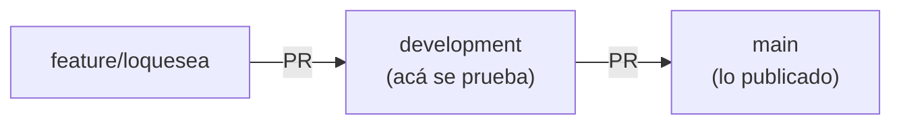

# Tareas

> **Qué es.** La bolsa de tareas pendientes hasta la EFT y las reglas para trabajar sin pisarse.
> **Para quién.** Los tres. El porqué de cada tarea está en [PLAN-EFT](PLAN-EFT.md).
> **Última revisión:** 18-11-2026. La historia del EP1 quedó en
> [HISTORIA](HISTORIA.md).

> 📍 **En 10 segundos:** **no hay dueños.** El que puede, toma una tarea 🟢, la pasa a 🟡 y la sube
> de inmediato para que nadie la duplique. Una rama por tarea, PR a `development`, y que lo revise
> otro. Entrega de la EFT: **miércoles 2-dic-2026 a las 17:00**.

**Leyenda:** 🟢 libre · 🟡 en curso · ✅ hecho · 🔴 espera otra tarea · ⏸️ después de la EFT

---

## Cómo funciona

1. **Tomas una tarea:** la pasas de 🟢 a 🟡 en esta tabla y la subes de inmediato. Eso es lo único
   que evita que dos personas hagan lo mismo.
2. **Miras la columna *Toca* antes de empezar.** Si otra tarea 🟡 toca los mismos archivos, hablas
   primero con quien la tiene.
3. **Trabajas en tu rama** (`feature/loquesea`), nunca directo en `development`.
4. **Al terminar:** ✅ aquí y dos líneas en la [bitácora](BITACORA.md).

**Lo que se atrasa no se borra:** se le pone fecha nueva o se decide que no se hace (⏸️).

---

## Camino a la EFT · 17-nov → 2-dic

### Base

| | Tarea | Toca | Límite |
|---|---|---|---|
| ✅ | ~~Terraform fases 0 a 7~~: toda la cuenta, `tools/tf.sh`, el DNS y la prueba en una cuenta vacía ([ADR-033](adr/033-terraform-para-la-infraestructura.md)) | `infra/terraform/`, `tools/` | 17-nov |
| ✅ | ~~El panel de mensajería solo mira~~ ([ADR-032](adr/032-administracion-de-mensajeria.md)) | `gateway/Mensajeria/`, `frontend/src/modules/admin/` | 17-nov |
| ✅ | ~~Docs ordenados y al día con Terraform~~: 10 documentos con el mismo estilo, README de servicios y `tests/` | `docs/`, los README | 18-nov |
| 🟢 | **Revisar y mergear el PR de `feature/terraform`** → `development` (lo revisa alguien que no lo escribió) | — | 20-nov |
| 🟢 | Sincronizar el frontend con el repo de Panditax (allá sigue «Administrar») | `frontend/` (subtree, [DESARROLLO](DESARROLLO.md#el-frontend-y-el-repo-de-panditax)) | antes de desplegar `www` |
| 🟢 | Quitar o justificar el código de crear/borrar que quedó sin rutas en el gateway | `gateway/Mensajeria/`, `tests/gateway.Tests/` | 2-dic |
| 🟢 | `respaldar.sh` también vuelca el esquema `notification` | `tools/respaldar.sh` | 2-dic |

### Protección y trazabilidad

| | Tarea | Toca | Límite |
|---|---|---|---|
| 🟢 | **CI** con GitHub Actions: compilar y probar cada PR | `.github/workflows/` | 22-nov |
| 🟢 | **CD**: imágenes en GHCR y despliegue **solo desde `main`**, si AWS está prendido | `.github/workflows/`, `docker-compose.yml`, `tools/desplegar.sh` | 25-nov |
| 🟢 | **correlationId** en los pedidos y los eventos, y **logs JSON** en todos los servicios | `Program.cs` de cada servicio, scraper | 25-nov |
| 🟢 | **Lector de `cep-auditoria-precios`**: guarda todos los cambios y marca los sospechosos | `product-service/`, `infra/mensajeria/topologia.json` | 27-nov |

### Kinesis

| | Tarea | Toca | Límite |
|---|---|---|---|
| 🟢 | Probar permisos del Academy: crear un stream y un `put-record` | `infra/terraform/sondeo/` | 20-nov |
| 🟡 | **Kinesis con los precios capturados**: stream en Terraform, envío desde el scraper y lector del precio habitual — `feature/ea3-kinesis-trazabilidad`. Código y pruebas listos (`streaming.tf`, productor del scraper, `LectorPrecios`, estadísticas + migración, 16 pruebas). **Falta correr el sondeo de permisos y desplegar con AWS prendido.** | `infra/terraform/cuenta/`, `scraper-service/`, `product-service/` | 28-nov |
| 🟡 | DLQ del lector de Kinesis — incluida en la rama de arriba: `cep-precios-dlq` en `topologia.json` y el envío desde `LectorPrecios` (definitivo + recuperable-agotado) | `infra/mensajeria/`, `product-service/` | 28-nov |

> El resto depende de la prueba de permisos del Academy (6a), que necesita AWS prendido.

### Historial, ficha y monitoreo

| | Tarea | Toca | Límite |
|---|---|---|---|
| 🟢 | Limpiar el catálogo con `tools/limpiar-catalogo.py` (lo que entró antes del PR #48), con respaldo antes | datos, con AWS prendido | 24-nov |
| 🟢 | Barrido automático cada 3 h en la EC2 | `tools/desplegar.sh` (timer) | 24-nov |
| 🟢 | Guardar 3 precios (normal, internet, tarjeta) para que aparezca el tachado | `scraper-service/`, `product-service/` | 26-nov |
| 🟢 | Ficha pulida (rango habitual, gráfico) y arreglar lo visual roto tras los merges | `frontend/` | 28-nov |
| 🟢 | **Prometheus + Grafana** (perfil `monitoreo`), midiendo la RAM con `docker stats` | `docker-compose.yml` | 29-nov |

### Cierre

| | Tarea | Toca | Límite |
|---|---|---|---|
| 🟢 | Video, informes y ensayo de la defensa individual | fuera del repo | 2-dic |
| ⏸️ | Feed personalizado, rediseño visual completo, más tiendas, Kafka | — | después de la EFT |

---

## Deuda que no entra en la EFT

| Qué | Por qué espera |
|---|---|
| Un gestor de secretos (Parameter Store o Secrets Manager) en vez de `.env` en la EC2 | calidad, no rúbrica |
| Emparejamiento entre tiendas por número de modelo ([ADR-022](adr/022-identidad-de-producto-entre-tiendas.md)) | el problema difícil del proyecto; necesita tiempo |
| Medir el emparejamiento sobre 30 prendas a mano | da un número real para el informe; si sobra tiempo, antes |
| Red privada y base gestionada | cuestan por hora ([ARQUITECTURA §7](ARQUITECTURA.md#7--despliegue-lo-que-hay-y-por-qué-difiere-del-diseño)) |
| Rotar el token de Cloudflare o ponerle vencimiento | después del 2-dic |

---

## Modo de trabajo

| Rama | Regla |
|---|---|
| `main` | protegida: **1 revisión**, sin force-push ni borrado. Con el CD, lo que entra aquí se despliega |
| `development` | sin aprobación obligatoria en GitHub, pero **nadie mergea su propio PR** (acuerdo entre nosotros) |

| Acuerdo | Por qué |
|---|---|
| Cada uno commitea lo suyo | la nota es individual: el historial es la evidencia de quién hizo qué |
| Nadie mergea su propio PR | un segundo par de ojos, y deja evidencia de revisión cruzada |
| Pasas la tarea a 🟡 antes de empezar | es lo único que evita el trabajo duplicado |
| Cero secretos en el repo | un secreto subido queda en el historial para siempre: se rota |
| Antes de pedir revisión, las comprobaciones de [DESARROLLO](DESARROLLO.md#comprobaciones-antes-de-un-pr) | hasta que exista el CI, es lo único que frena algo roto |

**Lo que va a revisar el CI** (cuando exista): que compile y pasen las pruebas, **gitleaks** (que no
se cuele un secreto), **Trivy** (vulnerabilidades en las imágenes) y **Dependabot**.

## Ver también

- [PLAN-EFT](PLAN-EFT.md): el porqué y el orden de cada tarea
- [CONTEXTO](CONTEXTO.md): el estado de hoy
- [BITACORA](BITACORA.md): lo que ya se hizo
