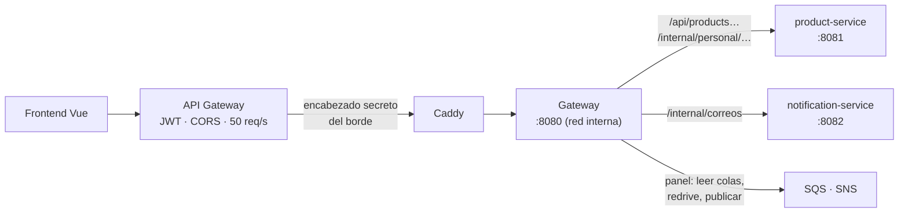
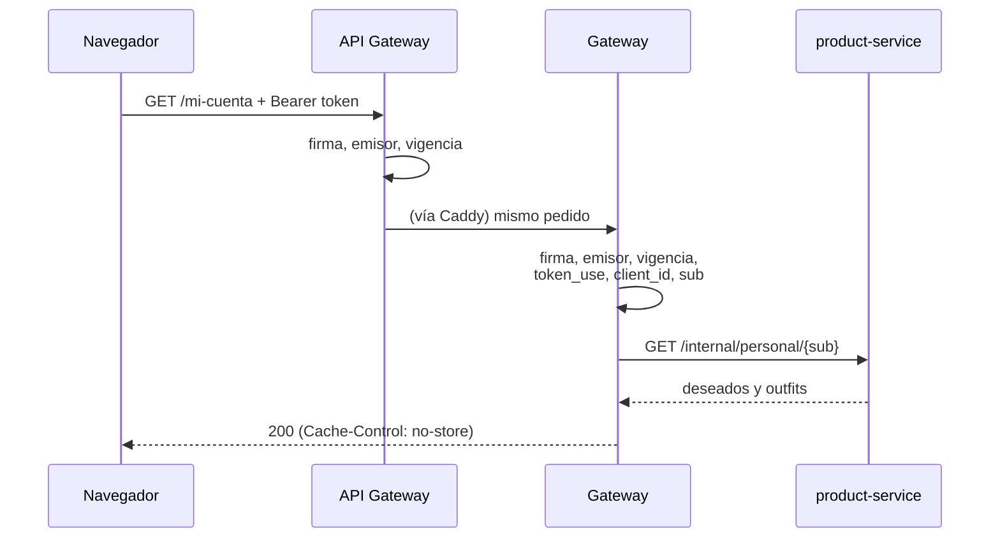
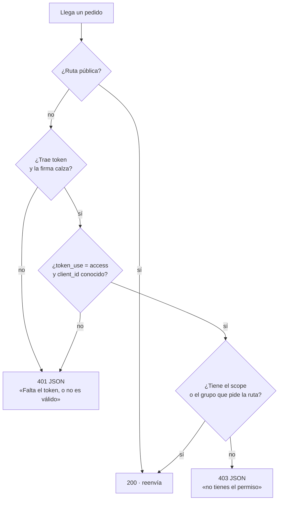
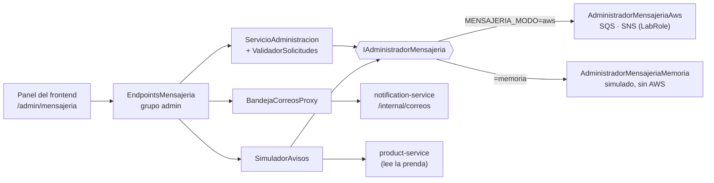

# Gateway · el BFF

> **Qué es.** La única puerta de la aplicación: todo lo que pide el frontend pasa por aquí antes de
> llegar a un servicio. Valida el token, decide quién puede qué y habla con el resto en la red
> interna.
> **Para quién.** El equipo y quien programe con IA en este módulo.
> **Última revisión:** 18-11-2026.

> 📍 **En 10 segundos:** ASP.NET Core 10. Recibe lo que el **API Gateway** deja pasar (vía Caddy),
> **vuelve a validar el JWT** de Cognito, publica el **contrato público en español**
> (`/productos`, `/mi-cuenta`, `/seguimiento`) y lo reenvía a **product-service**. Además lleva el
> **panel de mensajería** del EP3, que desde el 17-11 **solo mira**. No tiene base de datos propia.

**Leyenda:** ✅ funciona · 🟡 a medias · ⬜ falta · 🔎 por confirmar · 🚫 no se hace

---

## 1 · Dónde está en el sistema



El puerto `8080` del gateway **no se publica**: solo Caddy le habla por la red del compose. Y
Caddy responde **403** a quien llegue sin el encabezado que inyecta el API Gateway
([ADR-026](../docs/adr/026-encabezado-secreto-del-borde.md)), así que no hay camino que se salte el borde.

## 2 · Qué pasa con un pedido



El `sub` sale **del token**, nunca del navegador: nadie puede pedir el armario de otra persona
cambiando un número en la URL.

## 3 · Cómo decide 401, 403 o 200



| Comprobación | Con qué | Por qué |
|---|---|---|
| Firma, emisor y vigencia | metadata de `COGNITO_ISSUER` (JWKS en caché) | que el token sea de **nuestro** pool y esté vigente |
| `token_use = access` | evento `OnTokenValidated` | que nadie mande un `id_token` en su lugar |
| `client_id` en la lista | `COGNITO_CLIENT_IDS_VALIDOS` | el access token de Cognito **no trae `aud`**: se valida el cliente (detalle en [ARQUITECTURA §6](../docs/ARQUITECTURA.md#6--seguridad-e-identidad)) |
| Scope `ingesta` | política `product-write` | solo el scraper escribe en el catálogo |
| Grupo `admin` | `RequireRole("admin")` sobre `cognito:groups` | el panel y el diagnóstico |

El API Gateway ya validó lo mismo en el borde. Se repite aquí por **defensa en profundidad**: si
algo llega por otro camino, el servicio sigue protegido.

## 4 · Las rutas

El **contrato público es el de este servicio, en español** ([ADR-021](../docs/adr/021-contrato-publico-en-el-bff.md)).
El navegador nunca ve el nombre de un servicio interno.

| Ruta | Acceso | Va a |
|---|---|---|
| `GET /productos` · `/productos/{id}` · `/productos/{slug}` | pública | product-service `/api/products…` |
| `GET /catalogos` | pública | **arma** las categorías reales con su conteo (la única que transforma datos) |
| `POST /productos/{id}/visitas` | **pública** | suma una visita; no acepta cuerpo ni devuelve datos |
| `POST` · `PUT` · `DELETE /productos` | scope `ingesta` | product-service |
| `GET /mi-cuenta` · `PUT`/`DELETE /mi-cuenta/deseados/{id}` · `PUT`/`DELETE /mi-cuenta/outfits/{uuid}` | con sesión | product-service `/internal/personal/{sub}` ([ADR-028](../docs/adr/028-armario-personal-y-politica-catalogo.md)) |
| `GET /seguimiento` · `POST`/`DELETE /seguimiento/{id}` | con sesión | alias de los deseados, para el frontend viejo |
| `GET /api/yo` | con sesión | muestra los claims del token (para la demo) |
| `GET /api/admin/diagnostico` | grupo `admin` | prueba de que el grupo viaja en el token |
| `/api/admin/mensajeria/…` | grupo `admin` | el panel (§5) |
| `GET /health` | pública | sonda |

**Versiones.** Sin encabezado se usa `Version: 1.0`. Con `Version: 2.0`, pedir un producto por id
devuelve un **302** a su URL legible (`/productos/{slug}`): el gateway reescribe el `Location`
interno para que no se filtre `/api/products`.

**Errores.** 401 y 403 salen como JSON con `estado`, `error`, `mensaje` y `ruta`. Si
product-service no responde, **502** JSON. `/mi-cuenta`, `/seguimiento` y `/api/admin` van con
`Cache-Control: no-store`.

## 5 · El panel de mensajería

Lo pidió el EP3 ([ADR-032](../docs/adr/032-administracion-de-mensajeria.md)). Vive en
`Mensajeria/` y **nunca toca el SDK de AWS directamente**: todo pasa por `IAdministradorMensajeria`.



| Qué puede hacer | Ruta bajo `/api/admin/mensajeria` |
|---|---|
| Ver colas, una cola y sus mensajes | `GET /colas` · `/colas/{nombre}` · `/colas/{nombre}/mensajes` |
| Devolver una DLQ a su cola | `POST /colas/{nombre}/redrive` |
| Ver tópicos, suscripciones y la topología | `GET /topicos` · `/suscripciones` · `/topologia` |
| Ver los correos generados | `GET /correos` · `/correos/{id}` · `/correos/ejemplo/{tipo}` |
| Simular un aviso de cambio de precio | `POST /simular-aviso` |

> ⚠️ **Desde el 17-11-2026 el panel no crea ni borra colas, tópicos ni reglas.** Eso es de
> Terraform (`infra/mensajeria/topologia.json` + `tools/tf.sh subir`); las rutas de escritura
> responden 404/405. Los métodos de crear y borrar siguen en `ServicioAdministracion` sin ruta que
> los llame: deuda anotada en [CONTEXTO](../docs/CONTEXTO.md#deuda-abierta).

Contrato, errores y ejemplos en [MENSAJERIA](../docs/MENSAJERIA.md#administración-t11); casos
válidos e inválidos para la demo en [`Mensajeria.http`](Mensajeria.http).

## 6 · Las carpetas

| Carpeta / archivo | Qué hay |
|---|---|
| `Program.cs` | autenticación, políticas, rutas públicas y privadas, y el proxy |
| `Services/ProductServiceProxy.cs` | el reenvío a product-service, el 502 y la reescritura del `Location` |
| `Mensajeria/` | el panel: endpoints, servicio, validador, las dos implementaciones, bandeja y simulador |
| `Mensajeria.http` | la demo del panel, con casos que deben fallar |
| `../tests/gateway.Tests/` | pruebas del panel, el validador, el conteo del redrive y una contra AWS real |

## 7 · Configuración

| Variable | Para qué |
|---|---|
| `PRODUCT_URL` | dónde está product-service (`http://product-service:8081` en el compose) |
| `NOTIFICATION_URL` | dónde está notification-service, para la bandeja de correos |
| `COGNITO_ISSUER` | el emisor de los tokens: `https://cognito-idp.us-east-1.amazonaws.com/<pool>` |
| `COGNITO_CLIENT_IDS_VALIDOS` | los `client_id` aceptados, separados por coma |
| `COGNITO_WRITE_SCOPE` | el scope que permite escribir el catálogo (`…/ingesta`) |
| `MENSAJERIA_MODO` | `aws` en la EC2 · `memoria` en local, simulado y sin AWS |
| `MENSAJERIA_SEMILLA` | en modo memoria, si parte con colas de ejemplo (por defecto sí) |
| `TOPOLOGIA_RUTA` | opcional; por defecto `infra/mensajeria/topologia.json` |

Los valores de Cognito los escribe `tools/tf.sh` en `cognito.env`, fuera del repo.

## 8 · Correr y probar

```bash
PRODUCT_URL=http://localhost:8081 MENSAJERIA_MODO=memoria dotnet run --project gateway/Gateway.csproj
dotnet test tests/gateway.Tests        # sin AWS; la de AWS real solo corre con CEP_AWS_REAL=1
```

El resto de las comprobaciones antes de un PR, en [DESARROLLO](../docs/DESARROLLO.md).

## 9 · Deuda conocida

| | Qué | Por qué importa |
|---|---|---|
| 🟡 | Las rutas en español son **reenvío puro**, salvo `/catalogos` | el aislamiento es del nombre, no de la forma de los datos ([ADR-021](../docs/adr/021-contrato-publico-en-el-bff.md)) |
| 🟡 | Código de crear y borrar del panel sin ruta | o se borra, o se justifica para el modo memoria |
| ⬜ | Sin `correlationId` ni logs en JSON | entra en el camino a la EFT ([PLAN-EFT](../docs/PLAN-EFT.md)) |

## Ver también

- [ARQUITECTURA](../docs/ARQUITECTURA.md): dónde encaja el BFF y la seguridad completa
- [MENSAJERIA](../docs/MENSAJERIA.md): flujos, sobres y el panel
- [product-service](../product-service/README.md): a quién le reenvía
