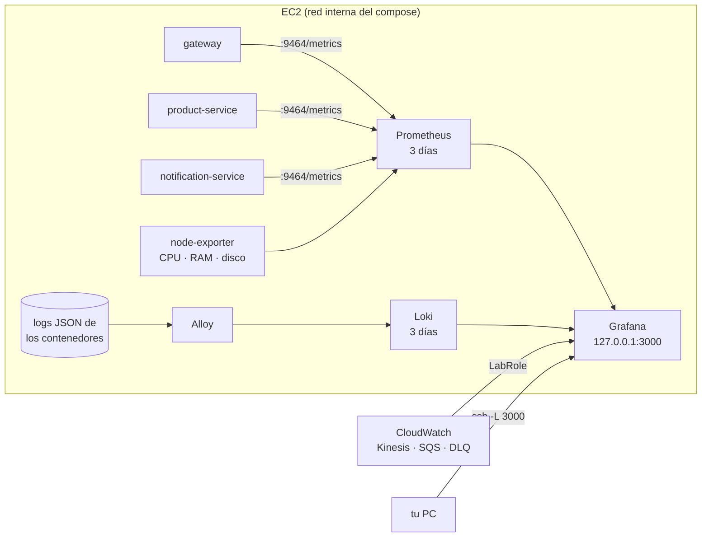

# Monitoreo · Prometheus, Grafana y Loki

> **Qué es.** La configuración del monitoreo: qué números se guardan, dónde van los logs y el
> tablero de Grafana. Todo corre en la misma EC2, con el perfil `monitoreo` del compose.
> **Para quién.** El equipo, para la demo de la EFT y para mirar la EC2 cuando algo anda raro.
> **Última revisión:** 28-11-2026.

> 📍 **En 10 segundos:** `docker compose --profile monitoreo up -d` levanta 5 contenedores.
> **Prometheus** guarda los números de los servicios .NET y de la EC2, **Loki** guarda los logs,
> **Alloy** lleva los logs a Loki y **Grafana** lo dibuja todo en un solo tablero, sumando Kinesis y
> SQS desde CloudWatch. Nada queda abierto a internet: Grafana se ve por **túnel SSH**. La decisión
> y sus costos están en [ADR-036](../../docs/adr/036-monitoreo-prometheus-grafana-loki.md).

**Leyenda:** ✅ funciona · 🟡 a medias · ⬜ falta · 🔎 por confirmar · 🚫 no se hace

---

## 1 · Dónde está en el sistema



| Pieza | Qué hace | Tope de RAM | Medido (28-11) |
|---|---|---|---|
| Prometheus | Cada 15 s lee `/metrics` y lo guarda 3 días | 256 MB | ~100 MB |
| node-exporter | La EC2 misma: CPU, RAM, disco, red | 64 MB | ~15 MB |
| Loki | Guarda los logs 3 días | 256 MB | ~100 MB |
| Alloy | Lee los logs de los contenedores y les pone `servicio` y `nivel` | 192 MB | ~90 MB |
| Grafana | El tablero; fuentes y tablero se cargan solos | 512 MB | ~375 MB |

---

## 2 · El tablero «Cacha el Precio · salud»

| Fila | Qué muestra | Para la demo |
|---|---|---|
| Resumen | servicios arriba, errores 5xx de la última hora, RAM y disco de la EC2 | el estado de un vistazo |
| Los servicios | peticiones/s, **códigos del gateway (200 / 401 / 403 / 5xx)**, latencia p95, el BFF hacia atrás, RAM de cada servicio | al correr las llamadas del borde se ven aparecer los 401 y 403 |
| El negocio | pasos de `RegistroTrazas`, **repetidos descartados** (idempotencia), cómo terminó cada mensaje de cola | la idempotencia trabajando |
| La EC2 | CPU, RAM usada contra total, red | por qué `t3.medium` |
| AWS | precios entrando a Kinesis, atraso del lector (alarma a 1 h), mensajes en cola, **DLQ** | el stream y la DLQ en vivo |
| Logs | **pegar un `correlationId`** y ver su recorrido; líneas por servicio; errores y advertencias | un barrido seguido de punta a punta |

El `correlationId` se pega en la caja de arriba: el de un pedido (cabecera `X-Correlation-Id`) o el
de un barrido (`barrido-paris-20261128T000012Z`). Por dentro es `{servicio=~".+"} |= "<id>"`.

---

## 3 · Las carpetas

| Archivo | Qué es |
|---|---|
| `prometheus.yml` | a quién le pide `/metrics` (los 3 servicios en el 9464 y node-exporter) |
| `loki.yml` | Loki en un solo proceso, disco local, borra a las 72 h |
| `config.alloy` | descubre los contenedores del proyecto `cachaelprecio` y les saca `nivel` del JSON |
| `grafana/provisioning/` | las 3 fuentes (Prometheus, Loki, CloudWatch) y dónde está el tablero |
| `grafana/tableros/cacha-el-precio.json` | el tablero. Si lo mejoras en la interfaz, expórtalo como JSON y commitéalo aquí |

---

## 4 · Correr y probar

**En tu PC:**

```bash
docker compose --profile monitoreo up -d          # todo + monitoreo
# http://localhost:3000  ·  admin / la GRAFANA_CLAVE del .env (vacía = admin)
docker compose --profile monitoreo stop prometheus node-exporter loki alloy grafana
```

Sin AWS en el `.env`, la fila de CloudWatch queda vacía y el resto funciona igual.

**En la EC2:** ver [OPERAR-EN-AWS · El monitoreo](../../docs/OPERAR-EN-AWS.md#el-monitoreo).

**Comprobar que `/metrics` no sale a internet:** `curl -i https://api.cacha-el-precio.com/metrics`
tiene que dar **404**. Las métricas solo existen en el puerto 9464 de la red interna.

---

## 5 · Deuda conocida

| | Qué | Por qué no está |
|---|---|---|
| ⬜ | Métricas del scraper | corre cada 3 h; sus números ya se ven en Kinesis y en las etapas de product-service |
| ⬜ | Alertas en Grafana | la única alarma (atraso de Kinesis) vive en CloudWatch, por Terraform |
| 🔎 | CloudWatch desde la EC2 | depende de que el `LabRole` deje `cloudwatch:GetMetricData`; probar en la primera subida |

---

## Ver también

- [ADR-036](../../docs/adr/036-monitoreo-prometheus-grafana-loki.md): por qué así y lo que cuesta
- [PLAN-EFT §8](../../docs/PLAN-EFT.md#8--la-ram-y-el-monitoreo): la RAM y el monitoreo en el plan
- [OPERAR-EN-AWS · El monitoreo](../../docs/OPERAR-EN-AWS.md#el-monitoreo): prenderlo y entrar por túnel
