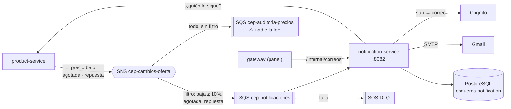
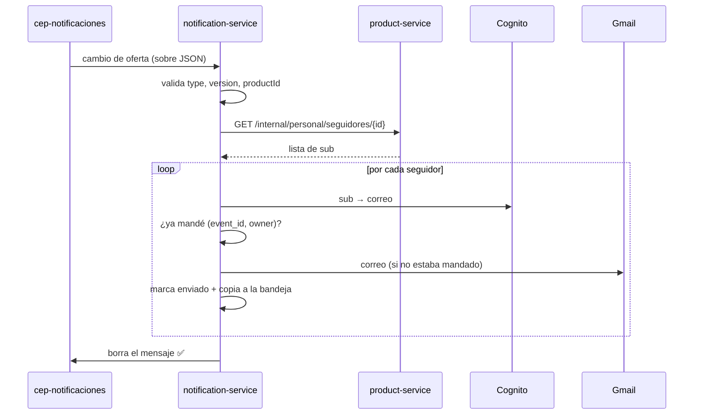

# Notification Service · los avisos por correo

> **Qué es.** El servicio que avisa por correo a quien sigue una prenda cuando **baja de precio**,
> se **agota** o se **repone**.
> **Para quién.** El equipo y quien programe con IA en este módulo.
> **Última revisión:** 18-11-2026.

> 📍 **En 10 segundos:** ASP.NET Core 10, consumidor del **flujo 2** de la mensajería. Lee la cola
> **`cep-notificaciones`** (que se llena desde SNS con un filtro), pregunta a product-service
> **quién sigue la prenda**, traduce cada usuario a su correo con **Cognito** y manda un correo por
> persona **sin repetir nunca**. Guarda en su esquema `notification` qué avisos ya mandó y una
> bandeja con los últimos 50 correos para el panel.

**Leyenda:** ✅ funciona · 🟡 a medias · ⬜ falta · 🔎 por confirmar · 🚫 no se hace

---

## 1 · Dónde está en el sistema



## 2 · Qué hace con cada mensaje



El mensaje se borra **recién cuando todos quedaron enviados o saltados**. Si se cae a la mitad, el
reintento no repite a quien ya recibió: la marca `(event_id, owner)` en `notificaciones_enviadas`
lo impide. Eso es la **idempotencia** del flujo.

## 3 · Los errores

| Tipo | Ejemplos | Qué hace |
|---|---|---|
| **Recuperable** | base, Cognito o product-service caídos; Gmail no responde; timeout | no borra el mensaje: reaparece a los 60 s |
| **Recuperable agotado** | el mismo error en el **último** intento (el `maxReceiveCount` de la cola) | lo aparta en la DLQ con `error-type=recuperable-agotado` y la causa, para verlo en el panel |
| **Definitivo** | JSON roto, `type` o `version` desconocidos, sin `productId` | a la DLQ con atributos de diagnóstico, sin gastar reintentos |
| **Dirección inválida** | SMTP 550/553 | salta a esa persona y sigue con el resto |

Detalle y ejemplos de sobres en [MENSAJERIA](../docs/MENSAJERIA.md).

## 4 · La bandeja de correos

Cada correo generado se copia en `notification.correos_generados` (los últimos 50), con el
destinatario enmascarado. Así el panel de mensajería los muestra **aunque el servicio corra con
`CORREO_MODO=log`**, sin mandar nada de verdad. Si la copia falla, el aviso igual cuenta como
enviado.

| Ruta (red interna) | Para qué |
|---|---|
| `GET /internal/correos` · `/internal/correos/{id}` | la bandeja |
| `GET /internal/correos/ejemplo/{tipo}` | un correo de muestra con una prenda inventada |
| `GET /internal/diagnostico/seguidores/{productId}` | probar la cadena prenda → seguidores → correos (solo en Development) |
| `GET /health` | sonda |

## 5 · Las carpetas

| Carpeta | Qué hay |
|---|---|
| `Consumidor/` | `ConsumidorNotificaciones`: el bucle de long polling, el borrado y la DLQ |
| `Service/` | `ServicioNotificaciones`: el trabajo de un mensaje (validar → seguidores → correos → enviar) |
| `Mensajeria/` | `IColaMensajes` y su versión SQS: el negocio no habla con el SDK |
| `Correo/` | `IEnviadorCorreo` (`smtp` con MailKit o `log`), las plantillas y las rutas de la bandeja |
| `Seguidores/` | el cliente a product-service y `sub → correo` con Cognito (o una lista fija en local) |
| `Repository/` | la marca de enviados y la bandeja |
| `Data/` · `Migrations/` | el esquema `notification`, aplicado con `Migrate()` al arrancar |
| `../tests/notification-service.Tests/` | consumidor y bandeja, todo con dobles en memoria: sin AWS, Gmail ni base |

## 6 · Configuración

| Variable | Para qué |
|---|---|
| `ConnectionStrings__PostgreSql` | PostgreSQL con `Search Path=notification,public` |
| `PRODUCT_URL` | dónde preguntar por los seguidores |
| `COGNITO_USER_POOL_ID` · `AWS_REGION` | `sub → correo`; sin pool usa `CorreosPrueba` de la configuración |
| `SQS_NOTIFICACIONES_URL` · `SQS_NOTIFICACIONES_DLQ_URL` | la cola y su DLQ; vacías = el consumidor no arranca |
| `CORREO_MODO` | `log` (solo registra) o `smtp` (Gmail de verdad) |
| `SMTP_USUARIO` · `SMTP_CLAVE` | cuenta de Gmail y contraseña **de aplicación**; obligatorias con `smtp` |
| `SITIO_URL` | la base del enlace «Ver el detalle» del correo |

## 7 · Correr y probar

```bash
docker compose up -d postgres product-service notification-service
curl -s localhost:8082/health                     # Healthy
dotnet test tests/notification-service.Tests
```

Sin cola configurada el consumidor no arranca, y es lo normal en local. Para ver un correo sin AWS:
`CORREO_MODO=log` y el `sub` de un usuario de prueba en `CorreosPrueba`
(`appsettings.Development.json`).

## 8 · Deuda conocida

| | Qué | Por qué importa |
|---|---|---|
| 🟡 | `tools/respaldar.sh` no vuelca el esquema `notification` | quien sigue una prenda la deja de seguir al migrar de cuenta |
| ⬜ | Sin `correlationId` | no se puede seguir un aviso desde el scraper hasta el correo ([PLAN-EFT](../docs/PLAN-EFT.md)) |

## Ver también

- [MENSAJERIA](../docs/MENSAJERIA.md): el contrato del flujo 2
- [ADR-029](../docs/adr/029-mensajeria-sqs-sns.md) y [ADR-030](../docs/adr/030-notification-service.md): por qué existe así
- [product-service](../product-service/README.md): quién publica los cambios
