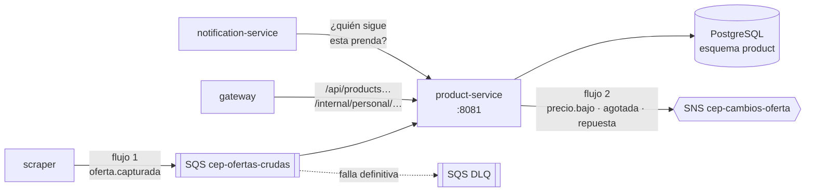
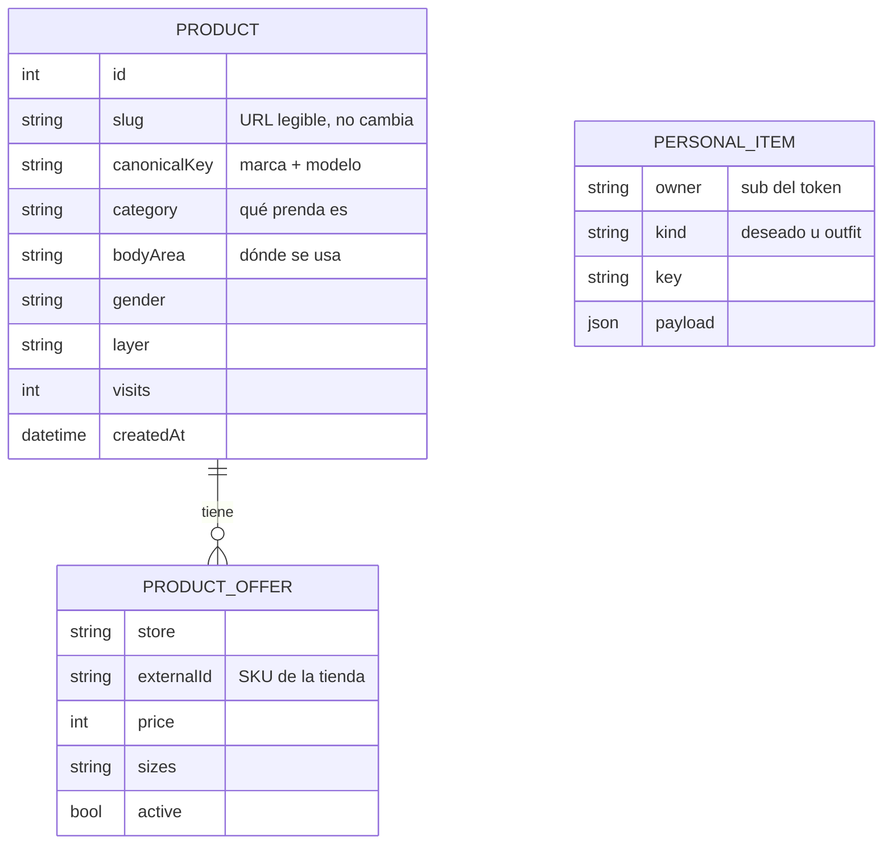
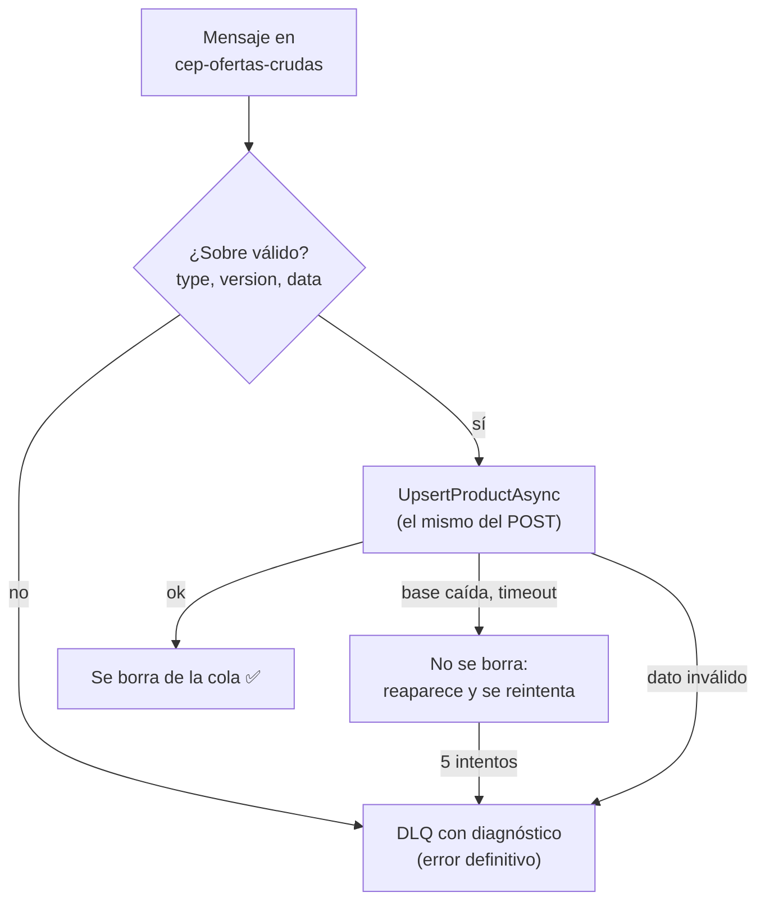

# Product Service · el catálogo

> **Qué es.** El dueño del catálogo que ve la gente: cada producto con las ofertas de cada tienda,
> el armario personal de cada usuario y los avisos de cambio de precio.
> **Para quién.** El equipo y quien programe con IA en este módulo.
> **Última revisión:** 18-11-2026.

> 📍 **En 10 segundos:** ASP.NET Core 10 + EF Core sobre **PostgreSQL, esquema `product`**.
> Recibe las ofertas del scraper por la **cola `cep-ofertas-crudas`** (o por HTTP), las agrupa por
> modelo (`canonicalKey`) y, cuando una oferta que ya existía **baja, se agota o se repone**,
> publica el cambio en **SNS `cep-cambios-oferta`**. Nadie del exterior le habla directo: todo
> entra por el gateway.

**Leyenda:** ✅ funciona · 🟡 a medias · ⬜ falta · 🔎 por confirmar · 🚫 no se hace

---

## 1 · Dónde está en el sistema



## 2 · El modelo: un producto, varias ofertas



| Regla | Por qué |
|---|---|
| `(Store, ExternalId)` es único | repetir el mismo `POST` **actualiza**, no duplica: la ingesta es idempotente |
| `canonicalKey` agrupa el mismo modelo entre tiendas | si no viene, se deriva del nombre quitando género, color y talla. Es una heurística ([ADR-025](../docs/adr/025-catalogo-multi-oferta-postgresql.md)) |
| Una tienda con varios SKU del mismo modelo se muestra como **una** oferta | el menor precio disponible y la unión de tallas, para no parecer dos tiendas |
| `slug`, `visits` y `createdAt` **no se aceptan** en la petición | el slug es identidad pública; las visitas solo suben de a una con un `UPDATE … + 1` atómico; la fecha la pone el servicio en UTC |
| Los campos de categoría son **texto abierto** | una categoría nueva legítima no bloquea la ingesta |
| Lo infantil se **rechaza** al entrar y se **oculta** al leer | política del catálogo ([ADR-028](../docs/adr/028-armario-personal-y-politica-catalogo.md)) |

El **historial de precios no vive aquí**: es del scraper (`scraper.price_history`). Este servicio
guarda el estado actual.

## 3 · Flujo 1: cómo entra una oferta



`ConsumidorOfertas` hace el bucle; `ProcesadorOfertaCapturada` decide qué es error recuperable y
qué es definitivo. Sin `SQS_OFERTAS_CRUDAS_URL` el consumidor no arranca (lo normal en local).

## 4 · Flujo 2: cuándo publica un cambio

Al guardar una oferta **que ya existía**, `DecisionCambiosOferta` compara lo guardado con lo que
llega. Es una función pura, sin base ni AWS, para poder probarla sola
([ADR-031](../docs/adr/031-publicacion-cambios-oferta.md)).

| Lo que pasó | Evento | Va con |
|---|---|---|
| El precio bajó | `precio.bajo` | precio anterior, nuevo y % de descuento |
| Estaba disponible y ya no | `oferta.agotada` | último precio |
| No estaba y volvió | `oferta.repuesta` | precio |
| Oferta nueva o el precio subió | nada | — |

Publica **todos** los cambios. El que decide cuáles merecen correo es el **filtro del tópico**
(bajas de 10% o más, agotados y reposiciones). Sin `SNS_CAMBIOS_OFERTA_ARN`, solo los escribe en el
log. Contrato completo en [MENSAJERIA](../docs/MENSAJERIA.md).

## 5 · Las rutas

Todas piden el encabezado `Version: 1.0` (o `2.0` donde se indica). Desde fuera se llega por el
gateway, que las publica en español.

| Método | Ruta | Resultado |
|---|---|---|
| GET | `/api/products` | productos con sus ofertas |
| GET | `/api/products/{id}` | un producto · con `Version: 2.0`, **302** a su slug |
| GET | `/api/products/{slug}` | un producto por su URL legible (`Version: 2.0`) |
| GET | `/api/products/by-category/{c}` · `/by-price/{p}` · `/by-size/{t}` | filtros |
| POST | `/api/products` | upsert idempotente; `200` |
| PUT · DELETE | `/api/products/{id}` | actualizar (`204`) o borrar con sus ofertas |
| POST | `/api/products/{id}/visits` | +1 visita; `204` o `404` |
| GET · PUT · DELETE | `/internal/personal/{owner}/…` | deseados y outfits de un usuario; el `owner` lo pone el gateway desde el token |
| GET | `/internal/personal/seguidores/{productId}` | quién sigue una prenda (lo usa notification-service) |
| GET | `/health` | sonda |

En desarrollo también están `/openapi/v1.json` y `/scalar/v1`.

## 6 · Las carpetas

| Carpeta | Qué hay |
|---|---|
| `Controllers/` | `ProductController` (catálogo) y `PersonalController` (armario, en la red interna) |
| `Service/` · `Repository/` | la lógica del upsert y el acceso a EF |
| `Models/Domain/` | `ProductIdentity` (cómo se arma el `canonicalKey`) y `CatalogPolicy` (qué no entra) |
| `Mensajeria/` | consumidor del flujo 1, decisión y publicadores del flujo 2, todo tras interfaces |
| `Data/` · `Migrations/` | el `DbContext` y las migraciones de EF, que se aplican solas al arrancar |
| `../tests/product-service.Tests/` | consumidor, decisión de cambios y publicación de eventos |

## 7 · Configuración

| Variable | Para qué |
|---|---|
| `ConnectionStrings__PostgreSql` | PostgreSQL con `Search Path=product,public` |
| `SQS_OFERTAS_CRUDAS_URL` · `SQS_OFERTAS_CRUDAS_DLQ_URL` | la cola del flujo 1 y su DLQ; vacías = sin consumidor |
| `SNS_CAMBIOS_OFERTA_ARN` | el tópico del flujo 2; vacío = solo log |
| `AWS_REGION` | la región (`us-east-1`) |

## 8 · Correr y probar

```bash
dotnet run --project product-service/Product-Service.csproj --launch-profile http   # :8081
dotnet test tests/product-service.Tests
```

**Todo cambio de esquema va por una migración de EF Core**, nunca un `ALTER` a mano. Los comandos
de migraciones y el resto de las comprobaciones antes de un PR están en
[DESARROLLO](../docs/DESARROLLO.md#migraciones-de-base-de-datos).

## 9 · Deuda conocida

| | Qué | Por qué importa |
|---|---|---|
| ⬜ | Guardar los **3 precios** (normal, internet, tarjeta) | sin eso la ficha nunca muestra el precio tachado |
| ⬜ | Leer la cola **`cep-auditoria-precios`**, que hoy nadie consume | trazabilidad para la EFT ([PLAN-EFT](../docs/PLAN-EFT.md)) |
| 🟡 | El emparejamiento entre tiendas es una heurística por nombre | une o separa modelos mal a veces ([ADR-022](../docs/adr/022-identidad-de-producto-entre-tiendas.md)) |

## Ver también

- [ARQUITECTURA](../docs/ARQUITECTURA.md): quién es dueño de qué dato
- [MENSAJERIA](../docs/MENSAJERIA.md): los sobres y los errores
- [scraper-service](../scraper-service/README.md): de dónde vienen las ofertas
