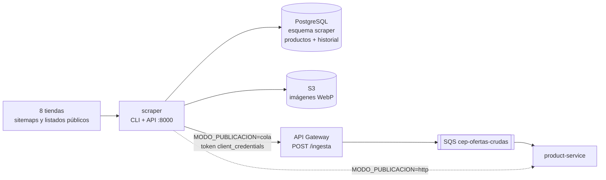
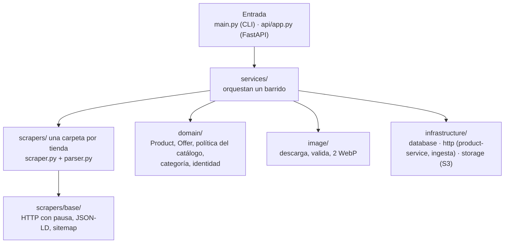
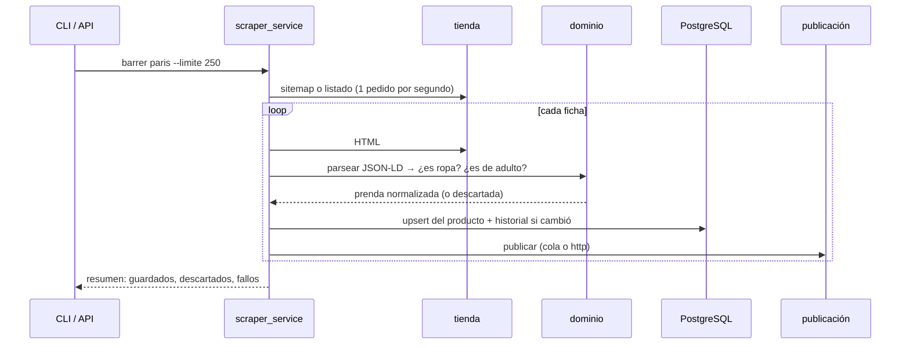

# Scraper Service · la captura de precios

> **Qué es.** El servicio que visita las tiendas, saca nombre, precio, tallas e imagen de cada
> prenda, guarda el **historial de precios** y le entrega el catálogo a product-service.
> **Para quién.** El equipo y quien programe con IA en este módulo.
> **Última revisión:** 18-11-2026. Absorbe lo que estaba en `README.arquitectura.md` y
> `CONVERS.md` (ver el [historial de git](#ver-también)).

> 📍 **En 10 segundos:** Python 3.14 + FastAPI. Un **CLI** (`scrapper barrer <tienda>`) recorre los
> sitemaps o listados públicos de **8 tiendas**, lee los datos por **JSON-LD y Open Graph** (no por
> CSS), descarta lo que no es ropa o es infantil, sube las imágenes a **S3** como WebP, guarda en
> PostgreSQL (**esquema `scraper`**, con el historial) y publica cada prenda: por la **cola** del
> API Gateway (`MODO_PUBLICACION=cola`) o directo por HTTP. Una **API mínima** permite lanzar un
> barrido sin entrar a la máquina.

**Leyenda:** ✅ funciona · 🟡 a medias · ⬜ falta · 🔎 por confirmar · 🚫 no se hace

---

## 1 · Dónde está en el sistema



Con `cola`, si product-service está caído **las prendas esperan en la cola** en vez de perderse
(flujo 1 del EP3). El token lo saca con el client `scraper` de Cognito y **solo trae el scope
`ingesta`**: no sirve para nada más.

## 2 · Cómo está armado por dentro

Capas con una dirección: lo de arriba usa lo de abajo, nunca al revés. Una tienda nueva es un
paquete más en `scrapers/` y **no obliga a tocar el resto**.



| Carpeta | Qué hay |
|---|---|
| `src/scraper/main.py` | el CLI: `tiendas`, `esquema`, `descubrir`, `barrer` |
| `src/scraper/api/` | la API mínima (FastAPI) |
| `src/scraper/services/` | `scraper_service` (un barrido), `product_service_sync` (publicar en `http` o `cola`) |
| `src/scraper/scrapers/` | un paquete por tienda, más `base/` con lo común |
| `src/scraper/domain/` | el modelo y las reglas: qué es ropa, qué es infantil, cómo se categoriza |
| `src/scraper/image/` | imágenes: tope de tamaño y píxeles, WebP de 400 px (tarjeta) y 800 px (detalle) |
| `src/scraper/infrastructure/` | PostgreSQL, clientes HTTP y S3 |
| `tests/` | `unit/` sin base ni red · `integration/` con PostgreSQL · `fixtures/` con HTML real de cada tienda |

## 3 · Un barrido, paso a paso



**El historial guarda solo los cambios.** Una fila nueva en `price_history` aparece solo cuando
cambia el precio o el stock. Así no se llena de duplicados y el historial **es** la lista de cambios,
que es justo lo que muestra el gráfico.

**Por qué JSON-LD y no selectores CSS.** Las tiendas publican esos datos para Google y los cambian
mucho menos que el maquetado. Además evita una trampa: un selector de precio puede tomar el de un
producto recomendado del carrusel. Lo cubre la prueba
`test_el_precio_es_el_del_producto_y_no_el_de_un_recomendado`.

## 4 · Las tiendas

| Tienda | Cómo se extrae | Estado |
|---|---|---|
| **Falabella** | `__NEXT_DATA__` de los listados públicos (su WAF bloquea las fichas al bot) | ✅ |
| **Paris** | JSON-LD | ✅ |
| **Hites** | JSON-LD + disponibilidad | ✅ |
| **H&M** (`cl.hm.com`) | JSON-LD + variantes de Next.js | ✅ |
| **La Polar** (sitemap de `abc.cl`) | microdatos schema.org | ✅ |
| **Sparta** | Open Graph + su bloque de Analytics | ✅ |
| **Ripley** | JSON-LD dentro de `@graph` | 🟡 parser listo; el sitemap responde 403 al bot |
| **Converse** | JSON-LD | 🚫 parser hecho, pero su `robots.txt` bloquea a todos los bots: no se barre |
| Zara · Nike | — | 🚫 bloquean al bot identificado; **no se suplanta un navegador** |

<details>
<summary>Lo que costó encontrar en cada tienda</summary>

- **Ripley** anida el `Product` en `@graph` y publica un segundo `Product` que solo trae
  valoraciones. La base elige el más completo.
- **Sparta** no publica `schema.org/Product`. El SKU y la marca salen de Analytics, y el precio de
  Open Graph: Analytics trae el precio **de lista** y Open Graph el **final**, que es el que sirve.
  También mezcla fichas y categorías en el sitemap; se filtran por patrón de URL antes de pedirlas.
- **Paris** publica su índice de sitemaps como `<urlset>` en vez de `<sitemapindex>`.
- **Paris, Hites y La Polar** mezclan rubros: se filtran los slugs de ropa **antes** de aplicar el
  límite, o unos pocos muebles se lo comían entero.
- **H&M** usa URLs numéricas; la ficha se valida después y `__NEXT_DATA__` da tallas y público.
- **Falabella** sin producto: los artículos descatalogados publican `"offers": []`. No es un fallo
  y se cuentan aparte.

</details>

## 5 · Las reglas que respeta

| Regla | Cómo |
|---|---|
| Un pedido cada 1–2 segundos por tienda | `SCRAPER_REQUEST_DELAY` |
| Se identifica | User-Agent `CachaElPrecioBot/1.0` |
| Respeta `robots.txt` | una tienda que bloquea no se barre (Converse) |
| Solo ropa y calzado de adulto | `domain/catalog_policy.py`; lo ambiguo se descarta antes de guardar |
| Un fallo de imagen no tumba la prenda | se guarda igual, sin imagen |

## 6 · Configuración

| Variable | Para qué |
|---|---|
| `DATABASE_URL` | PostgreSQL; sin ella la API usa un repositorio en memoria |
| `PRODUCT_SERVICE_URL` | destino en modo `http` |
| `MODO_PUBLICACION` | `http` (por defecto) o `cola` |
| `API_GATEWAY_URL_INGESTA` · `COGNITO_DOMINIO` · `COGNITO_SCRAPER_CLIENT_ID` · `COGNITO_SCRAPER_CLIENT_SECRET` · `COGNITO_SCRAPER_SCOPE` | obligatorias con `cola`; si falta una, **no arranca** |
| `AWS_S3_BUCKET` · `AWS_REGION` | dónde van las imágenes; sin bucket, no se procesan |
| `FALABELLA_LISTING_CATEGORIES` · `FALABELLA_LISTING_PAGES` | qué listados de Falabella recorrer |

## 7 · Correr y probar

```bash
cd scraper-service
uv run scrapper tiendas
uv run scrapper barrer paris --limite 20
uv run uvicorn scraper.api.app:app --reload        # API en :8000
uv run pytest -m "not red" && uv run ruff check src tests && uv run mypy src
```

| Ruta de la API | Para qué |
|---|---|
| `GET /health` · `GET /tiendas` | sonda y tiendas disponibles |
| `POST /scrape/{tienda}?limite=N` | lanza un barrido en segundo plano (`202`) |
| `GET /scrape/{tienda}/status` | resultado del último barrido |
| `GET /productos/{tienda}/{id}` · `…/historial` | un producto y su historial |

Las pruebas de integración se saltan solas sin `DATABASE_URL`. Las unitarias vacían esa variable a
propósito para no escribir datos de prueba en una base real.

**Agregar una tienda:** un paquete nuevo en `src/scraper/scrapers/<tienda>/` con `scraper.py` y
`parser.py`, y un HTML real en `tests/fixtures/`. No se toca product-service, el gateway ni el
frontend.

## 8 · Deuda conocida

| | Qué | Por qué importa |
|---|---|---|
| ⬜ | **Barrido automático cada 3 h** en la EC2 | hoy se lanza a mano y el historial se llena poco ([PLAN-EFT](../docs/PLAN-EFT.md)) |
| ⬜ | Guardar los **3 precios** (normal, internet, tarjeta) | para el precio tachado de la ficha |
| ⬜ | Mandar cada precio capturado a **Kinesis** | el stream de la EFT |
| 🟡 | Ripley, Converse, Zara y Nike sin barrido vivo | falta permiso o un feed oficial |

## Ver también

- [ARQUITECTURA](../docs/ARQUITECTURA.md) y [ADR-018](../docs/adr/018-scraper-en-python.md): por qué Python
- [MENSAJERIA](../docs/MENSAJERIA.md): el sobre `oferta.capturada`
- [`tools/scraper-rapido/`](../tools/scraper-rapido/README.md): el capturador viejo de Sparta, que tiene el historial más largo
- Los diagramas ASCII originales de Panditax (`README.arquitectura.md` y `CONVERS.md`) siguen en el historial de git, en el commit `1f96a4b`
